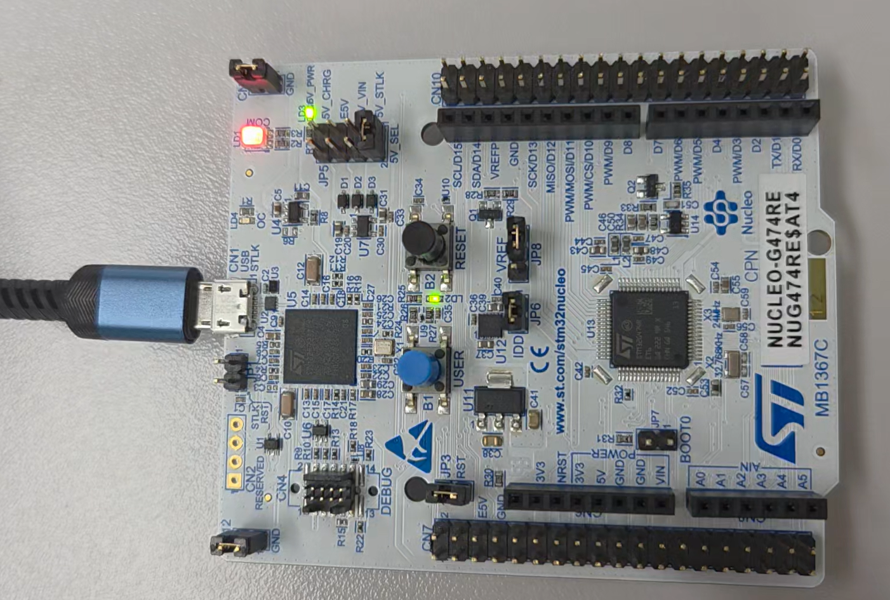
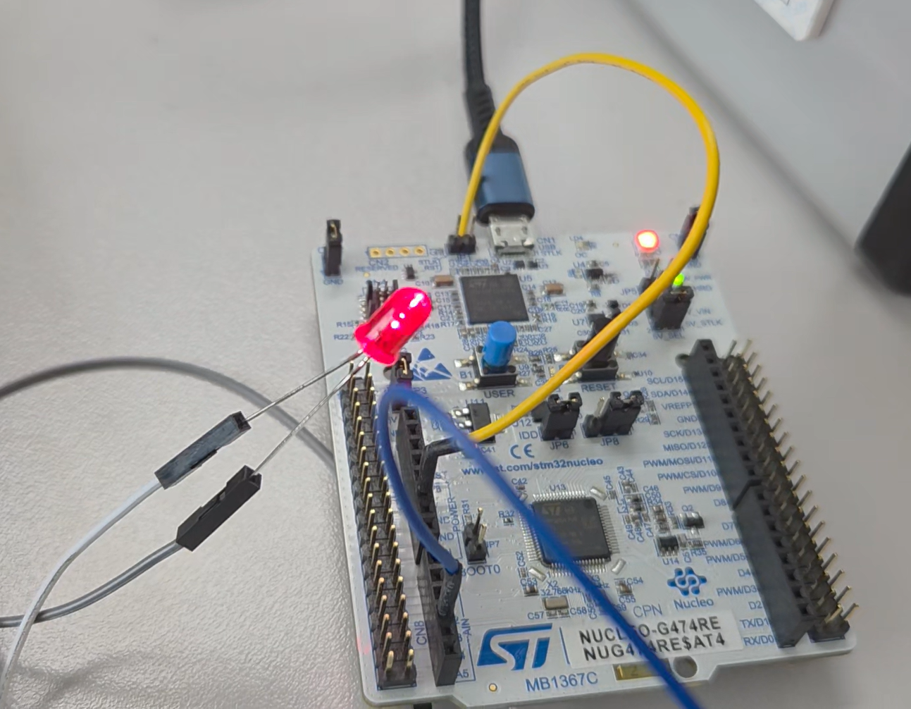
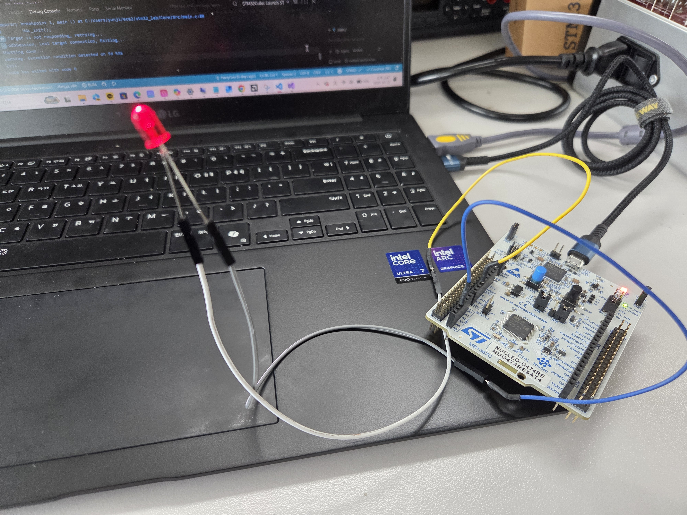
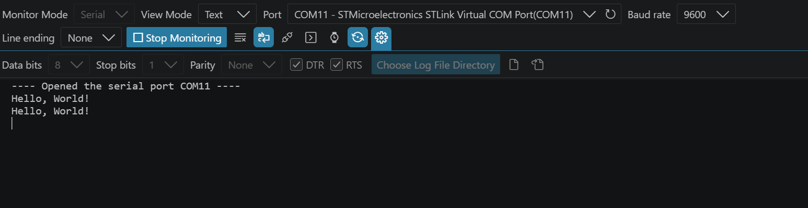
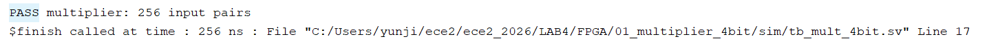
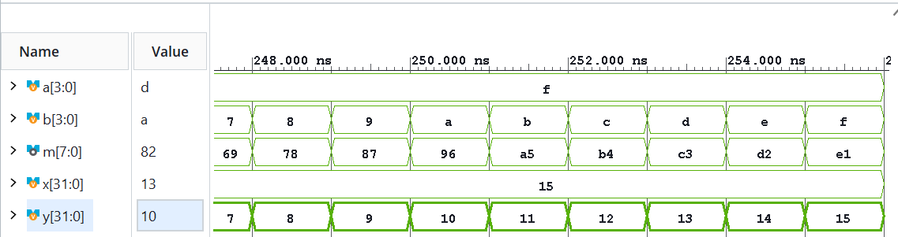
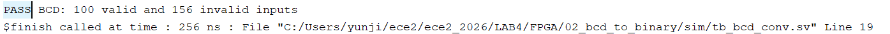
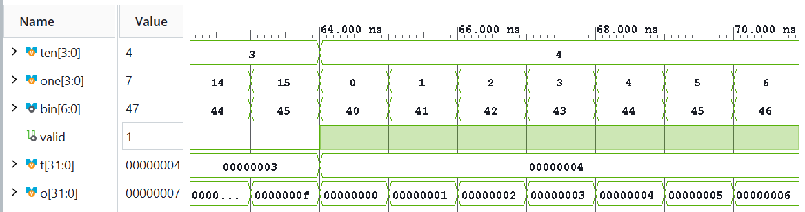
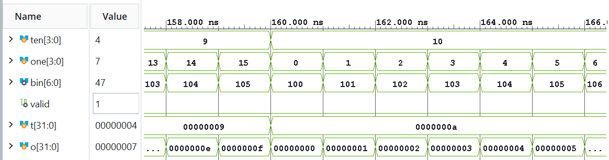

# 전자전기컴퓨터설계실험Ⅱ

## 실험 후 보고서

### LAB 4 – STM32 Polling과 FPGA 조합회로

학과: 전자전기컴퓨터공학부

학번/이름: 2025440032 / 김윤지

작성일: 2026.10.12

대상: STM32 GPIO 실습 및 FPGA 추가 실습

검증 환경: NUCLEO-G474RE / STM32Cube VS Code / CMake·Ninja / GNU Arm Toolchain / Vivado / FPGA board

프로젝트: ece2_2026 / LAB4

GitHub 저장소: https://github.com/yunuos2525-cloud/ece2_2026

소스 기준 커밋: 2b3c10b

제출 태그: LAB4_POST_FINAL

## 1. 실험 목적 및 검증 방법

LAB4에서는 STM32의 polling 방식으로 LED와 버튼을 제어하였다. C source를 작성하고 build한 뒤 NUCLEO-G474RE 보드에 적용하여 실제 동작을 확인하였다. Task 1에서는 보드의 내장 LED 점멸 간격을 버튼으로 변경하고, Task 2에서는 같은 제어 방식을 PB0에 연결한 외부 LED에 적용하였다. 또한 Serial Monitor에서 `Hello, World!`가 출력되는 것을 통해 STM32의 UART 출력을 확인하였다 [1].

FPGA 실습에서는 4-bit multiplier와 BCD-to-binary 변환기를 조합회로로 구현하였다. 각 회로는 Vivado simulation에서 전체 입력 testbench와 대표 파형을 확인한 뒤 synthesis와 implementation을 수행하여 bitstream을 생성하고, FPGA 보드에서 switch 입력에 따른 LED 출력을 확인하였다 [2].

## 2. STM32 실험 결과

### 2.1 Task 1 — Onboard LED Interval Control

Task 1은 `HAL_GetTick()`으로 현재 시간을 확인하고, `interval_ms`에 설정된 시간이 지나면 LED 상태를 전환하는 non-blocking 방식으로 구현하였다. 버튼 입력은 `HAL_GPIO_ReadPin()`으로 현재 상태를 읽은 뒤 이전 상태와 비교하여 눌림 순간의 rising edge를 검출하였고, 200 ms debounce 조건을 적용하였다. 버튼 처리와 LED timing 처리를 각각 독립된 `if` 문으로 구성하여 LED 점멸 동작 중에도 버튼 입력을 계속 확인할 수 있도록 하였다 [1], [3].

여기서 점멸 간격은 LED가 ON/OFF 상태를 전환하는 시간 간격을 의미한다. `interval_ms`는 처음에 1000 ms이고 버튼을 누를 때마다 2000, 4000, 8000, 1000 ms 순서로 바뀐다. 현재 구현은 간격이 바뀔 때 `last_ms`를 초기화하지 않으므로, 변경 직후의 첫 LED 전환도 마지막 LED 전환 시점을 기준으로 계산된다.

```c
GPIO_PinState current = HAL_GPIO_ReadPin(BUTTON_ece2_GPIO_Port, BUTTON_ece2_Pin);
uint32_t now_ms = HAL_GetTick();

if (current == GPIO_PIN_SET && previous == GPIO_PIN_RESET
    && now_ms - last_press_ms >= 200U)
{
    last_press_ms = now_ms;
    interval_ms = (interval_ms >= 8000U) ? 1000U : interval_ms * 2U;
}

if (now_ms - last_ms >= interval_ms)
{
    last_ms = now_ms;
    led_state = (led_state == GPIO_PIN_RESET)
                ? GPIO_PIN_SET : GPIO_PIN_RESET;
    HAL_GPIO_WritePin(LED_ece2_GPIO_Port, LED_ece2_Pin, led_state);
}
previous = current;
```

첫 번째 `if` 문은 버튼의 rising edge와 200 ms debounce 조건을 확인하여 `interval_ms`를 갱신한다. 두 번째 `if` 문은 `HAL_Delay()` 없이 경과 시간을 비교하여 LED 상태를 전환하므로 polling loop가 반복되는 동안 버튼과 LED timing을 계속 확인할 수 있다.

| 시험 조건 | 예상 결과 | 실제 관찰 | 해석 |
|---|---|---|---|
| 초기 상태에서 버튼을 차례로 네 번 누름 | LED 점멸 간격이 1→2→4→8→1 s로 순환 | 보드에서도 같은 순서로 점멸 간격이 변함 | `interval_ms`의 갱신 순서가 실제 LED 동작에 반영됨 |



그림 1. Task 1의 onboard LED 동작.

버튼을 누를 때마다 onboard LED의 점멸 간격이 1→2→4→8→1 s 순서로 바뀌는 것을 관찰하였다 ([동작 영상](../../stm32_evidence/board/LAB4/03_task1_interval/task1_interval.mp4)).

### 2.2 Task 2 — External LED

Task 2는 Task 1의 `HAL_GetTick()` timing, `interval_ms`, rising-edge 검출 및 200 ms debounce 구조를 그대로 사용하고, 출력 GPIO만 onboard LED의 PA5에서 PB0으로 변경하였다. PB0에 외부 LED를 연결한 뒤 Task 1과 같은 방법으로 버튼 입력에 따른 점멸 간격을 확인하였다.

| 시험 조건 | 예상 결과 | 실제 관찰 | 해석 |
|---|---|---|---|
| PB0에 외부 LED를 연결하고 버튼을 차례로 누름 | 외부 LED의 점멸 간격이 1→2→4→8→1 s로 순환 | 같은 순서로 외부 LED의 점멸 간격이 변함 | Task 1의 timing 및 버튼 처리 구조가 외부 GPIO 출력에서도 동일하게 동작함 |



그림 2. Task 2의 외부 LED 동작.



그림 3. Task 2의 외부 LED 연결 상태.

외부 LED에서도 버튼을 누를 때마다 1→2→4→8→1 s 순서로 점멸 간격이 변하였다 ([동작 영상](../../stm32_evidence/board/LAB4/04_task2_external_led/task2_external_led.mp4)).

### 2.3 Serial Monitor 확인

Serial Monitor를 9600 baud, 8 data bits, no parity, 1 stop bit로 설정하였다. 프로그램을 실행했을 때 `Hello, World!`가 출력되는 것을 확인하였으며, 이를 통해 PC와 STM32 사이의 UART 출력을 확인하였다.



그림 4. Serial Monitor에서 확인한 `Hello, World!` 출력.

## 3. FPGA 추가 실습 결과

### 3.1 4-bit Multiplier

`multiply_unsigned`는 두 4-bit unsigned 입력 `a`, `b`를 곱하여 8-bit `product`를 출력하며, 이 값은 top module의 `m`에 연결된다.

```verilog
assign product = a * b;
```

Testbench는 `a=0~15`, `b=0~15`의 총 256개 입력 조합을 자동으로 순회하면서 `m`과 `a×b`를 비교하였다. Vivado simulation은 `PASS multiplier: 256 input pairs` 메시지와 함께 종료되었다.



그림 5. 4-bit multiplier의 256개 입력 조합 PASS 결과.

대표 조건으로 `a=15`, `b=15`를 입력하였다. 예상값은 `15×15=225`이고, 8-bit binary로는 `1110_0001`이다. Vivado 파형에서도 `m=225`가 나타나 예상한 계산 결과와 일치하였다.



그림 6. `a=15`, `b=15`에서 `m=225`가 나타난 파형.

FPGA 보드에서는 switch로 `a`와 `b`를 입력하고 LED에서 곱셈 결과를 확인하였다. 입력값에 대해 계산한 예상 곱셈 결과와 LED 출력이 일치하는 것을 확인하였다 ([동작 영상](../../evidence/board/LAB4/raw_videos/01_multiplier_4bit.mp4)).

### 3.2 BCD to Binary

BCD 변환기는 `binary = ten×10 + one`을 계산하고, `ten≤9`이며 `one≤9`일 때 `valid=1`을 출력한다.

```verilog
assign binary = ten * 7'd10 + one;
assign valid = (ten <= 9) && (one <= 9);
```

`ten`과 `one`으로 `binary` 값을 계산하며, 두 digit이 모두 0~9 범위일 때 `valid=1`이 된다.

Testbench는 `ten=0~15`, `one=0~15`의 256개 입력 조합을 자동으로 검사하였고, Vivado simulation은 `PASS BCD: 100 valid and 156 invalid inputs` 메시지와 함께 종료되었다.



그림 7. BCD 변환기의 100개 valid 입력과 156개 invalid 입력 PASS 결과.

Valid 대표 조건은 `ten=4`, `one=2`이다. 예상 결과는 `bin=42`, `valid=1`이며, Vivado 파형에서도 같은 값을 확인하였다.



그림 8. `ten=4`, `one=2`에서 `bin=42`, `valid=1`이 나타난 파형.

Invalid 대표 조건은 `ten=10`, `one=2`이다. `ten=10`은 유효한 한 자리 BCD 값이 아니므로 `valid=0`이 출력되었으며, `bin`에는 산술식에 따른 값 102가 나타났다.



그림 9. `ten=10`, `one=2`에서 `bin=102`, `valid=0`이 나타난 파형.

보드에서는 switch로 BCD 입력을 바꾸면서 `bin` LED와 `valid` LED의 출력을 확인하였다. 유효한 BCD 입력에서는 예상한 이진수 값과 `valid=1`이 나타났고, 유효하지 않은 입력에서는 `valid=0`이 나타나 예상 동작과 일치하였다 ([동작 영상](../../evidence/board/LAB4/raw_videos/02_bcd_to_binary.mp4)).

### 3.3 VS Code와 Vivado 시뮬레이션 비교

| 실험 | VS Code/Icarus | Vivado | 비교 |
|---|---|---|---|
| 4-bit Multiplier | 256개 입력 조합 PASS | `PASS multiplier: 256 input pairs`, 대표 조건 `15×15=225` 확인 | 기능 결과 일치 |
| BCD to Binary | 100 valid / 156 invalid PASS | `PASS BCD: 100 valid and 156 invalid inputs`, valid/invalid 대표 조건 확인 | 기능 결과 일치 |

VS Code의 Icarus와 Vivado에서 두 회로의 전체 입력 검사가 모두 PASS로 종료되었다. Multiplier의 `15×15=225`와 BCD 변환기의 valid·invalid 대표 조건에서도 같은 출력을 확인하였다. 따라서 서로 다른 simulation 환경에서 회로의 기능 결과가 일치하였다.

## 4. 실험 자료 정리

LAB4 source는 `LAB4/` 아래에 STM32와 FPGA로 나누어 정리하였다. STM32 폴더에는 LED polling, 버튼 polling, Task 1, Task 2 source가 있으며, FPGA 폴더에는 multiplier와 BCD-to-binary의 RTL, testbench 및 XDC가 들어 있다.

STM32 Task 1과 Task 2의 보드 사진·동작 영상, 외부 LED 연결 사진, Serial Monitor 화면은 `stm32_evidence/` 아래에 보관하였다. FPGA의 Vivado PASS 결과, 대표 파형, Program Device 화면과 보드 동작 영상은 `evidence/` 아래 LAB4 경로에 정리하였다. 전체 source와 실험 자료의 경로는 README의 LAB4 항목에서 확인할 수 있다.

## 5. 결론

이번 실험에서는 STM32의 polling loop에서 시간 조건과 버튼 입력을 함께 처리하는 방법을 익혔다. `HAL_GetTick()`을 사용하여 LED가 점멸하는 동안에도 버튼 입력을 계속 확인할 수 있도록 구현하였고, 버튼 입력에 따라 점멸 간격이 1→2→4→8→1 s로 바뀌는 것을 내장 LED와 PB0 외부 LED에서 확인하였다. 또한 Serial Monitor에서 `Hello, World!`가 출력되는 것을 통해 STM32의 UART 출력을 확인하였다.

FPGA에서는 4-bit multiplier와 BCD-to-binary 변환기를 조합회로로 구현하였다. 전체 입력을 자동으로 검사하는 testbench가 PASS로 종료되었고, 대표 파형에서 계산한 예상값과 실제 출력이 일치하였다. FPGA 보드에서도 switch 입력에 따른 LED 출력을 확인하면서 RTL의 논리 연산이 실제 하드웨어 출력으로 나타나는 과정을 확인할 수 있었다.

## 참고문헌

[1] 전자전기컴퓨터설계실험Ⅱ 수업자료, `STM32_0.md`, “STM32_0 (예제 1, 예제 2, Task 1, Task 2)”.

[2] 전자전기컴퓨터설계실험Ⅱ 수업자료, `FPGA_additional.md`, “4비트 곱셈기와 BCD→이진수 변환”.

[3] STMicroelectronics, `stm32g4xx-hal-driver`, GitHub repository, commit `a6001282dfacfff57e9710250f15e4333b578865`, 확인일 2026.10.07, https://github.com/STMicroelectronics/stm32g4xx-hal-driver
