<div align="center">

<p style="font-size: 16px; margin-top: 80px; margin-bottom: 72px;">전자전기컴퓨터설계실험Ⅱ 실험 후 보고서</p>

<h1 style="font-size: 28px; margin-bottom: 96px;">LAB 5 – STM32 인터럽트와 PWM 및 FPGA 응용</h1>

</div>

|  |  |
|---|---|
| **학과** | 전자전기컴퓨터공학부 |
| **학번/이름** | 2025440032 / 김윤지 |
| **작성일** | 2026.10.19 |
| **대상** | STM32_1 및 FPGA 추가 실습 |
| **검증 환경** | NUCLEO-G474RE · STM32Cube VS Code · CMake/Ninja · GNU Arm Toolchain<br>Vivado 2026.1 · COMBO II-DLD Spartan-7 |
| **프로젝트** | ece2_2026 / LAB5 |
| **GitHub 저장소** | https://github.com/yunuos2525-cloud/ece2_2026 |
| **소스 기준 커밋** | `9704891` |
| **제출 태그** | `LAB5_POST_FINAL` |

## 1. 실험 목적 및 검증 방법

STM32 실험의 목적은 polling 방식과 interrupt 방식의 차이를 이해하고, 입력 처리와 주기적인 시간 처리를 서로 다른 interrupt service routine(ISR)으로 분리하는 것이었다. Task 3에서는 버튼 ISR로 점멸 간격을 선택하고 TIM6의 100 ms 주기 interrupt를 누적하여 LED 점멸 간격을 1, 2, 4, 8 s로 제어하였다. Task 4에서는 버튼 ISR에서 TIM3 Channel 1의 compare 값을 바꾸어 PWM(Pulse Width Modulation)의 duty를 25%, 50%, 75%로 변경하였다. Task 3은 실제 LED 점멸 순서를 보드에서 관찰하였고, Task 4는 debugger의 compare 값과 오실로스코프의 PWM 파형을 비교하였다 [1].

FPGA 실험에서는 세 종류의 순차·직렬 회로를 구현하였다. Piano는 8개 입력 중 하나를 선택하여 해당 음계 주파수의 구형파를 만들고, Traffic은 `direction`과 `phase` 상태에 따라 차량·보행자 신호와 점멸 모드를 제어한다. ADC는 FPGA가 SPI 신호를 생성하여 보드의 AD7908에 channel 명령을 보내고, 직렬 변환 결과의 상위 8 bit를 LED에 표시하도록 설계하였다. 각 회로는 testbench의 예상값 검사, Vivado Behavioral Simulation 파형, synthesis와 implementation, 실제 FPGA 보드 동작의 순서로 검증하였다 [2].

PRE 이후 Piano의 RTL·TB·XDC는 유지하였다. Traffic은 미확정이었던 차량·좌회전·보행자 LED 24개의 `PACKAGE_PIN`을 `traffic.xdc`에 추가하여 FSM의 출력이 실제 application LED에 연결되도록 하였다. ADC는 초기 보드에서 VR을 회전해도 LED 값이 변하지 않는 현상이 발생하여 SPI timing과 AD7908 응답 구조를 다시 분석하였다. 그 결과 RTL과 TB를 수정하고, `adc_board_top`을 추가하였으며, `adc.xdc`에 `adc_ncs=H3`, `adc_din=H5`, `adc_dout=J6`, `adc_sclk=H7`을 지정하였다. 따라서 ADC의 PRE 3-frame 결과와 POST 8-frame 결과는 단순한 파형 시간축 차이가 아니라 설계와 시험 조건을 개선한 전후 결과이다.

## 2. STM32 인터럽트 및 PWM 실험

### 2.1 Task 3 — 인터럽트 기반 LED 점멸 간격 제어

Task 3에서는 버튼 입력과 시간 계산을 하나의 반복문에서 처리하지 않고 두 ISR로 분리하였다. 버튼 ISR은 사용자가 원하는 간격만 선택하고, TIM6 ISR은 실제 시간을 누적하여 LED를 toggle한다. 이 구조에서는 LED가 긴 간격으로 점멸하는 동안에도 버튼 입력을 interrupt로 받을 수 있고, 버튼 처리 코드가 timer의 100 ms 주기 계산을 직접 지연시키지 않는다.

버튼 ISR은 200 ms debounce 조건을 통과한 입력마다 `requested_interval_index`를 0→1→2→3→0으로 변경한다. TIM6 ISR은 요청된 index가 현재 사용 중인 `active_interval_index`와 다르면 새 값을 적용하고 `elapsed_ticks`를 0으로 초기화한다. 따라서 간격 변경 시 이전 간격에서 누적된 tick이 새 간격에 섞이지 않고, 새 간격 전체를 처음부터 센다.

**코드 1. 버튼 ISR의 간격 선택과 TIM6 ISR의 LED timing**

```c
static volatile uint8_t requested_interval_index = 0U;
static const uint16_t interval_ticks[4] = {10U, 20U, 40U, 80U};

static void button_isr_p7(void)
{
    static uint32_t last_ms = 0U;
    uint32_t now_ms = HAL_GetTick();

    if (now_ms - last_ms >= 200U)
    {
        last_ms = now_ms;
        requested_interval_index =
            (uint8_t)((requested_interval_index + 1U) % 4U);
    }
}

static void tim6_isr_p4(void)
{
    static uint8_t active_interval_index = 0U;
    static uint16_t elapsed_ticks = 0U;
    uint8_t requested = requested_interval_index;

    if (requested != active_interval_index)
    {
        active_interval_index = requested;
        elapsed_ticks = 0U;
        return;
    }

    elapsed_ticks++;
    if (elapsed_ticks >= interval_ticks[active_interval_index])
    {
        elapsed_ticks = 0U;
        HAL_GPIO_TogglePin(LED_ece2_GPIO_Port, LED_ece2_Pin);
    }
}
```

TIM6 interrupt 주기는 100 ms이므로 점멸 간격은 `100 ms × interval_ticks[index]`로 계산된다.

| Index | 누적 tick | 예상 LED toggle 간격 |
|---:|---:|---:|
| 0 | 10 | 1 s |
| 1 | 20 | 2 s |
| 2 | 40 | 4 s |
| 3 | 80 | 8 s |

버튼을 차례로 눌렀을 때 실제 보드에서 LED 점멸 간격이 1→2→4→8→1 s로 순환하는 것을 관찰하였다. 약 52.613 s의 [Task 3 동작 영상](../../stm32_evidence/board/LAB5/04_task3_interval_isr/board_video.mp4)에는 버튼 입력에 따라 점멸 속도가 단계적으로 바뀌는 과정이 기록되어 있다.

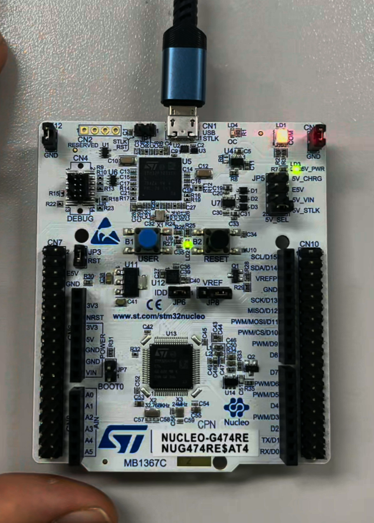

그림 1. Task 3 실행 중인 NUCLEO-G474RE와 PA5 LED 상태.

버튼을 누를 때마다 LED 점멸 간격이 1→2→4→8→1초로 변경되는 것을 실제 보드에서 확인하였다. 이는 버튼 ISR에서 점멸 간격을 선택하고 TIM6 ISR에서 주기적인 시간을 계산하도록 기능을 분리한 설계가 의도대로 동작함을 보여준다. LAB4에서 사용한 polling 방식과 달리, 이번 실험에서는 메인 반복문에서 버튼과 시간을 지속적으로 확인하지 않고 각 인터럽트가 발생할 때 필요한 동작을 수행하도록 구현하였다.

### 2.2 Task 4 — 버튼 인터럽트 기반 PWM duty 제어

PWM은 일정한 주기 안에서 출력이 HIGH인 시간의 비율을 조절하는 방식이다. TIM3의 counter `CNT`는 0부터 auto-reload 값 `ARR`까지 반복해서 증가하고, compare register `CCR`과의 비교 결과에 따라 Channel 1 출력의 HIGH 구간이 결정된다. 본 실험은 한 주기를 1000 count로 구성하였으므로 active-high PWM의 목표 duty는 다음과 같이 계산하였다.

\[
\mathrm{Duty}(\%) = \frac{CCR}{1000}\times100
\]

저장된 Task 4 구현에서는 C 변수 `pwm_compare`에 compare 값을 보관한다. 초기화 함수가 TIM3 Channel 1 PWM을 시작하고, 버튼 ISR은 200 ms debounce 후 값을 250→500→750→250으로 순환시킨다. `__HAL_TIM_SET_COMPARE()`가 이 C 변수의 값을 TIM3의 하드웨어 compare register에 기록하므로 이후 PWM 출력의 HIGH 시간이 바뀐다.

**코드 2. 버튼 입력에 따른 TIM3 compare 값 변경**

```c
volatile uint32_t pwm_compare = 250U;

void ece2_474_init(void)
{
    HAL_TIM_PWM_Start(&htim3, TIM_CHANNEL_1);
    __HAL_TIM_SET_COMPARE(&htim3, TIM_CHANNEL_1, pwm_compare);
}

static void button_isr_p7(void)
{
    static uint32_t last_ms = 0U;
    uint32_t now_ms = HAL_GetTick();

    if (now_ms - last_ms >= 200U)
    {
        last_ms = now_ms;

        if (pwm_compare == 250U)
            pwm_compare = 500U;
        else if (pwm_compare == 500U)
            pwm_compare = 750U;
        else
            pwm_compare = 250U;

        __HAL_TIM_SET_COMPARE(&htim3, TIM_CHANNEL_1, pwm_compare);
    }
}
```

| CCR | 예상 Duty | 약 1 ms 주기에서 예상 HIGH 시간 |
|---:|---:|---:|
| 250 | 25% | 0.25 ms |
| 500 | 50% | 0.50 ms |
| 750 | 75% | 0.75 ms |

실험에 사용한 통합 프로그램의 debugger에서는 compare 값을 나타내는 변수명이 `g_pwm_ccr`로 표시되었다. 저장된 개별 Task 4 코드의 `pwm_compare`와 이름은 다르지만, 그림 2의 세 화면은 버튼 입력 후 compare 값이 250, 500, 750으로 변하는 과정을 보여 준다.

| `g_pwm_ccr=250` | `g_pwm_ccr=500` | `g_pwm_ccr=750` |
|:---:|:---:|:---:|
| 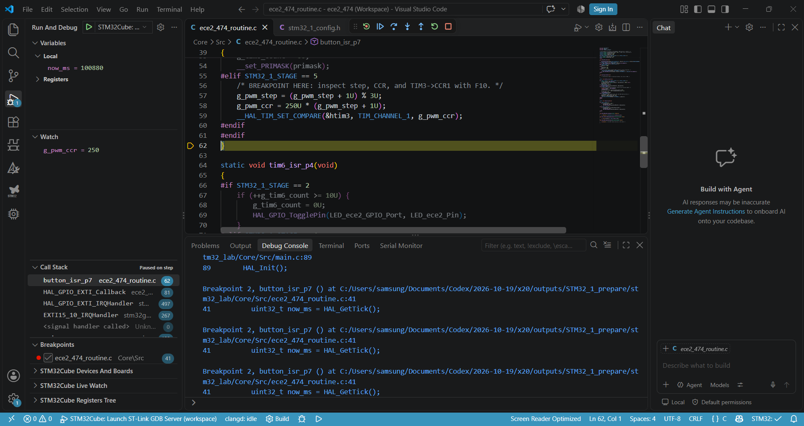 | 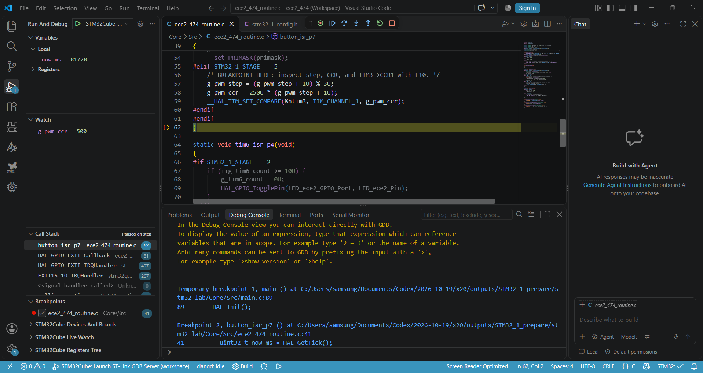 | 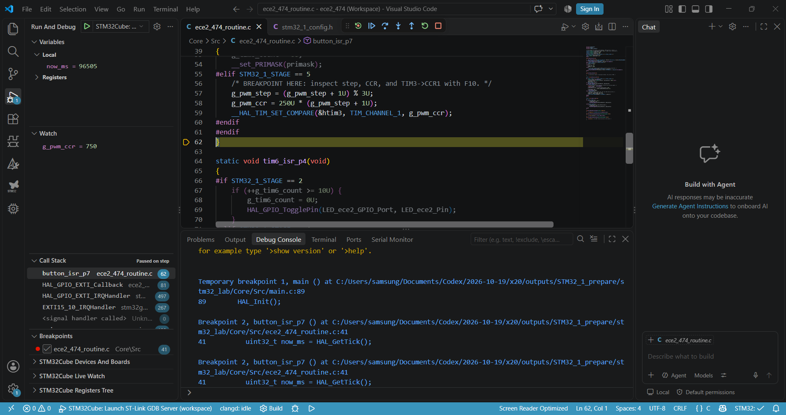 |

그림 2. 버튼 ISR 실행 후 debugger에서 확인한 PWM compare 값 250, 500, 750.

각 compare 설정에서 PB4의 PWM을 오실로스코프로 측정한 결과는 다음과 같다.

| CCR | 목표 Duty | 측정 Duty | 오차 | 측정 주파수 |
|---:|---:|---:|---:|---:|
| 250 | 25% | 24.79% | -0.21 %p | 1.000 kHz |
| 500 | 50% | 50.34% | +0.34 %p | 1.000 kHz |
| 750 | 75% | 74.98% | -0.02 %p | 1.008 kHz |

| CCR 250 | CCR 500 | CCR 750 |
|:---:|:---:|:---:|
| 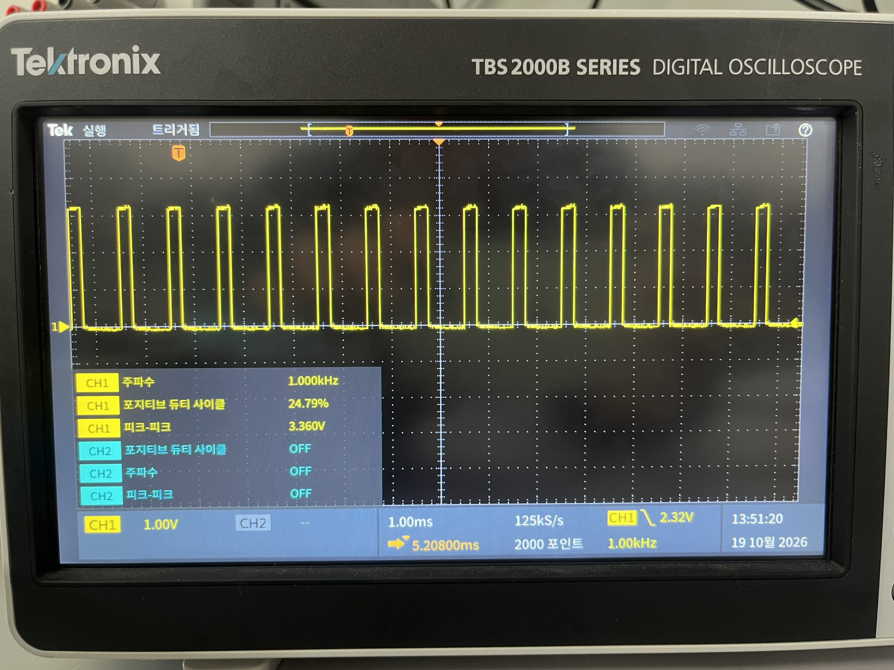 | 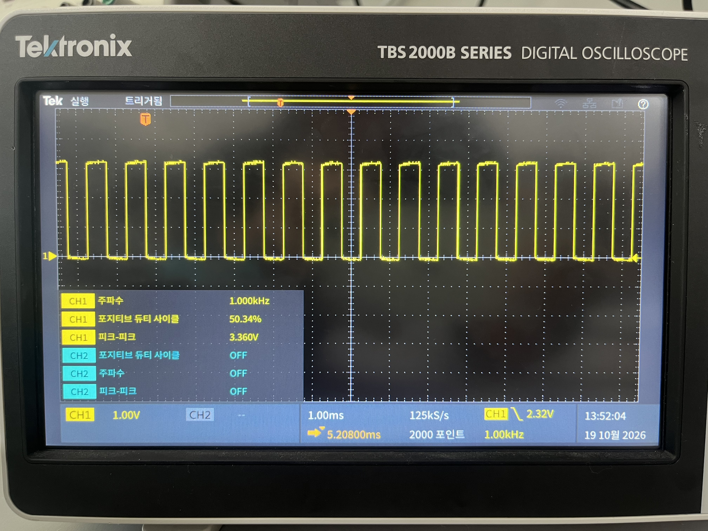 | 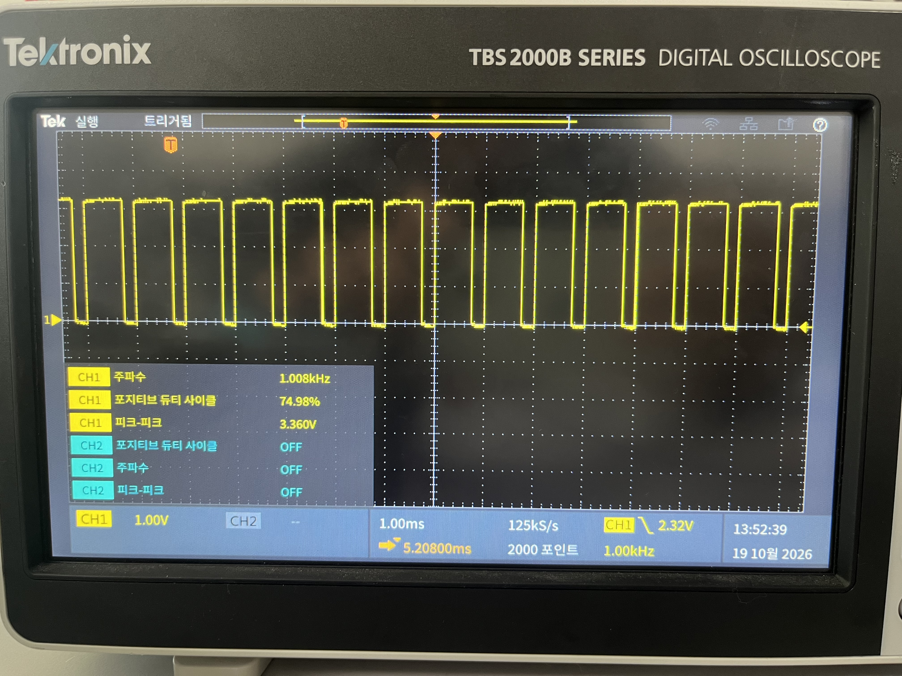 |

그림 3. CCR 250, 500, 750에서 측정한 PWM 파형.

CCR이 증가할수록 counter 한 주기에서 compare 조건을 만족하는 구간이 길어지므로 HIGH 시간이 증가하였다. 반면 `ARR`와 timer clock 설정은 바꾸지 않았기 때문에 측정 주파수는 1.000, 1.000, 1.008 kHz로 거의 일정하게 유지되었다. Duty 오차의 최대값은 0.34 %p였으며 계산값과 실측값이 대체로 일치하였다. 따라서 버튼 interrupt에서 변경한 소프트웨어 compare 값이 TIM3 하드웨어 register를 거쳐 실제 PWM pulse width로 나타남을 확인하였다. 연속적인 변화는 [Task 4 동작 영상](../../stm32_evidence/board/LAB5/05_task4_pwm_control/pwm_change.mp4)에 기록하였다.

## 3. FPGA 응용 실험

### 3.1 Piano — 음계 선택과 구형파 발생

Piano는 `key[7:0]`에서 8개 입력 중 하나만 활성화되었을 때 해당 음계의 주파수를 선택하고, 그 주파수에 맞는 구형파를 `piezo`로 출력한다. 입력과 음계의 대응은 C4부터 C5까지이며, 아무 입력이 없거나 두 개 이상이 동시에 활성화되면 `frequency_hz=0`으로 두어 무음으로 만든다.

| Key | 음계 | 주파수 |
|---|---|---:|
| `8'h80` | C4 | 262 Hz |
| `8'h40` | D4 | 294 Hz |
| `8'h20` | E4 | 330 Hz |
| `8'h10` | F4 | 349 Hz |
| `8'h08` | G4 | 392 Hz |
| `8'h04` | A4 | 440 Hz |
| `8'h02` | B4 | 494 Hz |
| `8'h01` | C5 | 523 Hz |

`note_select`는 입력 pattern을 주파수로 변환하고, `square_tone`은 `CLK_HZ/(2×frequency_hz)`만큼 clock을 센 뒤 출력을 반전한다. 두 번의 반전이 한 주기를 이루므로 이 방법으로 선택한 주파수의 구형파를 생성할 수 있다.

**코드 3. 입력에 따른 음계 선택과 반주기 구형파 생성**

```verilog
case (key)
    8'h80: frequency_hz = 32'd262;
    8'h40: frequency_hz = 32'd294;
    8'h20: frequency_hz = 32'd330;
    8'h10: frequency_hz = 32'd349;
    8'h08: frequency_hz = 32'd392;
    8'h04: frequency_hz = 32'd440;
    8'h02: frequency_hz = 32'd494;
    8'h01: frequency_hz = 32'd523;
    default: frequency_hz = 32'd0;
endcase

wire [31:0] half_cycles = (frequency_hz == 0)
                          ? 32'd0 : CLK_HZ / (2 * frequency_hz);

if (count >= half_cycles - 1) begin
    count <= 32'd0;
    tone <= ~tone;
end
```

Testbench는 simulation 시간을 줄이기 위해 `CLK_HZ=10000`을 사용하였다. A4의 440 Hz 조건에서 예상 반주기는 `floor(10000/(2×440))=11` clock이다. 실제 50 MHz 보드에서는 같은 계산에 따라 `floor(50000000/(2×440))=56818` clock마다 `piezo`가 반전된다. Testbench는 8개 음, 무입력, 복수 입력 `8'h03`, reset을 모두 검사하였다.

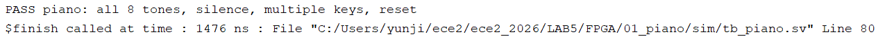

그림 4. Piano의 8개 음, 무음, 복수 입력 및 reset 검사 PASS.

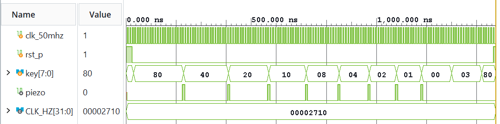

그림 5. `key=80→40→20→10→08→04→02→01`과 무음 조건을 포함한 전체 파형.

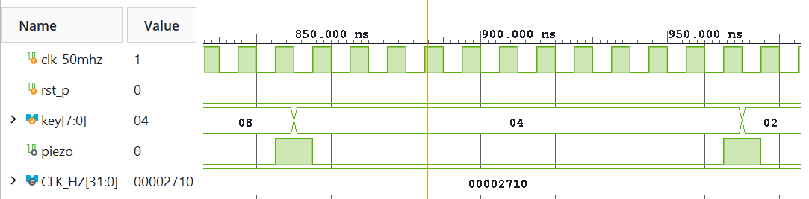

그림 6. `key=8'h04`에서 반주기 count에 따라 `piezo`가 반전되는 대표 파형.

Vivado simulation은 `PASS piano: all 8 tones, silence, multiple keys, reset`으로 종료되었다. 전체 파형에서 8개 key가 순서대로 선택되었고, 대표 파형에서 `key=8'h04` 구간의 `piezo` 반전 간격이 예상한 11 simulation clock과 일치하였다.

FPGA를 정상적으로 programming한 직후에는 소리가 나지 않았다. RTL과 simulation 결과를 다시 확인한 뒤 보드의 물리 설정을 점검한 결과 `PIEZO ENABLE` 스위치가 비활성화되어 있었다. 스위치를 활성화하자 음이 출력되었고, 문제 해결 후 촬영한 [Piano 동작 영상](../../evidence/board/LAB5/raw_videos/01_piano.mp4)에서 실제 연주 동작을 확인하였다. 이 과정은 FPGA 기능 검증에서 RTL뿐 아니라 출력 장치의 enable switch와 같은 보드 설정도 함께 확인해야 함을 보여 주었다.

### 3.2 Traffic — 상태 기반 차량·보행자 신호 제어

Traffic 회로는 `second_tick`, `traffic_sequence`, `traffic_lights`의 세 부분으로 구성하였다. `second_tick`은 50 MHz clock으로부터 상태 갱신용 `tick`과 점멸용 `blink`를 만들고, `traffic_sequence`는 현재 방향 `direction`과 시간 단계 `phase`를 저장한다. `traffic_lights`는 이 두 상태를 차량 및 보행자 LED pattern으로 변환한다.

정상 mode에서 각 direction은 phase 0~12를 순서대로 진행한다. Phase 0~10에는 선택된 방향의 차량 Green이 켜지고, phase 11~12에는 Yellow가 켜진다. 보행자 Green은 phase 0~3에서 연속 점등되고 phase 4~10에서는 `blink`에 따라 점멸한다. Phase 12 다음 tick에서 phase가 0으로 돌아가면서 direction이 다음 방향으로 바뀐다.

| Phase | 차량 신호 | 선택된 방향의 보행자 신호 |
|---:|---|---|
| 0~3 | Green | Green 연속 점등 |
| 4~10 | Green | Green 점멸 |
| 11~12 | Yellow | Red |

**코드 4. Phase 진행과 direction 전환**

```verilog
if (rst_p || flicker) begin
    direction <= 2'd0;
    phase <= 4'd0;
end else if (tick) begin
    if (phase == 4'd12) begin
        phase <= 4'd0;
        direction <= direction + 1'b1;
    end else begin
        phase <= phase + 1'b1;
    end
end
```

`flicker=1`이면 정상 phase 출력 대신 모든 차량 Yellow와 보행자 Red가 `blink`에 따라 점멸한다. 정상 mode에서는 현재 direction의 Red를 끄고 Green 또는 Yellow를 선택한다. `led_left`는 논리적으로 `led_green`과 같은 값을 사용하지만, XDC에서는 각각 별도의 물리 핀 네 개에 연결하였다.

**코드 5. 정상 신호와 flicker mode 출력 선택**

```verilog
if (flicker) begin
    led_red = 4'b0000;
    led_yellow = {4{blink}};
    led_walk_red = {4{blink}};
end else begin
    led_red[direction] = 1'b0;
    if (phase <= 4'd10)
        led_green[direction] = 1'b1;
    else
        led_yellow[direction] = 1'b1;

    if (phase <= 4'd3) begin
        led_walk_red[direction] = 1'b0;
        led_walk_green[direction] = 1'b1;
    end else if (phase <= 4'd10) begin
        led_walk_red[direction] = 1'b0;
        led_walk_green[direction] = blink;
    end
end
led_left = led_green;
```

Testbench는 네 direction의 phase 0~12 전체 순환, 차량 Green→Yellow 전환, 보행자 점멸, flicker mode와 reset을 검사하였다.

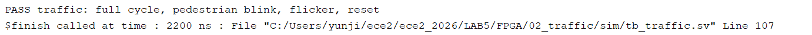

그림 7. Traffic 전체 cycle, 보행자 점멸, flicker 및 reset 검사 PASS.

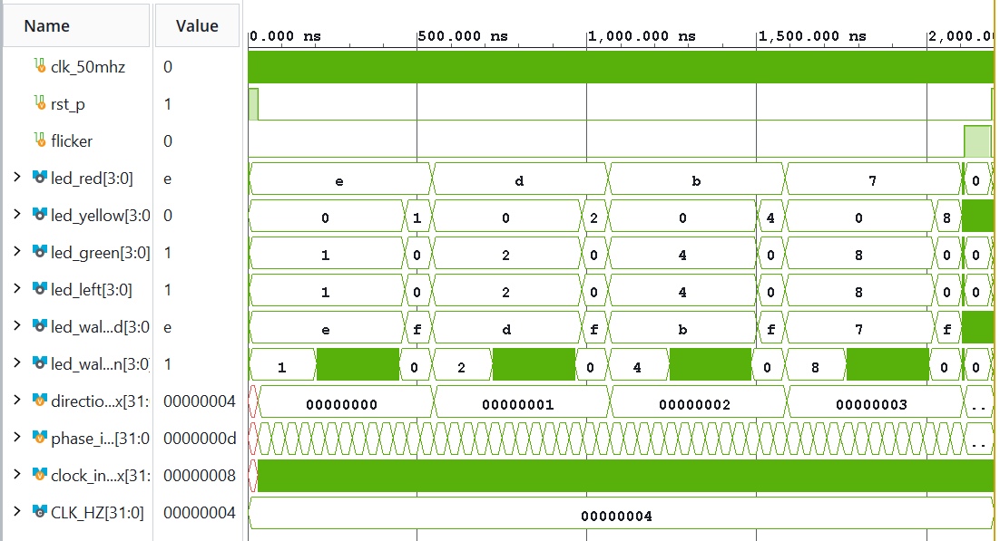

그림 8. 네 direction에서 phase 0~12가 반복되는 Traffic 전체 파형.

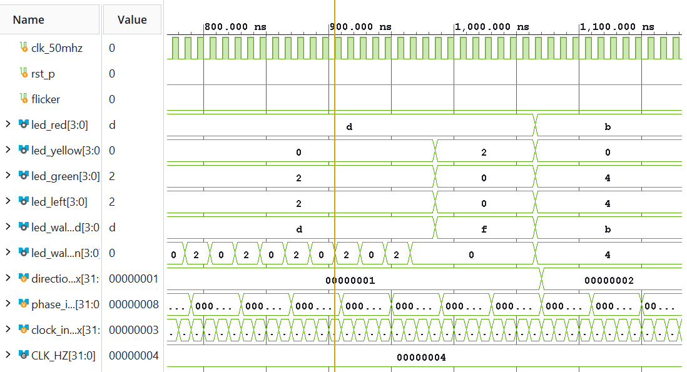

그림 9. Direction 1의 Green→Yellow 전환과 direction 2의 phase 0 시작 구간.

대표 전환 구간에서 `direction=1`, `phase=10`일 때 `led_green=4'h2`, `led_yellow=4'h0`이었고, phase 11~12에서는 `led_green=0`, `led_yellow=4'h2`로 변하였다. 다음 tick에서는 `direction=2`, `phase=0`, `led_green=4'h4`가 되어 예상한 방향 전환과 일치하였다.

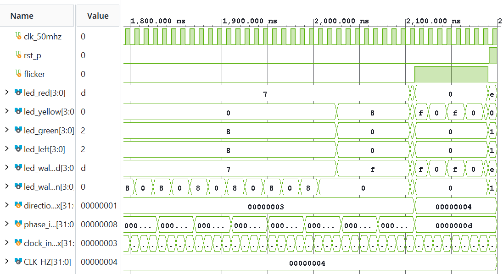

그림 10. Flicker mode에서 차량 Yellow와 보행자 Red가 함께 점멸하는 구간.

Flicker 구간에서는 차량 Red·Green과 보행자 Green이 0으로 유지되고, 차량 Yellow와 보행자 Red가 `4'hF↔4'h0`으로 바뀌었다. Vivado simulation은 `PASS traffic: full cycle, pedestrian blink, flicker, reset`으로 종료되어 전체 자동 검사와 대표 파형이 일치하였다.

PRE 이후 `traffic.xdc`에는 `led_red`, `led_yellow`, `led_green`, `led_left`, `led_walk_red`, `led_walk_green`의 각 4 bit, 총 24개 출력 핀을 추가하였다. 이에 따라 RTL에서 생성한 네 방향의 신호 pattern이 COMBO II-DLD의 차량·좌회전·보행자 LED에 각각 전달되었다. Implementation과 programming 후 실제 신호 동작은 [Traffic 보드 영상](../../evidence/board/LAB5/raw_videos/02_traffic.mp4)에 기록하였다.

### 3.3 ADC — 초기 실패 분석과 SPI 설계 개선

#### 3.3.1 초기 3-frame simulation과 보드 실패

ADC 회로의 목적은 FPGA가 `add_sel[2:0]`에 따른 16-bit command를 AD7908로 전송하고, 동시에 수신한 변환 결과를 `sample[11:0]`과 `led_out[7:0]`으로 표시하는 것이었다. PRE testbench는 channel 2, 5, 7의 세 frame을 생성하고 command bit 수, sample, LED와 reset을 검사하였다. 대표 입력 `16'hA5C3`에 대해 예상값은 `sample=12'h5C3`, `led_out=8'h5C`였으며 초기 simulation은 다음 PASS로 종료되었다.


그림 11. 초기 ADC의 세 serial frame, command, sample 및 reset 검사 PASS.


그림 12. Channel 2→5→7의 초기 세 frame과 sample·LED 출력.


그림 13. 초기 `A5C3` 응답에서 `sample=5C3`, `led_out=5C`가 된 대표 frame.

초기 파형은 testbench가 직접 제공한 세 응답을 RTL이 수신하는 조건에서는 예상값과 일치하였다. 그러나 이 설계를 실제 FPGA 보드에 적용한 뒤 VR을 회전해도 LED 표시값이 변하지 않는 현상을 직접 관찰하였다. 당시 실패 장면은 사진이나 영상으로 촬영하지 못했지만, simulation PASS만으로 실제 AD7908 통신이 검증된 것은 아님을 확인할 수 있었다.

#### 3.3.2 SPI protocol 분석과 RTL 수정

초기 설계와 최종 설계를 비교한 결과, 실제 ADC의 직렬 timing과 conversion pipeline을 testbench가 충분히 표현하지 못하였다. 최종 설계에서는 다음 항목을 수정하였다.

| 항목 | 초기 설계 | 최종 설계 |
|---|---|---|
| Command control bit | 후반 control field `111` | `101`로 변경하여 source의 `RANGE=0` 구성 반영 |
| MOSI(`adc_din`) | frame 진행 중 현재 `tx_word` 직접 사용 | frame 시작 시 `tx_word`를 latch하고 다음 falling edge 전에 bit 안정화 |
| MISO(`adc_dout`) | SCLK rising edge 중심 capture | falling edge를 생성하는 시점에 현재 DOUT bit capture |
| 첫 응답 | 첫 frame부터 sample과 valid 갱신 | 첫 frame을 dummy로 보고 sample과 `data_valid` 갱신 억제 |
| Channel 변경 | command와 같은 frame에서 새 channel 결과 가정 | channel 변경 frame에는 이전에 설정한 channel 결과가 돌아오는 pipeline 반영 |
| 응답 정렬 | 임의 16-bit reply의 하위 12 bit 사용 | `{0, channel[2:0], data[7:0], 4'b0000}` 형식 사용 |
| Frame 간격 | 별도 대기 조건 없음 | `quiet_count` 추가, TB에서 최소 50 ns quiet time 검사 |
| 물리 연결 | SPI `PACKAGE_PIN` 미확정 | `adc_board_top` 추가 및 AD7908 네 신호의 XDC 핀 지정 |

AD7908 command는 channel 선택과 동작 조건을 포함한다. 최종 `adc_command`는 channel bit를 command에 삽입하고 후반 control field를 `101`로 변경하였다.

**코드 6. 최종 AD7908 command 구성**

```verilog
assign command = {3'b101, channel, 2'b11, 1'b0, 3'b101, 4'b0000};
```

`serial_frame16`은 SCLK idle을 HIGH로 유지한다. Frame이 시작될 때 command 전체를 `tx_latched`에 저장하고 MSB를 먼저 `adc_din`으로 출력한다. 이후 현재 DOUT bit를 capture하면서 SCLK를 falling edge로 전환하고, 다음 rising edge 구간에서 다음 DIN bit를 준비한다. 따라서 MOSI는 다음 falling edge 전에 안정되고 MISO는 지정한 edge에서 한 번씩 수집된다.

**코드 7. Frame 시작, DOUT capture 및 다음 DIN bit 준비**

```verilog
if (!busy) begin
    adc_sclk <= 1'b1;
    adc_ncs  <= 1'b1;
    adc_din  <= 1'b0;
    if (quiet_count < 3'd4)
        quiet_count <= quiet_count + 1'b1;
    if (start && quiet_count == 3'd4) begin
        adc_ncs    <= 1'b0;
        adc_din    <= tx_word[15];
        tx_latched <= tx_word;
        busy       <= 1'b1;
        bit_index  <= 5'd15;
        half_count <= {HALF_WIDTH{1'b0}};
        rx_word    <= 16'b0;
    end
end else if (half_count == HALF_CYCLES - 1) begin
    half_count <= {HALF_WIDTH{1'b0}};
    if (adc_sclk) begin
        rx_word[bit_index] <= adc_dout;
        adc_sclk <= 1'b0;
    end else begin
        adc_sclk <= 1'b1;
        if (bit_index == 0) begin
            adc_ncs     <= 1'b1;
            adc_din     <= 1'b0;
            busy        <= 1'b0;
            done        <= 1'b1;
            quiet_count <= 3'd0;
        end else begin
            bit_index <= bit_index - 1'b1;
            adc_din <= tx_latched[bit_index - 1'b1];
        end
    end
end
```

ADC는 command를 받은 즉시 같은 frame에서 해당 channel 결과를 반환하는 구조가 아니므로 첫 응답과 channel 변경 시점을 구분해야 한다. `first_frame`은 전원 인가 또는 reset 후 첫 frame을 dummy로 처리한다. 이후 `done`이 발생하면 수신 word의 `[11:0]`을 sample로 저장하고 한 clock 동안 `data_valid`를 발생시킨다. Reply의 `[11:4]`가 8-bit 변환 결과이므로 이 부분을 LED에 연결하였다.

**코드 8. Dummy frame 억제와 sample·LED 갱신**

```verilog
if (rst_p) begin
    sample <= 12'b0;
    data_valid <= 1'b0;
    first_frame <= 1'b1;
end else begin
    data_valid <= 1'b0;
    if (done) begin
        first_frame <= 1'b0;
        if (!first_frame) begin
            sample <= rx_word[11:0];
            data_valid <= 1'b1;
        end
    end
end

assign led_out = sample[11:4];
```

실제 보드에서는 simulation용 `sample`과 `data_valid`를 외부 port로 내보내지 않고 `adc_board_top` 내부에서 연결하였다. 이 top은 clock, reset, channel switch, ADC SPI 네 신호와 LED만 물리 port로 노출한다.

**코드 9. 보드 구현용 `adc_board_top` 연결**

```verilog
wire [11:0] sample;
wire data_valid;

adc u_adc (
    .clk_50mhz(clk_50mhz), .rst_p(rst_p), .add_sel(add_sel),
    .adc_dout(adc_dout), .adc_sclk(adc_sclk),
    .adc_ncs(adc_ncs), .adc_din(adc_din),
    .sample(sample), .data_valid(data_valid), .led_out(led_out)
);
```

| FPGA port | 방향 | `PACKAGE_PIN` | 기능 |
|---|---|---|---|
| `adc_ncs` | FPGA→ADC | H3 | Active-low chip select |
| `adc_din` | FPGA→ADC | H5 | ADC command data |
| `adc_dout` | ADC→FPGA | J6 | Conversion result data |
| `adc_sclk` | FPGA→ADC | H7 | Serial clock |

네 신호에는 `LVCMOS33`을 적용하였다. 이 변경으로 simulation용 `adc`와 실제 AD7908 핀을 사용하는 implementation top의 역할을 분리하고, 논리 SPI 신호가 보드의 ADC에 연결되도록 하였다.

#### 3.3.3 최종 8-frame 검증

최종 testbench는 reset 전 여섯 frame과 reset 후 두 frame을 사용하였다. 각 frame에서 SCLK rising/falling edge가 각각 16회인지, MOSI command가 bit 단위로 맞는지, NCS가 frame 동안 LOW인지, frame 사이 quiet time이 50 ns 이상인지, `data_valid`가 한 clock pulse인지도 함께 검사하였다.

| Frame | 보낸 channel | 모델 응답 | 예상 `data_valid` | 예상 `sample` / LED | 검증 목적 |
|---:|---:|---|---:|---|---|
| 1 | 2 | CH0, `00` | 0 | `000` / `00` | 전원 인가 후 dummy 억제 |
| 2 | 2 | CH2, `32` | 1 | `320` / `32` | CH2 결과 수신 |
| 3 | 5 | 이전 CH2, `32` | 1 | `320` / `32` | Channel 변경 frame의 이전 응답 |
| 4 | 5 | CH5, `65` | 1 | `650` / `65` | CH5 결과 수신 |
| 5 | 7 | 이전 CH5, `65` | 1 | `650` / `65` | Channel 변경 frame의 이전 응답 |
| 6 | 7 | CH7, `A7` | 1 | `A70` / `A7` | CH7 결과 수신 |
| 7 | 2 | CH0, `00` | 0 | `000` / `00` | Reset 후 dummy 재억제 |
| 8 | 2 | CH2, `32` | 1 | `320` / `32` | Reset 후 정상 복귀 |

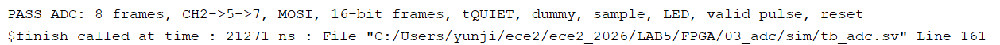

그림 14. 최종 ADC의 8-frame, MOSI, timing, dummy, sample, LED 및 reset 검사 PASS.

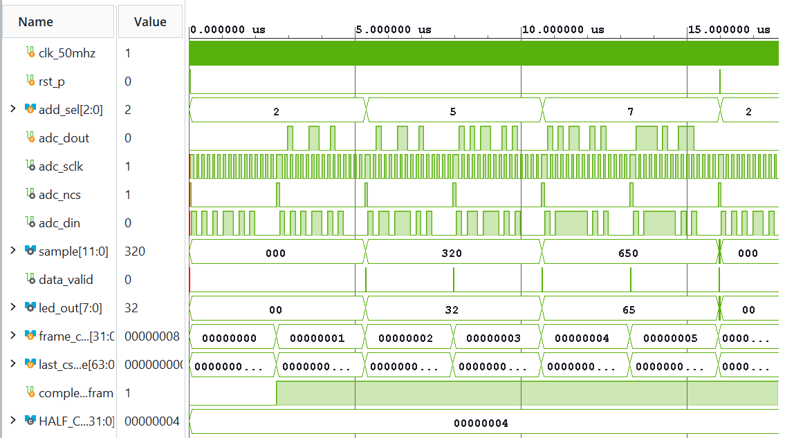

그림 15. Channel 2→5→7, reset 및 다시 CH2로 시작하는 최종 8-frame 전체 파형.

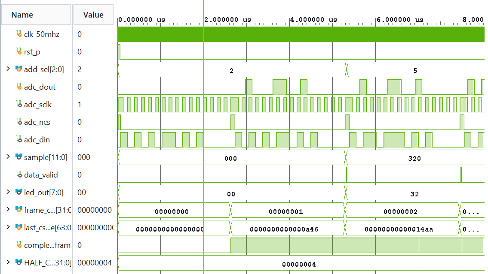

그림 16. 첫 dummy frame, CH2 결과와 CH5 명령 시 이전 CH2 응답을 보여 주는 확대 파형.

첫 frame에서는 `data_valid=0`, `sample=000`, LED `00`이 유지되어 dummy 응답이 억제되었다. 두 번째 frame에서 CH2 응답 `32`가 들어오자 `sample=320`, LED `32`로 갱신되었다. 세 번째 frame은 CH5 command를 전송하지만 수신값은 이전 CH2 결과이므로 sample과 LED가 그대로 유지되고, 다음 frame에서 CH5 결과 `65`가 반영되었다. CH7 전환과 reset 이후에도 같은 규칙이 적용되었다. Testbench는 표의 여덟 조건과 SPI timing 검사를 모두 통과하여 다음 메시지로 종료되었다.

`PASS ADC: 8 frames, CH2->5->7, MOSI, 16-bit frames, tQUIET, dummy, sample, LED, valid pulse, reset`

#### 3.3.4 보드 재검증 및 고찰

수정한 RTL, `adc_board_top`, AD7908 XDC를 사용하여 synthesis와 implementation을 수행하고 새 bitstream을 생성하였다. ADC의 Program Device는 실제로 수행했지만 성공 화면은 촬영하지 못하였다. 수정된 설계를 보드에 적용한 후 VR을 회전시키자 LED 표시값이 입력 변화에 따라 달라지는 것을 확인하였다. 초기 실험에서 나타난 LED 무반응 현상이 개선되었으며, FPGA의 SPI 제어와 ADC 변환 결과 출력이 실제 보드에서도 동작함을 확인하였다. 최종 과정은 [ADC 보드 영상](../../evidence/board/LAB5/raw_videos/03_adc.mp4)에 기록하였다. 이 관찰은 입력 변화에 따른 LED 표시의 기능적 동작을 확인한 것이며, 전압과 ADC 변환값의 정량적 정확도는 별도로 측정하지 않았다.

초기 ADC 설계는 3-frame simulation에서 PASS하였으나, 실제 보드에서는 VR을 회전시켜도 LED 출력이 변하지 않았다. 이를 해결하기 위해 AD7908의 SPI 통신 방식과 수신 데이터 구조를 분석하고, 송수신 timing, dummy frame 처리, channel 전환에 따른 응답 지연을 반영하여 RTL을 수정하였다. 또한 testbench를 8-frame으로 확장하여 각 channel의 command와 수신 결과, `data_valid` 및 reset 동작을 검증하였다. 최종 simulation에서 예상값과 실제 파형이 일치하였다.

이 실험을 통해 testbench PASS는 testbench가 표현한 조건의 통과를 의미하며, 외부 소자의 실제 protocol을 충분히 모델링하지 않으면 보드 동작을 보장할 수 없다는 점을 확인하였다. 특히 channel을 변경한 command와 그 channel의 conversion 결과가 같은 frame에 나타나지 않을 수 있으므로, 직렬 통신 회로에서는 edge timing뿐 아니라 conversion pipeline도 함께 고려해야 한다.

## 4. Vivado 구현 결과

세 FPGA 설계는 Vivado 2026.1에서 `xc7s75fgga484-1` device, 50 MHz clock의 20 ns constraint, `LVCMOS33` 조건으로 구현하였다. Behavioral Simulation 이후 synthesis, placement와 routing, bitstream 생성을 완료하였다.

| 실험 | Design top | Synthesis / Implementation | Timing | Bitstream / Programming |
|---|---|---|---|---|
| Piano | `piano` | 성공 / fully routed | WNS 13.566 ns, TNS 0 | `piano.bit` 생성, Program Device 수행 |
| Traffic | `traffic` | 성공 / fully routed | WNS 14.850 ns, TNS 0 | `traffic.bit` 생성, Program Device 수행 |
| ADC | `adc_board_top` | 성공 / fully routed | WNS 16.219 ns, TNS 0 | `adc_board_top.bit` 생성, Program Device 수행 |

세 routed design에는 `CFGBVS`와 `CONFIG_VOLTAGE`가 지정되지 않았다는 `CFGBVS-1` warning이 각각 1건 남았다. Timing 표의 값은 설정한 50 MHz 내부 clock 경로에 대한 결과이며, Traffic과 ADC의 외부 I/O delay는 별도로 지정하지 않았으므로 외부 장치 interface timing 전체를 의미하지 않는다. Traffic과 ADC의 pin 검증에서는 미할당 port나 I/O standard 누락에 해당하는 UCIO-1/NSTD-1 오류가 발생하지 않았다.

## 5. 결론

STM32 실험에서는 버튼 입력과 시간 처리를 서로 다른 ISR로 분리하여 interrupt 기반 제어의 장점을 확인하였다. Task 3에서는 버튼 ISR이 1, 2, 4, 8 s의 간격을 선택하고 TIM6 ISR이 100 ms tick을 누적하여 LED를 toggle하도록 하였으며, 실제 보드에서 1→2→4→8→1 s 순환을 관찰하였다. Task 4에서는 버튼 ISR이 PWM compare 값을 250, 500, 750으로 변경하도록 하였고, 오실로스코프에서 duty 24.79%, 50.34%, 74.98%와 약 1 kHz의 주파수를 측정하였다. 이를 통해 software에서 설정한 compare 값이 timer hardware의 PWM pulse width로 반영되는 과정을 이해하였다.

FPGA Piano에서는 입력에 따라 주파수를 선택하고 반주기 counter로 구형파를 만드는 방법을 확인하였다. 초기 무음 현상은 RTL이 아니라 `PIEZO ENABLE` switch 설정에서 발생했으며, switch를 활성화한 뒤 실제 음 출력을 확인하였다. Traffic에서는 direction과 phase를 이용한 상태 기반 순차 제어로 차량·보행자 신호와 flicker mode를 구현하고, 24개 출력 핀을 실제 LED에 연결하여 simulation의 상태 변화가 물리 출력으로 전달되도록 하였다.

ADC 실험에서는 초기 3-frame simulation이 PASS했음에도 실제 보드에서 VR 변화가 LED에 반영되지 않았다. 이후 SPI command, MOSI setup, MISO sampling edge, dummy frame, channel pipeline, reply 정렬과 quiet time을 분석하여 RTL과 testbench를 수정하였다. 최종 8-frame simulation에서 각 channel 전환과 reset 조건이 예상값과 일치했으며, 수정 후에는 VR 입력 변화에 따라 LED 표시값이 달라지는 것을 실제 보드에서 확인하였다. 이 과정은 simulation과 실제 hardware 검증을 함께 수행해야 하며, 외부 장치의 protocol과 testbench model이 일치해야 한다는 점을 보여 주었다.

## 참고문헌

[1] 전자전기컴퓨터설계실험Ⅱ, 「STM32 강의자료」, `STM32_1.md`, 2026.

[2] 전자전기컴퓨터설계실험Ⅱ, 「FPGA 추가 실험자료」, `FPGA_additional.md`, 2026.
