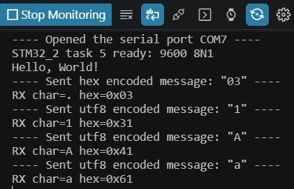
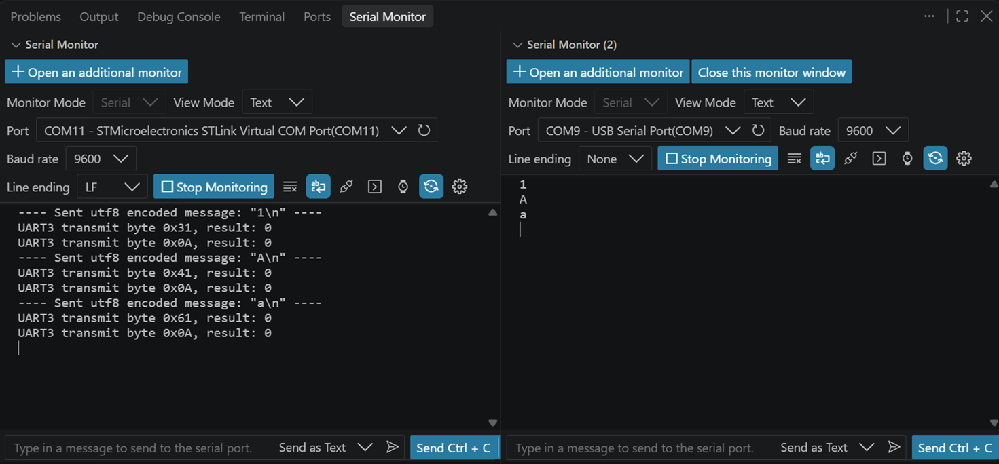
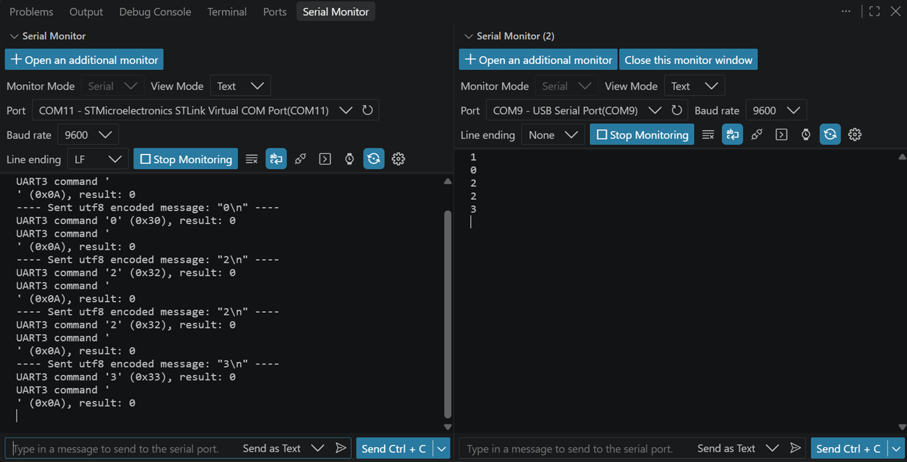
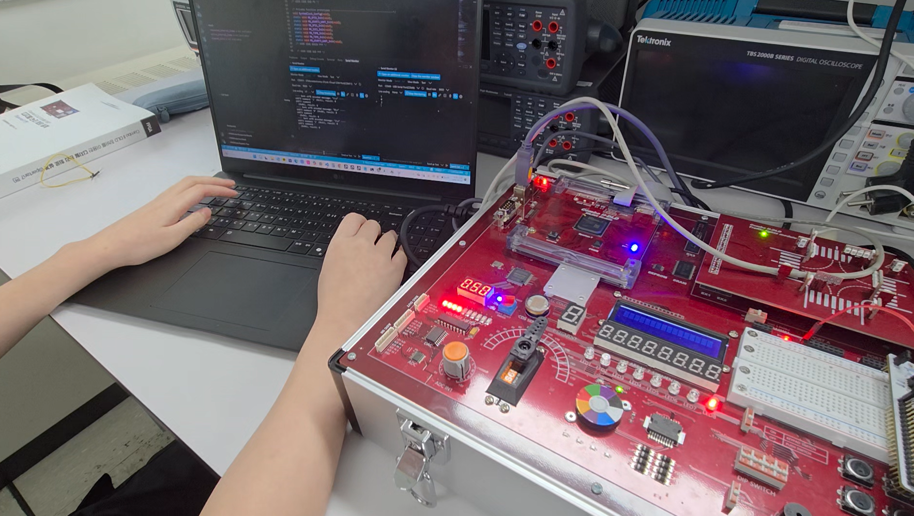
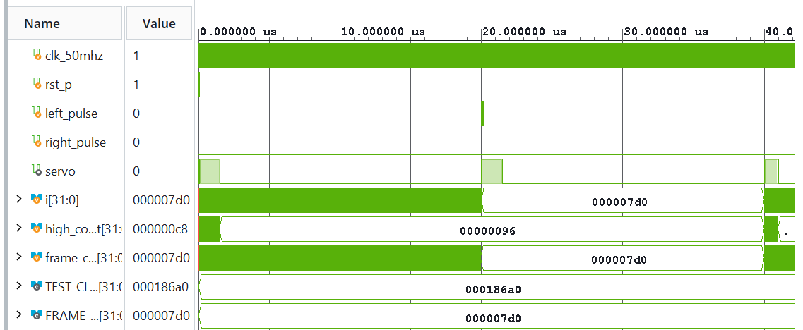
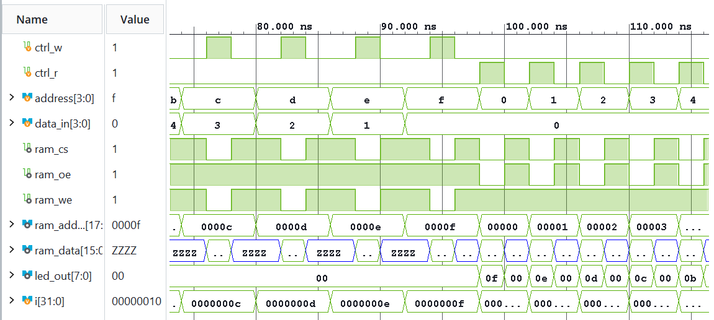
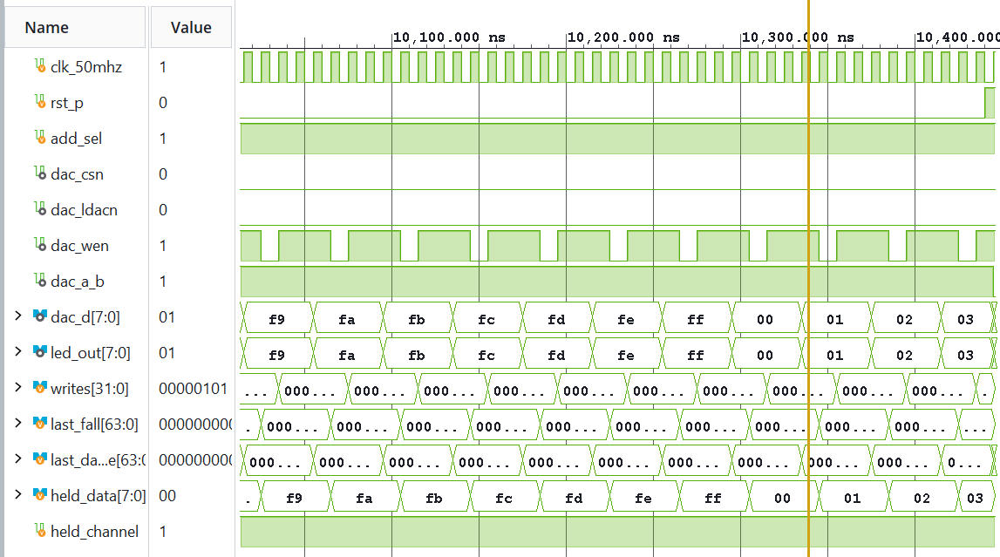

<div align="center">

<p style="font-size: 16px; margin-top: 80px; margin-bottom: 72px;">전자전기컴퓨터설계실험Ⅱ 실험 후 보고서</p>

<h1 style="font-size: 28px; margin-bottom: 96px;">LAB 6 – UART 통신 및 FPGA 주변장치 제어</h1>

</div>

|  |  |
|---|---|
| **학과** | 전자전기컴퓨터공학부 |
| **학번/이름** | 2025440032 / 김윤지 |
| **작성일** | 2026.10.30 |
| **대상** | STM32_2 및 FPGA 추가 실습 |
| **검증 환경** | STM32Cube VS Code · CMake/Ninja · GNU Arm Toolchain<br>Vivado 2026.1 · Icarus Verilog |
| **프로젝트** | ece2_2026 / LAB6 |
| **GitHub 저장소** | https://github.com/yunuos2525-cloud/ece2_2026 |
| **소스 기준 커밋** | `816fe04` |
| **제출 태그** | `LAB6_POST_FINAL` |

## 1. 실험 목적 및 진행 방법

이번 실험에서는 STM32의 UART2와 UART3를 이용하여 PC에서 입력한 한 바이트를 FPGA로 전달하고, FPGA가 수신한 데이터를 다시 PC로 보내는 통신 경로를 구성하였다. Task 5에서는 PC와 STM32 사이의 문자 입출력을 확인하였고, Task 6에서는 PC → STM32 → FPGA → PC 경로로 문자를 전달하였다. Task 7에서는 FPGA가 수신 문자를 명령으로 해석하여 LED 상태를 제어하도록 확장하였다 [1].

FPGA 추가 실습에서는 PWM으로 서보모터의 위치를 제어하고, 외부 SRAM의 양방향 데이터 버스를 읽고 쓰며, DAC에 8-bit 증가 데이터를 전달하였다. PRE에서 작성한 testbench로 입력과 예상 출력을 먼저 비교한 뒤 Vivado에서 합성·구현하고 실제 보드에서 동작을 관찰하였다. 시뮬레이션 결과와 실제 보드 결과는 같은 기능을 서로 다른 단계에서 확인한 것이므로, 보드에서만 확인할 수 있는 서보 각도, SRAM 저장값, DAC 아날로그 출력은 별도로 구분하였다 [2].

## 2. STM32 UART 및 FPGA 통신 실험

### 2.1 Task 5 — PC와 STM32의 문자 입출력

STM32의 UART2는 ST-LINK USB를 통해 PC의 Virtual COM Port와 연결된다. Serial Monitor를 9600 baud, 8 data bit, parity 없음, stop bit 1로 설정하고 문자 `1`, `A`, `a`를 각각 전송하였다. 프로그램은 `getchar()`로 받은 문자를 `uint8_t`로 변환한 뒤 문자와 16진수 값을 함께 출력한다.

```c
int ch = getchar();
if (ch != EOF) {
    uint8_t byte = (uint8_t)ch;
    printf("received: %c, byte: 0x%02X\r\n",
           ch, (unsigned int)byte);
}
```

| 입력 | 예상 ASCII | 실제 출력 |
|:---:|:---:|:---:|
| `1` | `0x31` | `0x31` |
| `A` | `0x41` | `0x41` |
| `a` | `0x61` | `0x61` |



그림 1. UART2로 입력한 `1`, `A`, `a`와 STM32가 출력한 ASCII 값.

세 문자의 실제 출력값이 ASCII 표의 예상값과 일치하였다. 따라서 PC에서 보낸 문자 한 바이트를 STM32가 정상적으로 수신하고 내부 값으로 변환해 출력함을 확인하였다.

### 2.2 Task 6 — STM32에서 FPGA로 UART 데이터 전달

Task 6의 데이터 경로는 PC의 UART2 입력을 STM32가 받은 뒤 UART3으로 FPGA에 전송하고, FPGA가 같은 바이트를 USB-UART로 다시 PC에 보내는 구조이다. MCU와 FPGA는 9600 baud, 8N1로 설정하고 STM32 PC10(TX), FPGA RX, 공통 GND를 연결하였다.

STM32에서는 다음 함수로 한 바이트를 UART3에 전송하였다.

```c
HAL_StatusTypeDef result =
    HAL_UART_Transmit(&huart3, &data, 1U, 100U);
```

반환값 `0`은 STM32의 UART3 전송 함수가 `HAL_OK`로 종료되었다는 뜻이다. 이 값만으로 FPGA 수신까지 성공했다고 판단할 수는 없으므로, FPGA의 Echo와 LED를 별도로 확인하였다.



그림 2. STM32 UART3 송신 로그와 FPGA USB-UART Echo 결과.

문자 `1`, `A`, `a`를 보냈을 때 STM32 화면에는 각각 `0x31`, `0x41`, `0x61`의 전송 결과가 나타났고, FPGA 쪽 Serial Monitor에는 같은 문자가 다시 수신되었다. 또한 실제 보드에서 `A`를 전송했을 때 FPGA LED가 ASCII `0x41`에 해당하는 `01000001`로 표시되는 것을 확인하였다. 따라서 송신 함수의 성공뿐 아니라 FPGA의 실제 수신, LED 표시, Echo까지 연결된 통신 경로가 동작하였다.

### 2.3 Task 7 — UART 명령으로 FPGA LED 제어

Task 7은 수신한 ASCII 문자를 FPGA에서 해석하여 LED 한 개의 상태를 변경한다. `0`은 LED를 끄고, `1`은 켜며, `2`는 현재 상태를 반전한다. 그 밖의 문자는 기존 상태를 유지한다. 명령을 정상적으로 받았는지는 FPGA Echo를 통해 함께 확인하였다.

```verilog
case (rx_data)
    8'h30: led_state <= 1'b0;
    8'h31: led_state <= 1'b1;
    8'h32: led_state <= ~led_state;
    default: led_state <= led_state;
endcase
```

| 입력 명령 | 예상 LED 상태 | 실제 관찰 |
|:---:|---|---|
| `1` | ON | ON |
| `0` | OFF | OFF |
| 첫 번째 `2` | OFF → ON | ON으로 반전 |
| 두 번째 `2` | ON → OFF | OFF로 재반전 |
| `3` | 기존 OFF 유지 | OFF 유지 |



그림 3. `1`, `0`, `2`, `2`, `3` 명령의 STM32 송신 결과와 FPGA Echo.



그림 4. STM32와 FPGA를 연결하여 UART LED 제어를 수행한 보드 구성.

Serial Monitor 캡처에서는 다섯 명령의 송신과 Echo를 확인할 수 있었다. 실제 보드에서는 `1`, `0`, `2`, `2`, `3`을 차례로 입력하여 LED가 ON, OFF, ON, OFF, OFF 유지 순서로 동작하는 것을 확인하였다. 동작 과정은 [Task 7 보드 영상](../../stm32_evidence/board/LAB6/03_task7_uart_led/uart_led_control.mp4)에 기록하였다.

이 결과를 통해 UART 통신의 성공과 수신 데이터에 따른 FPGA 내부 상태 제어가 함께 이루어졌음을 확인하였다. 세 STM32 프로그램의 Build 결과는 다음과 같다.

| 프로그램 | RAM | FLASH | Build 결과 |
|---|---:|---:|---|
| Task 5 | 2640 B | 27752 B | 정상 종료 |
| Task 6 | 2640 B | 27788 B | 정상 종료 |
| Task 7 | 2640 B | 27788 B | 정상 종료 |

## 3. FPGA 주변장치 실험

### 3.1 Servo — PWM과 리셋 연결 수정

Servo 회로는 20 ms 주기의 PWM을 만들고 HIGH 시간을 1.0~2.0 ms 범위에서 변경한다. PRE simulation에서는 시간을 줄인 parameter를 사용하여 한 frame을 2000 clock으로 만들었다. Testbench는 왼쪽 입력에서 펄스 폭이 감소하고 오른쪽 입력에서 증가하며, HIGH 구간이 100/150/200 clock과 범위 제한을 만족하는지 검사하여 PASS하였다.

```verilog
if (count == FRAME_CYCLES - 1) begin
    count <= 0;
    width_cycles <= pulse_us * (CLK_HZ / 1000) / 1000;
end
assign servo = !rst_p && (count < width_cycles);
```



그림 5. Servo의 위치 값 변경과 다음 PWM frame에 적용되는 HIGH 구간.

보드 동작을 확인하는 과정에서 `servo_board_top.v`의 리셋 연결을 다음과 같이 수정하였다.

| 수정 전 | 수정 후 |
|---|---|
| `.rst_p(~resetn)` | `.rst_p(resetn)` |

`servo_ctrl`의 `rst_p`는 HIGH일 때 내부 상태를 reset한다. 수정 전에는 외부 `resetn`이 LOW일 때 내부 reset이 HIGH가 되었고, 수정 후에는 외부 입력이 HIGH일 때 내부 reset이 HIGH가 된다. 보드 동작을 확인하는 과정에서 이 연결을 변경하여 내부 회로가 reset으로 해석하는 입력 레벨을 반대로 바꾸었다.

수정 후 Vivado 구현을 다시 수행하고, 실제 보드에서 버튼 조작에 따라 서보모터의 각도가 여러 위치로 변하는 것을 확인하였다. 동작 과정은 [Servo 보드 영상](../../evidence/board/LAB6/raw_videos/01_servo.mp4)에 기록하였다. 기존 [Program Device 캡처](../../evidence/vivado/LAB6/01_servo/program_device.png)는 수정 전 코드의 기록이므로 수정 후 결과와 구분하였다.

수정 후 구현 결과에서는 WNS가 -0.019 ns, TNS가 -0.078 ns이고 setup timing을 만족하지 못한 endpoint가 5개 있었다. WNS가 음수라는 것은 가장 여유가 작은 경로가 요구 시간보다 0.019 ns 늦었다는 뜻이다. 실제 서보의 각도 변화는 확인했지만 timing 조건은 만족하지 못했으므로, 기능 동작과 timing 결과를 구분하였다.

### 3.2 SRAM — 외부 메모리 Write/Read

SRAM 회로는 4-bit 주소와 데이터를 사용하여 외부 SRAM의 하위 주소와 데이터 비트를 제어한다. Write일 때 FPGA가 `ram_data`를 구동하고, Read일 때는 버스를 High-Z로 해제하여 SRAM이 저장 데이터를 출력하도록 하였다. PRE testbench에서는 주소 0~15에 `15-address` 값을 쓴 뒤 같은 주소에서 읽었으며, 비활성 구간의 High-Z와 read/write 동시 입력의 버스 보호도 검사하였다.

```verilog
assign ram_address = {14'b0, address};
assign ram_data = drive_data ? {12'b0, data_in} : 16'bz;
assign led_out = read_data ? {4'b0, ram_data[3:0]} : 8'b0;
```



그림 6. SRAM write 이후 주소 0, 1, 2에서 `F`, `E`, `D`를 읽는 대표 파형.

시뮬레이션에서는 주소 0, 1, 2를 읽을 때 `ram_data`가 각각 `000F`, `000E`, `000D`로 나타났고 LED도 `0F`, `0E`, `0D`로 일치하였다. 실제 보드에서는 스위치로 주소와 데이터를 설정한 뒤 Write를 수행하고 같은 주소에서 Read하였다. 여러 주소에서 LED의 값이 앞서 저장한 데이터와 일치하는 것을 직접 확인하였다.

실험 과정은 [SRAM 보드 영상](../../evidence/board/LAB6/raw_videos/02_SRAM.mp4)에 기록하였다. 주소·데이터 설정과 readback LED의 일치로 RTL의 버스 방향 제어와 실제 SRAM의 저장·읽기 동작이 연결되어 동작함을 확인하였다.

### 3.3 DAC — 8-bit 디지털 데이터 전달

DAC 회로는 8-bit 값을 0부터 255까지 증가시키고, 데이터를 먼저 출력한 다음 한 clock 뒤에 `dac_wen`을 LOW로 만들어 write pulse를 발생시킨다. Testbench에서는 260회 write를 수행하여 데이터·채널의 setup/hold, LED와 데이터의 일치, 채널 전환, `FF→00` 순환을 확인하였다.

```verilog
we_n <= 1'b1;
if (write_pending) begin
    we_n <= 1'b0;
    write_pending <= 1'b0;
end else if (update) begin
    data <= value;
    a_b <= channel;
    write_pending <= 1'b1;
end
```



그림 7. `FC→FD→FE→FF→00→01→02→03` 데이터와 DAC write pulse.

대표 파형에서 `dac_d`와 LED가 `FC, FD, FE, FF, 00, 01, 02, 03` 순서로 변했고, 각 값은 `dac_wen`이 LOW가 되기 전에 먼저 안정되었다. 따라서 `FF→00`을 포함한 정확한 데이터 순환은 시뮬레이션에서 확인하였다. 실제 보드에서는 LED pattern이 연속적으로 변화하는 것을 관찰하였으며, 과정은 [DAC 보드 영상](../../evidence/board/LAB6/raw_videos/03_DAC.mp4)에 기록하였다.

보드에서는 디지털 데이터에 따른 LED 변화를 확인했으며, DAC의 아날로그 출력 전압은 별도로 측정하지 않았다.

## 4. Vivado 구현 결과

FPGA part는 모두 `xc7s75fgga484-1`을 사용하였다. Servo, SRAM, DAC는 Vivado Behavioral Simulation 자료가 있으며, UART Task 6·7은 PRE testbench와 실제 통신 결과를 중심으로 확인하였다.

| 실험 | Design Top | 구현 결과 | Timing 요약 | 보드 결과 |
|---|---|---|---|---|
| Servo | `servo_board_top` | Synthesis·Implementation·bit 생성 | WNS -0.019 ns, 위반 존재 | 수정 코드에서 각도 변화 확인 |
| SRAM | `sram` | Synthesis·Implementation·bit 생성 | 내부 clock 경로 없음 | 저장값과 read LED 일치 |
| DAC | `dac` | Synthesis·Implementation·bit 생성 | WNS +14.745 ns | 디지털 데이터·LED 변화 확인 |
| UART Task 6 | `lab6_uart_echo` | Synthesis·Implementation·bit 생성 | WNS +14.824 ns | Echo 및 `A→01000001` 확인 |
| UART Task 7 | `lab6_uart_led` | Synthesis·Implementation·bit 생성 | WNS +14.662 ns | `1/0/2/2/3` 동작 확인 |

Servo를 제외한 clock 사용 회로는 양수 WNS를 기록하였다. 각 구현에는 보드 configuration voltage와 관련된 CFGBVS 경고가 남아 있었다. SRAM에서는 `ram_data[15:4]`의 양방향 I/O buffering이 완전하지 않다는 RPBF-3 경고가 12건 발생하였다. 실제 보드에서 Write/Read는 정상 동작했지만, 이 결과만으로 구현 경고가 해결된 것은 아니므로 경고는 남은 구현 사항으로 기록하였다.

## 5. 결과 고찰

UART 실험에서는 각 단계의 성공 조건을 분리하는 것이 중요하였다. STM32의 `HAL_UART_Transmit()` 결과 0은 MCU 내부 전송 함수가 정상 종료되었다는 뜻이지만 FPGA가 실제로 문자를 받았다는 증거는 아니다. FPGA Serial Monitor의 Echo와 `A`에 대한 LED `01000001`을 함께 확인하여 실제 수신까지 검증할 수 있었다. Task 7에서도 Echo는 명령 수신을 보여 주고, LED의 ON/OFF/반전/유지는 수신 데이터를 올바르게 해석했음을 보여 주었다.

FPGA 주변장치 실험에서는 simulation과 보드 관찰의 범위가 달랐다. Servo testbench는 PWM frame과 pulse width를 검사하고 보드에서는 실제 각도 변화를 확인했지만, 구현 timing에는 작은 위반이 남았다. SRAM testbench는 이상적인 메모리 model과 버스 방향을 검사했고 실제 보드에서는 저장값과 readback LED가 일치하였다. DAC는 디지털 write 순서와 LED 변화까지 확인했지만 아날로그 출력 전압은 측정하지 않았다. 따라서 디지털 sequence의 정상 동작과 실제 DAC 아날로그 출력 검증을 같은 결과로 취급하지 않았다.

Servo 리셋 연결 수정은 한 신호의 극성이 전체 회로 상태에 직접 영향을 줄 수 있음을 보여 주었다. Simulation에서 하위 모듈이 정상이어도 board top에서 reset을 어떤 레벨로 연결하는지에 따라 실제 회로가 계속 reset 상태에 머물거나 반대로 reset이 해제될 수 있다. 또한 실제 동작 관찰과 timing constraint 충족은 서로 다른 검증 항목이므로 둘을 독립적으로 확인해야 한다.

## 6. 결론

STM32 Task 5에서는 `1`, `A`, `a`의 ASCII 값 `0x31`, `0x41`, `0x61`을 확인하였다. Task 6에서는 STM32 UART3 송신 이후 FPGA Echo와 `A`의 LED `01000001` 표시를 확인하여 PC–STM32–FPGA 통신 경로가 동작함을 확인하였다. Task 7에서는 `1`, `0`, `2`, `2`, `3` 명령에 따라 LED가 ON, OFF, ON, OFF, OFF 유지 순서로 동작하였다.

FPGA 추가 실습에서는 수정된 Servo 회로의 각도 변화와 SRAM의 Write/Read 데이터 일치를 확인하였다. DAC는 시뮬레이션에서 데이터 순환을 확인하고 실제 보드에서 LED pattern의 연속적인 변화를 관찰하였다.

## 참고문헌

[1] 전자전기컴퓨터설계실험Ⅱ, 「STM32_2 · 컴퓨터와 FPGA 통신」, `STM32_2.md`, 2026.

[2] 전자전기컴퓨터설계실험Ⅱ, 「FPGA 추가 실습 · 모듈과 테스트벤치」, `FPGA_additional.md`, 2026.
