<div align="center">

<p style="font-size: 16px; margin-top: 80px; margin-bottom: 72px;">전자전기컴퓨터설계실험Ⅱ 실험 후 보고서</p>

<h1 style="font-size: 28px; margin-bottom: 96px;">LAB 7 – STM32 SPI 통신 및 FPGA 송수신</h1>

</div>

|  |  |
|---|---|
| **학과** | 전자전기컴퓨터공학부 |
| **학번/이름** | 2025440032 / 김윤지 |
| **작성일** | 2026.11.02 |
| **대상** | STM32_3 Task 8~12 |
| **검증 환경** | STM32Cube VS Code · Icarus Verilog 12.0(devel)<br>Vivado 2026.1 · STM32 및 FPGA board |
| **프로젝트** | ece2_2026 / LAB7 |
| **GitHub 저장소** | https://github.com/yunuos2525-cloud/ece2_2026 |
| **소스 기준 커밋** | `ee3e56f744358530b6beb56724615bd59b5329ad` |
| **제출 태그** | `LAB7_POST_FINAL` |

## 1. 실험 목적 및 검증 개요

이번 실험에서는 SPI Mode 0을 사용하여 STM32와 FPGA 사이에서 8-bit 데이터를 MSB-first로 전달하였다. Task 8에서는 STM32 Master의 CS, SCK, MOSI 파형을 확인하였고, Task 9에서는 두 STM32의 Master와 Slave 역할을 교대하였다. Task 10과 11에서는 FPGA SPI Slave와 Master를 각각 설계하여 MCU-FPGA 통신을 시험하였으며, Task 12에서는 역할을 교대하여 두 FPGA 사이의 양방향 통신을 확인하였다[1].

공통 시험 데이터는 `0x55`, `0xA5`, `0x00`, `0xFF`이다. CS는 LOW일 때 활성화되며, 수신 측은 SCK 상승 에지에서 MOSI를 읽는다. 송신 측은 첫 상승 에지 전에 MSB를 준비하고 이후 하강 에지에서 다음 비트를 출력한다. MISO는 사용하지 않았으며, STM32–STM32, STM32–FPGA, FPGA–FPGA의 보드 간 통신에서는 SCK, MOSI, CS, GND를 연결하였다.

검증은 세 단계로 진행하였다. 먼저 Task 10~12의 RTL을 Icarus의 self-checking Testbench로 검사하였고, 같은 RTL과 Testbench를 Vivado XSim에서도 실행하였다. 다음으로 Task 10과 11을 합성·구현하여 timing과 DRC를 확인하고 bitstream을 생성하였다. 마지막으로 STM32와 FPGA 보드를 연결하여 UART 출력과 오실로스코프 파형을 관찰하였다. 시뮬레이션 통과, bitstream 생성, 실제 보드 통신은 서로 다른 단계의 결과로 구분하였다.

## 2. 실험 결과

### 2.1 Task 8 - STM32 SPI 송신 파형

STM32 Master는 1초마다 `55`, `A5`, `00`, `FF`를 순서대로 전송하고 각 전송 뒤 HAL 반환값을 UART에 출력하였다. 예상 결과는 각 데이터의 전송에서 `result=0`이 출력되고, CS가 LOW인 한 frame 안에 SCK 상승 에지가 8번 발생하는 것이다. STM32의 SPI 설정을 기준으로 계산한 SCK 주파수는 약 781.25 kHz이다.

UART에서는 네 데이터가 반복되고 모든 전송에서 `result=0`이 출력되었다. 이 값은 MCU의 송신 함수가 정상 종료되었다는 뜻이며 수신 장치의 결과를 의미하지는 않는다.

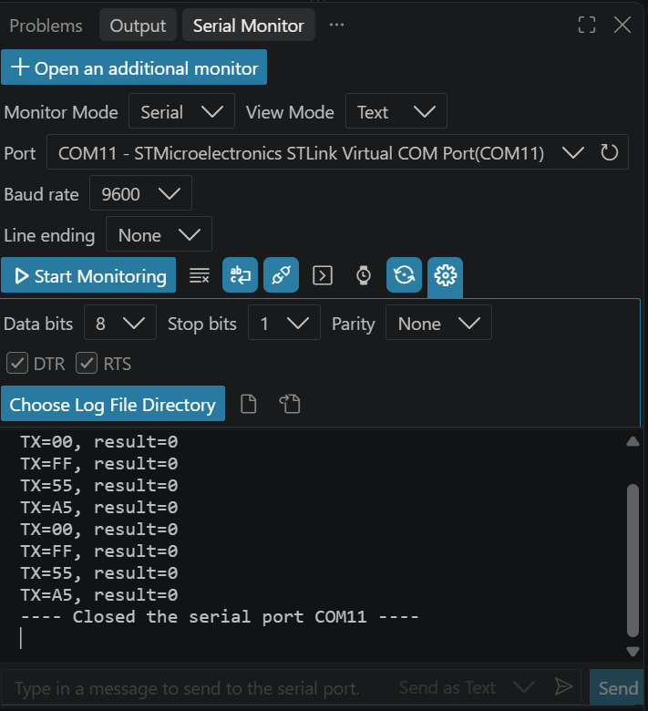

그림 1. `TX=55`, `TX=A5`, `TX=00`, `TX=FF`가 반복되고 각 전송의 HAL 반환값이 0으로 표시된 결과.

CS/SCK 측정에서는 CS가 LOW인 동안 SCK pulse 8개가 나타났다. `0x55`의 MSB-first 비트열은 `01010101`이므로, 각 SCK 상승 에지에서 읽히는 MOSI 논리값은 0과 1이 번갈아 나타나는 관계이다. CS/MOSI 측정에서는 같은 frame 구간에서 MOSI가 데이터에 따라 변하는 것을 확인하였다. 두 사진은 채널 수에 맞추어 각각 측정한 것이므로 동일 화면에서 세 신호를 동시에 측정한 결과는 아니다.

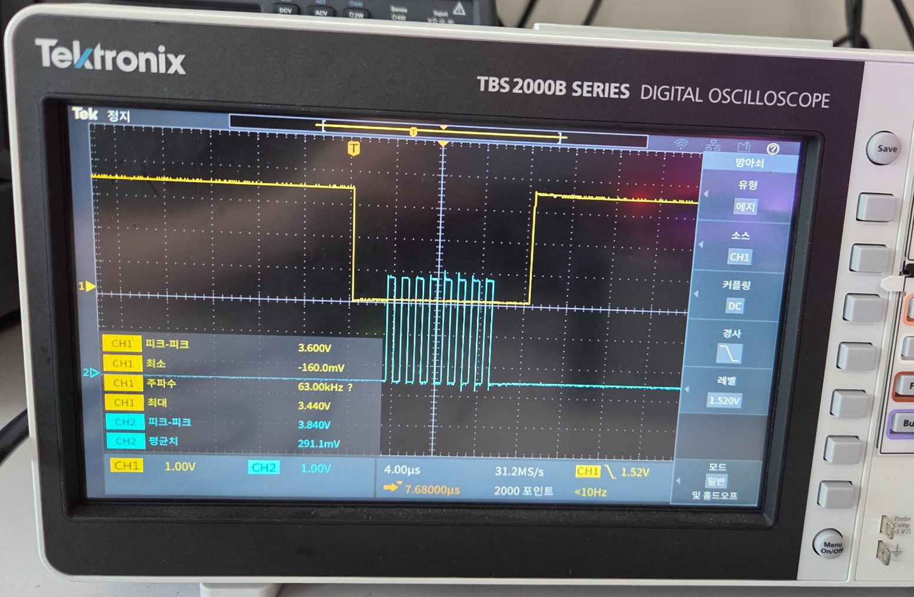

그림 2. CS가 LOW로 유지되는 한 byte 구간에 SCK pulse 8개가 나타난 파형.

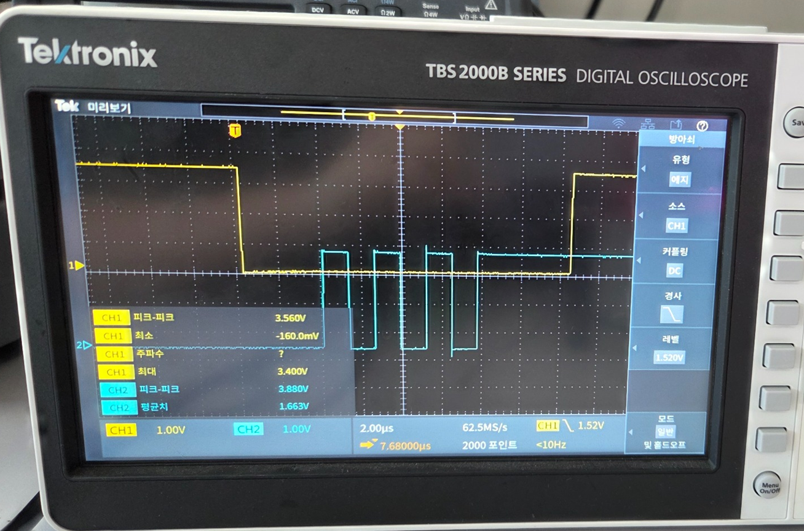

그림 3. CS LOW 구간에서 송신 데이터에 따라 MOSI가 변하는 파형. 그림 2와는 별도 측정이다.

### 2.2 Task 9 - STM32 간 통신

두 STM32를 PB3(SCK)-PB3, PA7(MOSI)-PA7, Master PB6(CS)-Slave PA4(NSS), GND-GND로 연결하였다. Slave를 먼저 실행한 뒤 Master를 시작하였으며, 역할을 바꿀 때는 프로그램과 CS 연결 방향을 함께 변경하였다. 예상 결과는 Slave UART에서 Master의 `55`, `A5`, `00`, `FF`가 같은 순서로 반복되는 것이다.

우리 조가 Slave였을 때 UART에서 `RX=55`, `RX=A5`, `RX=00`, `RX=FF`가 반복되어 송신 데이터와 수신 데이터가 일치하였다. 이후 역할을 교대하여 우리 조가 Master인 송신 실험도 수행하였다.

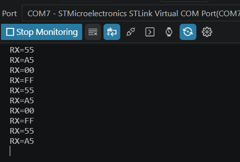

그림 4. 우리 조가 Slave 역할일 때 네 시험 데이터가 순서대로 수신된 결과.

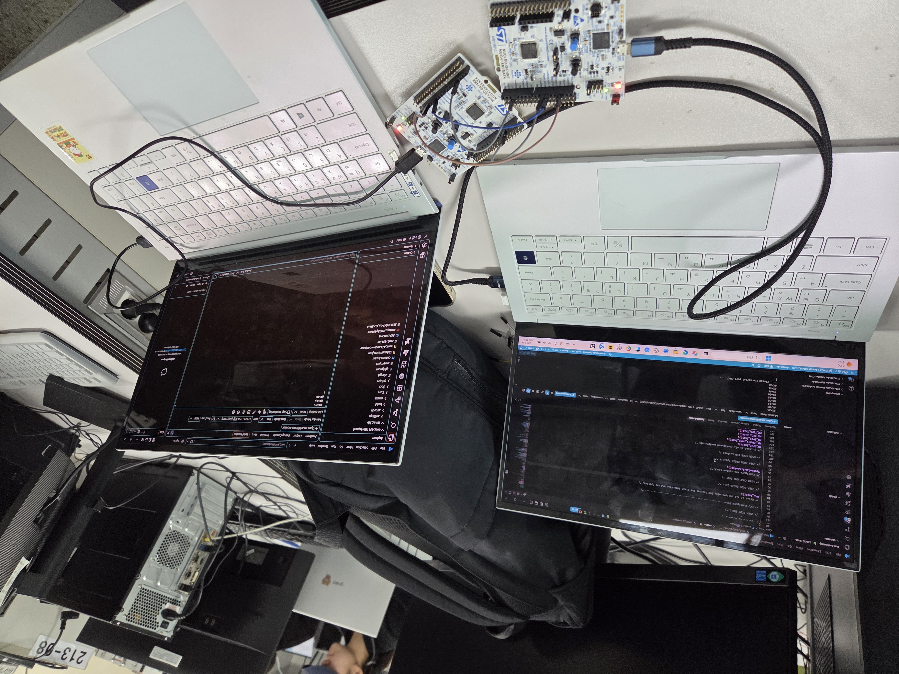

그림 5. Master와 Slave 역할을 바꾸어 STM32 두 대를 연결하고 UART를 확인한 실험 환경.

우리 조가 Master였던 방향은 실제로 수행하였으나 상대 조 수신 UART 화면은 별도로 보관되지 않았다. 따라서 그림 4는 우리 조가 Slave였던 방향의 수신값만 보여 주며, 반대 방향의 수신 결과를 같은 화면으로 대신하지 않았다.

### 2.3 Task 10 - STM32에서 FPGA로 송신

FPGA Slave는 외부 SCK, MOSI, CS를 50 MHz clock에 동기화한 뒤 SCK 상승 에지에서 MOSI를 shift register에 저장한다. 8번째 bit에서 `rx_valid`를 한 clock 발생시키고 수신값을 UART로 전달한다. CS가 8-bit 수신 전에 HIGH로 돌아오면 bit counter와 shift register를 초기화하여 불완전 frame을 폐기한다.

```verilog
if (bit_count == 3'd7) begin
    rx_data <= {shift[6:0], mosi_sync[1]};
    rx_valid <= 1'b1;
    bit_count <= 3'd0;
end else begin
    bit_count <= bit_count + 1'b1;
end
```

8번째 MOSI 값도 기존 7-bit shift 결과에 직접 결합하므로 nonblocking assignment의 갱신 순서와 관계없이 완성된 byte가 `rx_data`에 저장된다.

Testbench에서는 CS가 HIGH일 때의 clock 무시, 4-bit 불완전 frame 폐기, 네 정상 frame의 byte 순서, `rx_valid`, LED와 UART 출력을 검사하였다. Icarus와 XSim에서 모두 통과했으며, XSim 전체 파형에서는 `rx_data`가 `00 → 55 → A5 → 00 → FF`로 갱신되는 것을 확인하였다. UART의 네 byte 순서는 송신선의 토글만으로 판독한 것이 아니라 Testbench가 UART 출력을 복호화하여 예상값과 비교했으며, 오류 수는 0이었다.

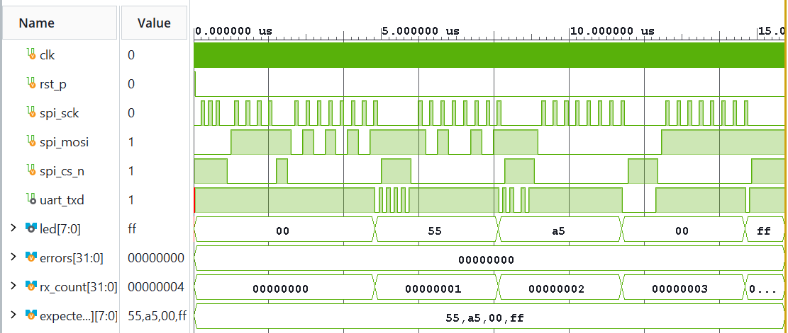

그림 6. 불완전 frame 검사 뒤 수신 데이터와 LED가 갱신되고 UART 송신 동작이 나타난 XSim 결과.

실제 보드에서는 STM32 PB3/PA7/PB6를 FPGA의 SCK/MOSI/CS에 연결하고 GND를 공통으로 사용하였다. MCU UART에는 네 시험 데이터와 `result=0`이 반복되었으며 현장에서 STM32-FPGA 통신 성공을 확인하였다.

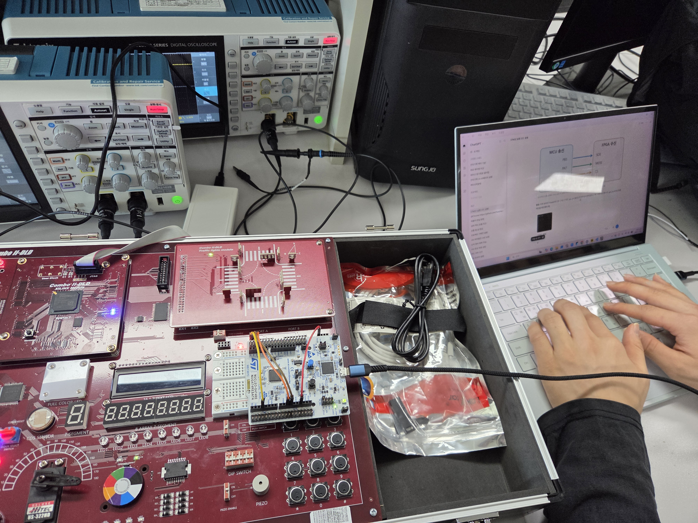

그림 7. STM32 Master와 FPGA Slave 사이에 SCK, MOSI, CS, GND를 연결한 실험 환경.

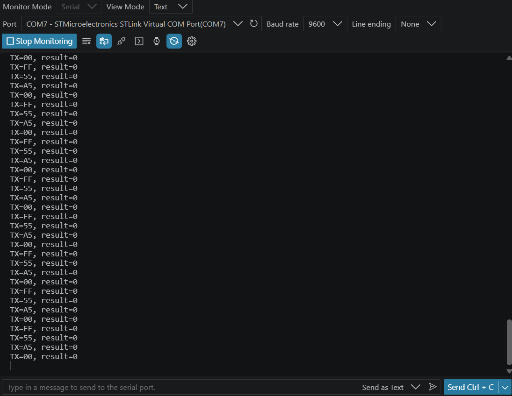

그림 8. MCU가 `55`, `A5`, `00`, `FF`를 반복 송신하고 각 HAL 호출이 `result=0`으로 종료된 결과.

저장된 UART 화면은 MCU 송신 측 자료이므로 이것만으로 FPGA의 수신값을 독립적으로 판독할 수는 없다. FPGA 수신 결과는 현장에서 확인했으나, 수신 UART 화면은 따로 캡처하지 못했다.

### 2.4 Task 11 - FPGA에서 STM32로 송신

FPGA Master는 50 MHz 입력 clock을 분주하여 SCK를 생성한다. 설계값은

`HALF_PERIOD_CYCLES = 50,000,000 / (2 × 1,000,000) = 25`

이므로 SCK는 1 MHz가 되도록 하였다. 전송 시작 시 CS를 LOW로 만들고 첫 MSB를 MOSI에 미리 출력한 뒤, SCK 하강 에지마다 다음 bit를 준비한다. 상위 모듈은 `55`, `A5`, `00`, `FF`를 약 1초 간격으로 순환한다.

```verilog
if (start) begin
    shift <= tx_data;
    bit_index <= 3'd7;
    spi_mosi <= tx_data[7];
    spi_cs_n <= 1'b0;
    busy <= 1'b1;
end
```

전송 시작 시 bit index를 7로 두고 `tx_data[7]`을 먼저 출력하여 첫 SCK 상승 에지 전에 MSB가 안정되도록 하였다.

Icarus와 XSim은 Mode 0의 대기 상태, 첫 MSB의 사전 준비, 한 frame의 상승 에지 8회, 네 byte 순서와 frame 간격을 검사하여 모두 통과하였다. XSim 파형에서도 각 데이터마다 CS LOW 구간과 SCK pulse가 나타났고 오류 수는 0이었다.

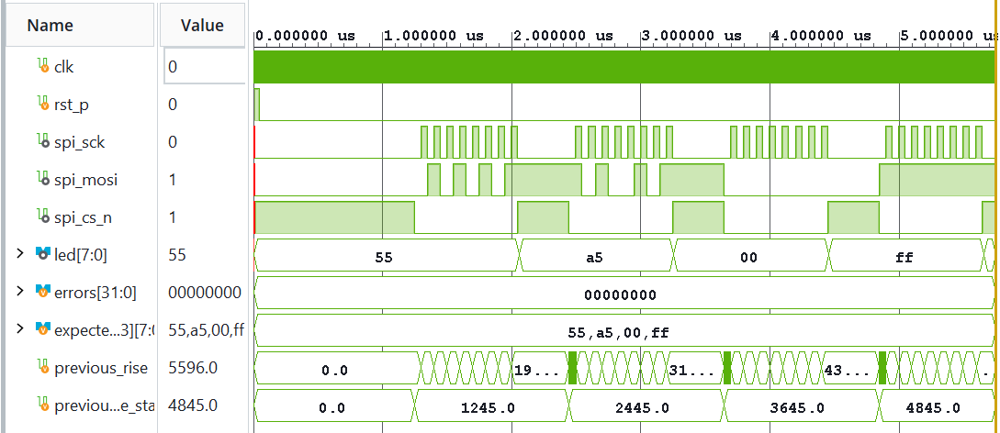

그림 9. `55`, `A5`, `00`, `FF`의 각 frame에서 CS, SCK, MOSI가 Mode 0 순서로 동작한 XSim 결과.

실제 보드에서는 FPGA의 SCK, MOSI, CS를 STM32 Slave의 PB3, PA7, PA4에 연결하였다. CS/SCK 사진에서는 CS가 LOW인 동안 SCK pulse 8개를 확인하였고, 별도 CS/MOSI 사진에서는 frame 동안 MOSI가 변하는 것을 확인하였다.

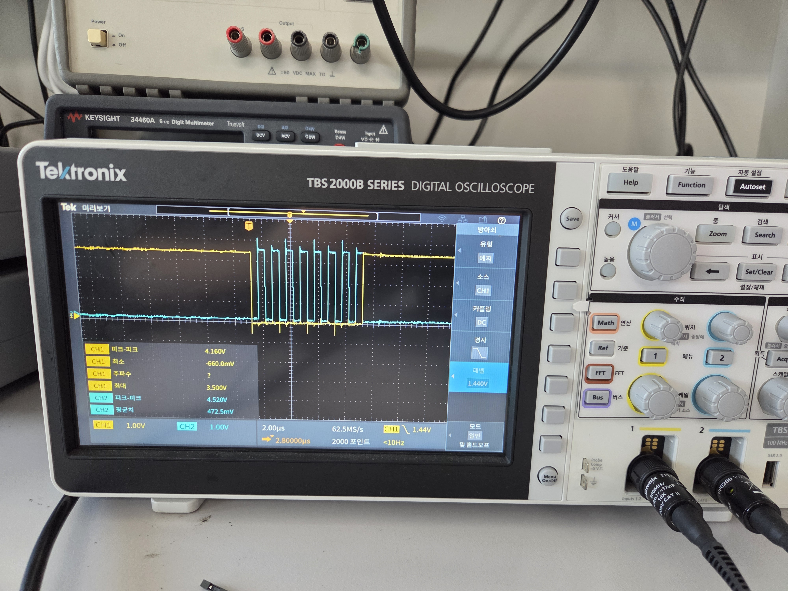

그림 10. CS LOW 구간에 SCK pulse 8개가 포함된 FPGA Master 송신 frame.

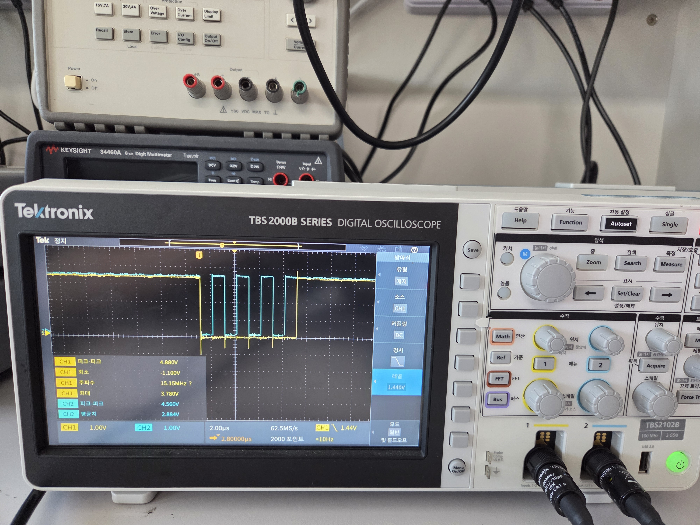

그림 11. 별도 측정에서 CS LOW 구간에 MOSI가 송신 bit에 따라 변한 파형.

STM32 Slave UART에서는 `RX=55`, `RX=A5`, `RX=00`, `RX=FF`가 반복되었다. 따라서 FPGA의 자동 순환 송신 데이터와 STM32 수신 데이터가 모두 일치하였다.

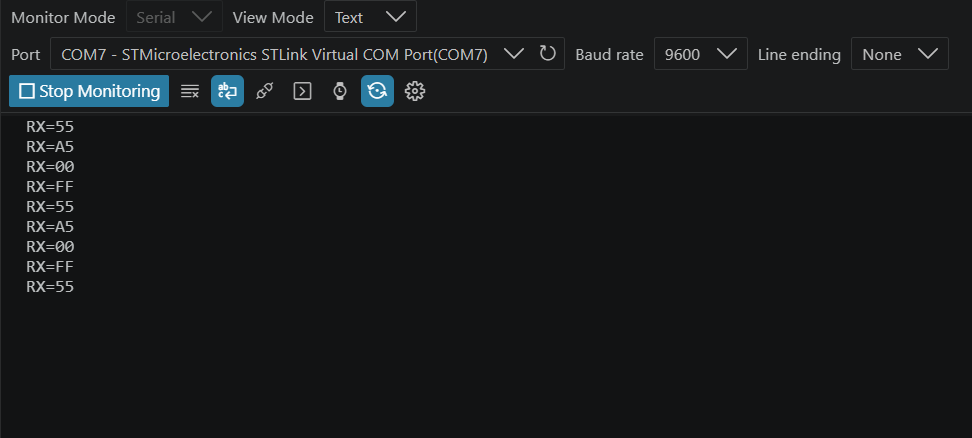

그림 12. FPGA Master가 전송한 네 byte를 STM32 Slave가 같은 순서로 반복 수신한 결과.

### 2.5 Task 12 - FPGA 간 양방향 통신

Task 12의 통합 시뮬레이션에서는 우리 조의 Task 11 Master RTL과 Task 10 Slave RTL을 수정 없이 연결하였다. 통합 Testbench는 두 top module의 SCK, MOSI, CS를 직접 연결하고 Slave의 `rx_valid`, 수신 데이터, UART byte를 비교하였다. Icarus와 XSim에서 네 byte가 모두 일치했으며 수신 count는 4, 오류 수는 0이었다.

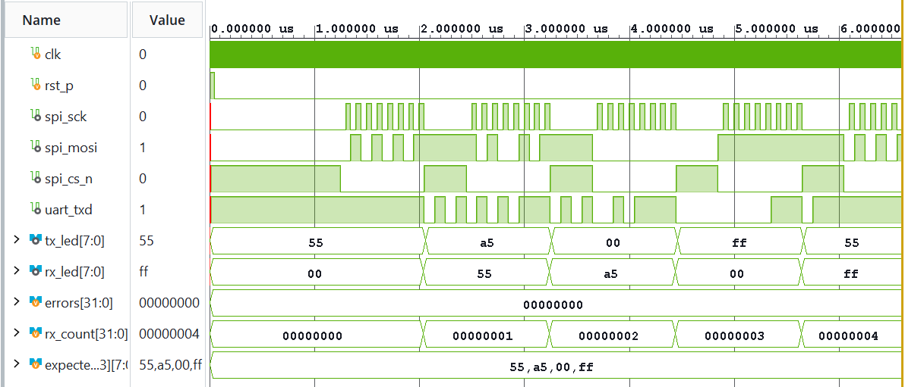

그림 13. Task 11 Master의 송신 frame을 Task 10 Slave가 수신하여 `55`, `A5`, `00`, `FF`로 갱신한 통합 XSim 결과.

실제 실험에서는 FPGA 두 대의 SCK, MOSI, CS, GND를 같은 이름끼리 연결하였다. 역할을 바꿀 때 신호 배선은 유지하고 각 FPGA에 적용하는 Master와 Slave 구성을 교대하였다.

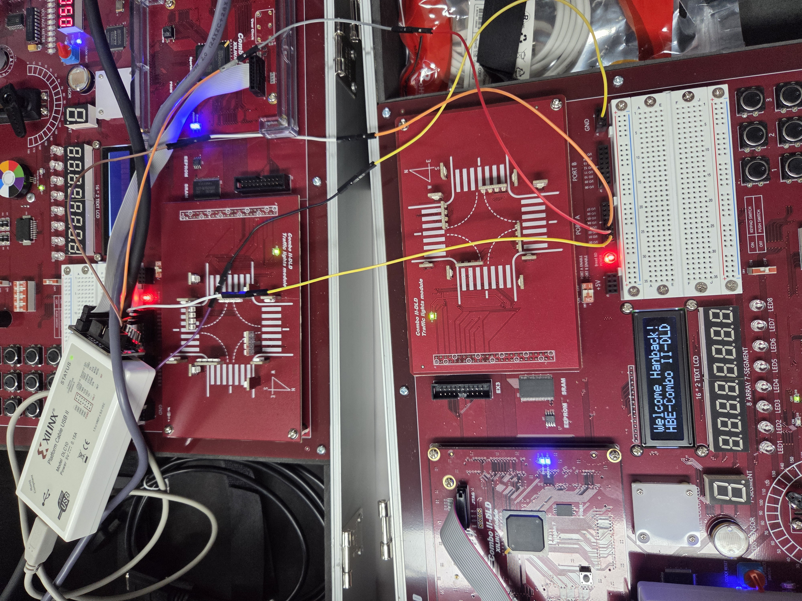

그림 14. 역할 교대 전후 공통으로 사용한 두 FPGA의 SCK, MOSI, CS, GND 연결.

먼저 우리 조가 Slave였을 때 상대 조 FPGA가 Master 역할을 하였다. 상대 조는 DIP 스위치로 송신 데이터를 바꾸었고, 이에 따라 우리 조 FPGA의 UART 수신값도 변하였다. 영상과 캡처에서는 `55`, `A5`, `00`으로 변하는 것을 확인하였다.

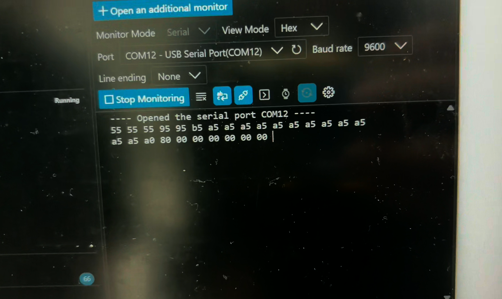

그림 15. 상대 조 Master의 DIP 입력 변화에 따라 우리 조 FPGA UART에서 `55`, `A5`, `00`이 관찰된 장면.

[Task 12 우리 조 Slave 방향 원본 영상](../../evidence/board/LAB7/task12/our_group_rx_dip_to_spi_rx.mp4)

역할을 교대한 뒤에는 우리 조 FPGA가 Task 11 Master의 자동 순환 방식으로 `55`, `A5`, `00`, `FF`를 전송하였다. 상대 조 FPGA의 UART 화면에서 네 값이 반복 수신되는 것을 확인하였다. 상대 조의 DIP 입력 방식과 우리 조의 자동 순환 방식은 시험 데이터 생성 방법만 다르며, 두 방향 모두 같은 Mode 0 SPI 연결을 사용하였다.

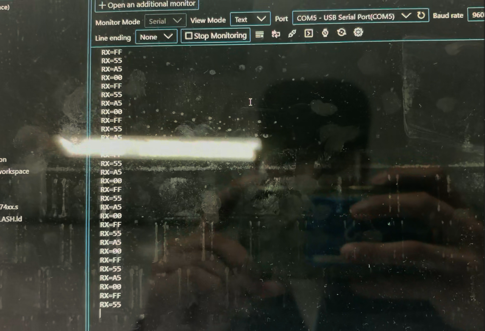

그림 16. 우리 조 Master가 자동 순환 송신한 `55`, `A5`, `00`, `FF`를 상대 조 FPGA UART가 반복 수신한 장면.

[Task 12 우리 조 Master 방향 원본 영상](../../evidence/board/LAB7/task12/our_group_tx_spi_tx_to_other_group.mp4)

## 3. FPGA 구현 결과

Task 10과 Task 11은 Vivado 2026.1에서 `xc7s75fgga484-1`을 대상으로 합성·구현하였다. 50 MHz 입력 clock에는 20 ns constraint를 적용하였고 SPI 신호는 SCK=F8, MOSI=E8, CS=A7에 배정하였다. Task 12는 이 두 설계의 역할을 조합하므로 별도 bitstream을 생성하지 않았다.

| 항목 | Task 10 FPGA Slave | Task 11 FPGA Master |
|---|---:|---:|
| Synthesis / Implementation | 완료 | 완료 |
| Post-route WNS | +15.236 ns | +15.479 ns |
| Post-route WHS | +0.120 ns | +0.163 ns |
| Timing constraint | 만족 | 만족 |
| DRC Error | 0 | 0 |
| Warning | `CFGBVS-1` 1건 | `CFGBVS-1` 1건 |
| Bitstream | 생성 완료 | 생성 완료 |
| Bitstream 크기 | 3,687,025 bytes | 3,687,025 bytes |

`CFGBVS-1`은 configuration bank의 `CFGBVS`와 `CONFIG_VOLTAGE` 속성이 설정되지 않았다는 경고이다. 두 설계 모두 배치·배선과 timing을 완료하고 bitstream 생성 전 DRC Error가 0이었지만, 이 warning을 실제 보드 전압 측정 결과로 해석하지 않았다.

- [Task 10 bitstream](../../evidence/vivado/LAB7/task10/final_pinmap_implementation/task10_mcu_fpga_rx_top.bit)
- [Task 11 bitstream](../../evidence/vivado/LAB7/task11/final_pinmap_implementation/task11_fpga_mcu_tx_top.bit)

합성·구현과 bitstream 생성은 설계가 FPGA에 배치될 수 있음을 확인한 단계이다. 실제 통신 결과는 Task 10~12의 배선, UART, 오실로스코프, 영상 관찰을 통해 별도로 확인하였다.

## 4. 종합 고찰 및 결론

이번 실험에서는 SPI Mode 0에서 CS가 LOW인 동안 SCK 상승 에지로 MOSI를 읽고, 송신 측이 하강 에지에 다음 bit를 준비하는 과정을 파형과 수신 데이터로 확인하였다. STM32와 FPGA는 각각 Master와 Slave 역할로 동작했으며, MCU–FPGA 통신에서도 같은 timing 규칙으로 8-bit 데이터가 전달되었다. 이를 통해 RTL의 edge 처리와 frame 제어가 실제 보드 통신 결과에 직접 연결된다는 점을 확인하였다.

FPGA–FPGA 실험에서는 동일한 물리적 배선을 유지한 채 역할을 교대하였다. 우리 조가 Slave일 때는 상대 조의 DIP 제어 Master를 사용했고, 우리 조가 Master일 때는 자동 순환 방식으로 데이터를 생성하여 두 방향의 실제 통신을 확인하였다. 서로 다른 데이터 생성 방식을 사용해도 Master와 Slave가 같은 SPI 규칙을 따르면 통신할 수 있었으며, 시뮬레이션·구현·보드 관찰을 구분하여 검증하는 과정의 의미도 확인하였다.

## 5. 참고문헌

[1] 전자전기컴퓨터설계실험Ⅱ, 「STM32_3 · SPI로 MCU와 FPGA 연결」, `STM32_3.md`, 2026.
