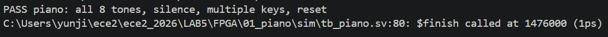
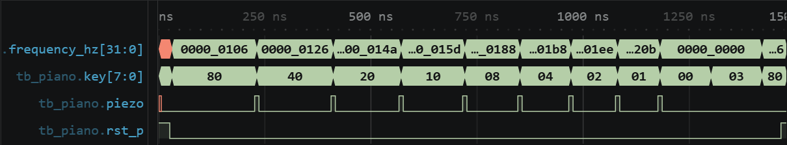
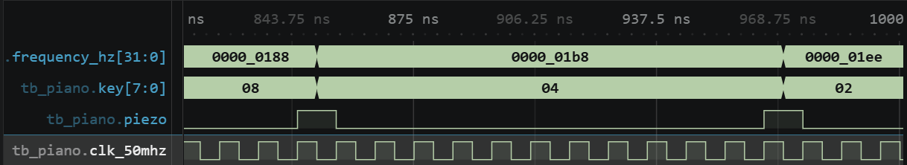
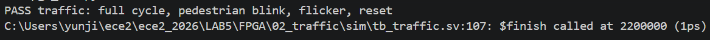
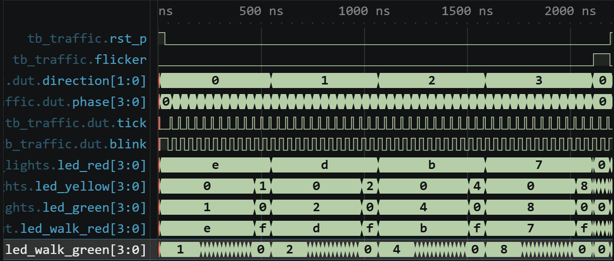
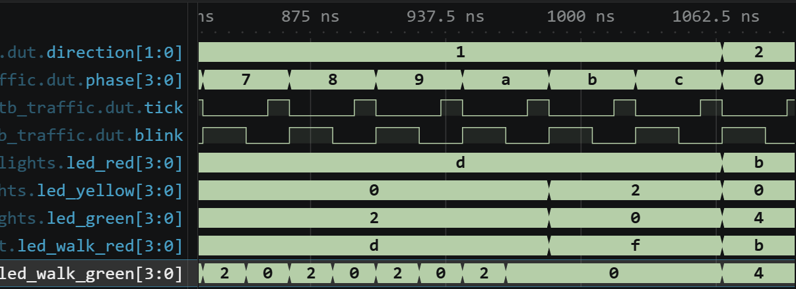
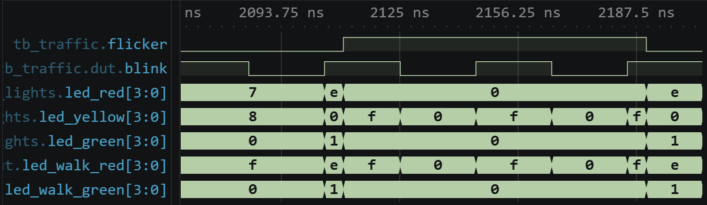
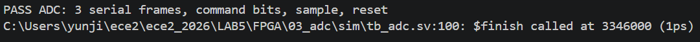
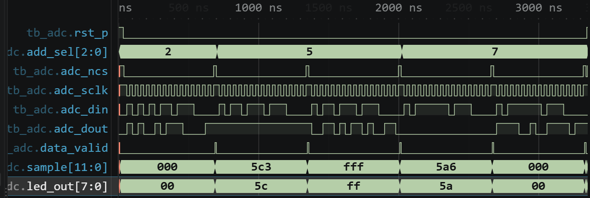
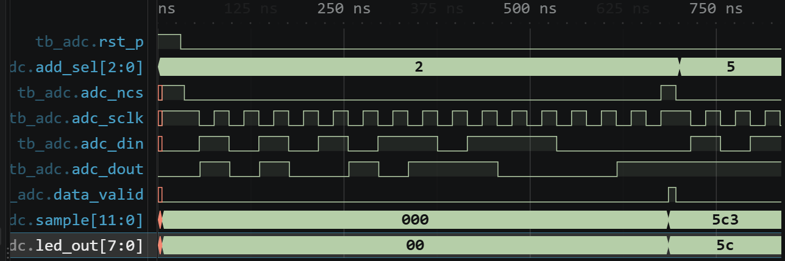

# 전자전기컴퓨터설계실험Ⅱ 실험 전 보고서

# LAB 5 – STM32 인터럽트와 PWM 및 FPGA 응용

| 항목 | 내용 |
|---|---|
| 학과 | 전자전기컴퓨터공학부 |
| 학번/이름 | 2025440032 / 김윤지 |
| 작성일 | 2026.10.14 |
| 대상 | STM32_1 및 FPGA 추가 실습 |
| 검증 환경 | STM32Cube VS Code · CMake/Ninja · GNU Arm toolchain · Icarus Verilog · VaporView |
| 프로젝트 | ece2_2026 / LAB5 |
| 기준 커밋 | 미확정 (PRE 제출용 source commit 생성 후 입력) |
| GitHub 주소 | github.com/yunuos2525-cloud/ece2_2026.git |
| 제출 태그 | `LAB5_PRE_FINAL` (예정, 미생성) |

## 1. 실험 목적

STM32 실험에서는 polling 방식에서 벗어나 button 외부 인터럽트와 TIM6 주기 인터럽트로 입력과 시간을 처리하는 방법을 익힌다. 먼저 button interrupt, TIM6 interrupt, TIM3 PWM의 세 예제를 확인한 뒤, Task 3에서는 버튼을 누를 때 LED 점멸 간격이 1 → 2 → 4 → 8 → 1 s로 바뀌도록 하고 Task 4에서는 PWM duty가 25 → 50 → 75 → 25%로 바뀌도록 구현한다. 변수 변화는 debugger의 Variables와 Watch로 확인하고, 정상 실행에서는 실제 출력 시간을 관찰할 계획이다. 예비실험 단계에서는 다섯 source의 compile, link, ELF 생성을 확인했으며 실제 보드 동작은 실험 당일 검증한다[1].

FPGA 실험에서는 건반 입력에 해당하는 음을 출력하는 Piano, 차량·보행자 신호의 순서를 제어하는 Traffic, 외부 ADC와 16-bit 직렬 통신을 수행하는 ADC 회로를 설계한다. 각 설계의 RTL과 testbench를 Icarus Verilog로 실행해 PASS를 확인하고, VaporView에서 전체 동작과 대표 구간의 신호 변화를 확인하였다. 예비실험의 PASS는 testbench의 자동 검사를 통과했다는 뜻이며, Vivado Behavioral Simulation과 실제 FPGA board 동작은 실험 당일 별도로 확인한다[2][3].

## 2. STM32 실험

### 2.1 인터럽트와 PWM 예제

#### Button interrupt

버튼 입력은 `button_isr_p7()`에서 처리한다. `HAL_GetTick()`으로 현재 시간을 읽고 마지막으로 인정된 입력과의 차이가 200 ms보다 작으면 해당 입력을 무시한다. 이 조건은 버튼 접점의 떨림으로 짧은 시간에 발생한 반복 입력이 여러 번의 누름으로 처리되는 것을 막는다. 유효한 입력일 때에는 `HAL_GPIO_TogglePin(GPIOA, GPIO_PIN_5)`로 PA5 LED 상태를 한 번 바꾼다. `polling_routine()`에는 버튼 처리 코드가 없으므로 버튼 동작은 polling이 아니라 인터럽트로만 수행된다.

```c
void button_isr_p7(void)
{
    uint32_t now = HAL_GetTick();

    if ((now - last_button_ms) < 200U)
        return;

    last_button_ms = now;
    HAL_GPIO_TogglePin(GPIOA, GPIO_PIN_5);
}
```

#### TIM6 interrupt

`ece2_474_init()`에서 `HAL_TIM_Base_Start_IT(&htim6)`를 호출해 TIM6를 동작시키고, 설정된 주기마다 update interrupt가 발생하도록 한다[5]. TIM6가 100 ms마다 interrupt를 발생시키면 `tim6_isr_p4()`가 호출된다. ISR 안에서 호출 횟수를 세고 10회가 되면 count를 0으로 되돌린 뒤 PA5를 toggle하므로, LED 상태는 약 1 s마다 바뀐다. 이 예제에서는 다른 함수가 PA5를 변경하지 않아 TIM6 동작만 관찰할 수 있다.

```c
void tim6_isr_p4(void)
{
    static uint32_t count_100ms = 0U;

    count_100ms++;
    if (count_100ms >= 10U) {
        count_100ms = 0U;
        HAL_GPIO_TogglePin(GPIOA, GPIO_PIN_5);
    }
}
```

#### TIM3 PWM

TIM3는 하드웨어 timer이고, Channel 1은 PB4에 PWM 파형을 출력한다. `HAL_TIM_PWM_Start(&htim3, TIM_CHANNEL_1)`을 호출하면 TIM3 CH1의 PWM 출력이 시작된다. 이어서 compare 값을 500으로 설정하면 한 주기 1000 count 중 500 count 동안 출력이 HIGH가 되므로 duty는 `500 / 1000 = 50%`이다. PWM 주파수는 약 1 kHz이므로 주기는 약 1 ms이고, HIGH와 LOW 시간은 각각 약 0.5 ms이다. 이 예제에는 불필요한 button 또는 TIM6 LED 동작이 없다.

```c
HAL_TIM_PWM_Start(&htim3, TIM_CHANNEL_1);
__HAL_TIM_SET_COMPARE(&htim3, TIM_CHANNEL_1, 500U);
```

### 2.2 Task 3: 인터럽트 기반 LED 점멸 간격 제어

Task 3은 버튼 인터럽트와 TIM6 인터럽트의 역할을 나누어 구현하였다. `button_isr_p7()`는 200 ms debounce 후 `requested_interval_index`를 0 → 1 → 2 → 3 → 0으로 변경한다. `tim6_isr_p4()`는 현재 선택된 간격에 따라 100 ms interrupt 횟수를 세고 PA5를 toggle한다. `polling_routine()`에는 버튼이나 시간 polling이 없다.

| 변수 | 역할 |
|---|---|
| `requested_interval_index` | 버튼 ISR에서 요청한 간격 index |
| `active_interval_index` | TIM6 ISR이 현재 사용 중인 간격 index |
| `elapsed_ticks` | 현재 간격에서 누적한 100 ms tick 수 |
| `interval_ticks[]` | 1, 2, 4, 8 s에 해당하는 `{10, 20, 40, 80}` |

`requested_interval_index`는 버튼 ISR에서 바뀌고 TIM6 ISR에서 읽히므로 `volatile`로 선언하였다. 따라서 compiler가 이전 값을 계속 재사용하지 않고 실행 중의 현재 값을 읽는다. TIM6 ISR에서 `requested_interval_index != active_interval_index`이면 active 값을 새 요청으로 바꾸고 `elapsed_ticks = 0`으로 만든다. 간격이 바뀌는 순간부터 새 간격을 다시 세기 때문에 이전 간격에서 누적된 시간이 새 간격에 섞이지 않는다.

```c
if (requested_interval_index != active_interval_index) {
    active_interval_index = requested_interval_index;
    elapsed_ticks = 0U;
}

elapsed_ticks++;
if (elapsed_ticks >= interval_ticks[active_interval_index]) {
    elapsed_ticks = 0U;
    HAL_GPIO_TogglePin(GPIOA, GPIO_PIN_5);
}
```

TIM6 주기가 100 ms이므로 필요한 tick 수는 다음과 같다.

| 설정 간격 | 계산 | `interval_ticks` |
|---:|---:|---:|
| 1 s | 1 s / 0.1 s | 10 |
| 2 s | 2 s / 0.1 s | 20 |
| 4 s | 4 s / 0.1 s | 40 |
| 8 s | 8 s / 0.1 s | 80 |

추가 검증 방법으로 debugger를 실행하여 button ISR의 interval 변경 코드에 breakpoint를 설정하고 F5로 실행한 뒤 버튼을 누른다. 정지하면 Variables에서 현재 실행 중인 함수의 변수 값을 확인하고, Watch에는 반복해서 관찰할 `requested_interval_index`를 등록하여 버튼 입력마다 0 → 1 → 2 → 3 → 0으로 바뀌는지 확인한다. 다음으로 `tim6_isr_p4()`에 breakpoint를 두고 Watch에 `requested_interval_index`, `active_interval_index`, `elapsed_ticks`를 등록하여 active 값이 갱신되고 elapsed가 0으로 reset되는 흐름을 확인한다.

Breakpoint에서 멈춘 상태는 timer가 정상적인 실시간으로 실행되는 상태가 아니다. 따라서 debugger에서는 변수와 제어 흐름만 확인하고, 실제 timing을 검사할 때에는 모든 breakpoint를 해제한다. 정상 실행에서 버튼을 한 번씩 눌러 1 → 2 → 4 → 8 → 1 s 순서로 바뀌는지, 한 번의 누름마다 한 단계만 이동하는지, 버튼을 길게 눌러도 반복 변경되지 않는지를 확인한다. Debugger의 Variables/Watch 값은 screenshot으로 기록하고, 정상 실행의 버튼과 PA5 LED 동작은 별도의 board video로 기록할 계획이다.

### 2.3 Task 4: 버튼 인터럽트 기반 PWM duty 제어

Task 4에서는 TIM3 CH1이 PB4에 PWM을 출력한다. 초기 `pwm_compare`는 250이고, 초기화 함수에서 PWM을 시작한 뒤 이 값을 compare register에 적용한다. 유효한 버튼 인터럽트가 들어오면 200 ms debounce 후 compare 값이 250 → 500 → 750 → 250으로 순환하며, `__HAL_TIM_SET_COMPARE()`가 새 값을 TIM3 CH1에 반영한다. PWM 주파수는 약 1 kHz로 유지되고 HIGH 시간의 비율만 바뀐다. `polling_routine()`은 PWM 값을 변경하지 않는다.

```c
volatile uint32_t pwm_compare = 250U;

HAL_TIM_PWM_Start(&htim3, TIM_CHANNEL_1);
__HAL_TIM_SET_COMPARE(&htim3, TIM_CHANNEL_1, pwm_compare);
```

| `pwm_compare` | Duty | 약 1 ms 주기에서 HIGH 시간 | LOW 시간 |
|---:|---:|---:|---:|
| 250 | 25% | 0.25 ms | 0.75 ms |
| 500 | 50% | 0.50 ms | 0.50 ms |
| 750 | 75% | 0.75 ms | 0.25 ms |

Debugger를 이용한 검증에서는 button ISR의 `pwm_compare` 변경 코드에 breakpoint를 설정하고 F5로 실행한 뒤 버튼을 누른다. 정지하면 Variables에서 현재 실행 중인 함수의 변수 값을 확인하고, Watch에는 반복해서 관찰할 `pwm_compare`를 등록한다. F10으로 한 줄씩 진행하여 compare 설정 함수에 새 값이 전달되는지 보고, 250 → 500 → 750 → 250 순환을 확인한 뒤에는 breakpoint를 모두 해제한다. 정상 실행에서는 PB4와 GND를 계측기에 연결하여 주기가 약 1 ms로 유지되는지와 HIGH 시간이 0.25, 0.50, 0.75 ms로 변하는지를 측정한다. `pwm_compare`의 변화는 Variables/Watch screenshot으로, 각 duty는 별도의 PWM 파형 화면으로 기록한다[1].

다섯 STM32 source는 실제 project의 기존 CMake/Ninja 방식으로 각각 build하였다. 모두 compile과 link에 성공했고 `ece2_474.elf`가 생성되었으며 warning은 없었다. 이 결과는 source의 build 가능성만 보여 주며, 보드 기능이 검증되었다는 뜻은 아니다.

| 프로그램 | Compile | Link | ELF | Warning |
|---|---|---|---|---:|
| Button interrupt | PASS | PASS | 생성 | 0 |
| TIM6 interrupt | PASS | PASS | 생성 | 0 |
| PWM example | PASS | PASS | 생성 | 0 |
| Task 3 interval ISR | PASS | PASS | 생성 | 0 |
| Task 4 PWM control | PASS | PASS | 생성 | 0 |

### 2.4 STM32 검증 계획

| 대상 | 검증 방법 / 시험 조건 | 예상 결과 | 기록할 자료 |
|---|---|---|---|
| Button interrupt | 보드에 program한 뒤 버튼을 짧게 누르고, 반복해서 누르거나 길게 눌러 본다. | 유효한 한 번의 입력마다 PA5가 한 번 toggle되고, 200 ms debounce로 반복 인식이 방지된다. | 버튼과 PA5가 함께 보이는 board video |
| TIM6 interrupt | TIM6 예제를 실행하여 PA5의 상태가 바뀌는 시간 간격을 관찰한다. | 100 ms interrupt 10회마다 PA5가 toggle되어 상태가 약 1 s마다 바뀐다. | 시간 간격을 판단할 수 있는 board video |
| PB4 PWM example | PB4와 GND를 계측기에 연결하여 주기와 HIGH/LOW 시간을 측정한다. | 약 1 kHz, 주기 1 ms, duty 50%, HIGH/LOW 약 0.5 ms이다. | 계측기 PWM 파형 화면 |
| Task 3 | Debugger의 breakpoint에서 코드를 멈추고 Variables와 Watch로 `requested_interval_index`, `active_interval_index`, `elapsed_ticks`를 확인한다. 모든 breakpoint를 끈 뒤 버튼 입력에 따른 LED 간격과 긴 누름을 시험한다. | `requested`는 0→1→2→3→0, `active`는 새 요청을 반영하고 `elapsed`는 0부터 다시 시작한다. PA5 간격은 1→2→4→8→1 s이며 한 입력당 한 단계만 바뀐다. | Variables/Watch screenshot, PA5 interval board video |
| Task 4 | Debugger의 breakpoint에서 코드를 멈추고 Variables와 Watch로 `pwm_compare`를 확인하며 F10으로 compare 적용을 따라간다. breakpoint를 해제한 뒤 PB4/GND를 계측기에 연결해 버튼 입력 전후 파형을 측정한다. | `pwm_compare`가 250→500→750→250으로 순환하고, 주기는 약 1 ms로 유지되며 duty는 25→50→75→25%로 바뀐다. | Variables/Watch screenshot, PWM 파형 화면 |

## 3. FPGA 실험

### 3.1 Piano

Piano의 입력은 `clk_50mhz`, `rst_p`, `key[7:0]`이고 출력은 `piezo`이다. 신호 흐름은 `key → note_select → frequency_hz → square_tone → piezo`이다. `note_select`는 한 개의 key만 눌렸을 때 음계 주파수를 선택하며, 아무 key도 누르지 않거나 여러 key를 동시에 누르면 0 Hz를 선택하여 무음으로 만든다. `square_tone`은 `half_cycles = CLK_HZ / (2 × frequency_hz)`를 계산하고 그 횟수마다 출력을 반전하여 사각파를 만든다.

| key | 음 | 목표 주파수 |
|---|---|---:|
| `8'h80` | C4 | 262 Hz |
| `8'h40` | D4 | 294 Hz |
| `8'h20` | E4 | 330 Hz |
| `8'h10` | F4 | 349 Hz |
| `8'h08` | G4 | 392 Hz |
| `8'h04` | A4 | 440 Hz |
| `8'h02` | B4 | 494 Hz |
| `8'h01` | C5 | 523 Hz |

Testbench에서는 simulation 시간을 줄이기 위해 `CLK_HZ=10000`을 사용한다. 이 값은 simulation 가속용 parameter일 뿐 실제 보드 clock이 아니다. 8개 key, 무입력, 복수 key, reset을 자동 검사했고 `key=8'h04`의 440 Hz에 대해서는 half period가 약 11 clock인지 대표적으로 확인하였다. PASS log는 이 모든 자동 조건을 통과했다는 근거이고, waveform은 대표 입력에서 `frequency_hz`와 `piezo`가 예상대로 바뀌는지를 직접 확인하는 근거이다.



그림 1. Piano testbench의 전체 자동 검사 PASS.



그림 2. 8개 key와 무입력·복수 key·reset 구간의 전체 파형.

전체 waveform에서는 `key`가 80 → 40 → 20 → 10 → 08 → 04 → 02 → 01 순서로 바뀔 때 각 key에 맞게 `frequency_hz`가 변경되었다. 이어서 `key=00`에서는 `frequency_hz=0`, `piezo=0`이 되었고, 복수 key 입력인 `key=03`에서도 `frequency_hz=0`, `piezo=0`이 되어 8개 음 선택과 두 무음 조건을 함께 확인하였다.



그림 3. 440 Hz 대표 입력에서 frequency 선택과 piezo 반전.

대표 waveform의 시험 조건은 `key=8'h04`, `frequency_hz=32'h0000_01B8`인 440 Hz이며 simulation의 `CLK_HZ`는 10000이다. 예상 half cycle은 `floor(10000 / (2 × 440)) = 11` clock이고, 실제 파형에서도 약 11 simulation clock 뒤 `piezo`가 toggle되어 예상과 일치하였다.

### 3.2 Traffic

Traffic의 입력은 `clk_50mhz`, `rst_p`, `flicker`이고, 출력은 차량 신호 `led_red[3:0]`, `led_yellow[3:0]`, `led_green[3:0]`, `led_left[3:0]`와 보행자 신호 `led_walk_red[3:0]`, `led_walk_green[3:0]`이다. 내부 흐름은 `second_tick → tick/blink → traffic_sequence의 direction/phase → traffic_lights의 출력`이다. `second_tick`의 `tick`은 매초 한 clock 동안만 1이 되는 enable 신호이며 별도의 느린 clock이 아니다. `blink`는 보행자 점멸과 flicker mode의 점멸에 사용된다.

`traffic_sequence`는 tick마다 phase를 증가시키고, phase 12 다음 tick에서 phase를 0으로 되돌리면서 direction을 0 → 1 → 2 → 3 → 0으로 진행한다. `traffic_lights`는 `direction` 값에 따라 현재 신호를 줄 차량 방향과 보행자 방향을 각각 선택한다. 선택된 차량 방향에는 phase에 따라 Green 또는 Yellow를 출력하고, 선택된 보행자 방향에는 Green, 점멸 Green 또는 Red를 출력한다. `led_left`에는 별도의 좌회전 상태 제어가 없으며, 현재 설계에서는 `led_green`과 동일한 4-bit 값이 출력된다.

| phase | 차량 신호 | 보행자 신호 |
|---:|---|---|
| 0–3 | 현재 direction Green, 나머지 Red | 현재 direction Green, 나머지 Red |
| 4–10 | 현재 direction Green, 나머지 Red | 현재 direction Green이 `blink`에 따라 점멸, 나머지 Red |
| 11–12 | 현재 direction Yellow, 나머지 Red | 모든 direction Red |

phase 12의 출력도 위 표의 Yellow/Red 상태이고, 그 다음 tick에서 phase 0과 다음 direction으로 함께 전환된다. `flicker=1`이면 정상 phase 출력 대신 모든 차량 Yellow와 모든 보행자 Red가 `blink`에 맞추어 점멸한다.

Testbench는 전체 phase와 direction 순환, 보행자 점멸, 정상 mode와 flicker mode의 출력, reset을 자동 검사하였다. 특히 phase 10→11의 Green→Yellow 변화와 phase 12→다음 direction phase 0의 전환을 검사한다. PASS log는 이 조건 전체의 자동 판정 결과이고, waveform은 대표 transition과 flicker 구간의 실제 신호 변화를 확인하는 자료이다.



그림 4. Traffic 전체 순환·보행자 점멸·flicker·reset 검사 PASS.



그림 5. direction과 phase가 진행되는 전체 traffic sequence.

전체 waveform에서는 `direction`이 0 → 1 → 2 → 3 → 0으로 순환하고, 각 direction에서 phase 0부터 12까지 진행하였다. 이 과정에서 차량 신호와 보행자 신호가 phase 구간에 따라 바뀌는 것을 확인하였다.



그림 6. Green에서 Yellow로 바뀌고 다음 direction으로 넘어가는 대표 구간.

대표 transition waveform에서는 `direction=1`일 때 phase 10에서 차량 `led_green=4'h2`, `led_yellow=4'h0`이었고, phase 11에서 `led_green=4'h0`, `led_yellow=4'h2`로 바뀌었다. Phase 12 다음 tick에서는 `direction=2`, `phase=0`이 되고 다음 방향의 Green이 시작되어 차량 Green→Yellow 변화와 다음 direction 전환을 확인하였다.



그림 7. flicker mode의 차량 Yellow·보행자 Red 점멸.

Flicker waveform에서는 차량 `led_red=4'h0`, `led_green=4'h0`과 보행자 `led_walk_green=4'h0`이 유지되었다. 차량 `led_yellow`와 보행자 `led_walk_red`는 각각 `4'hF ↔ 4'h0`으로 바뀌어 `blink`에 따라 함께 점멸하는 것을 확인하였다.

### 3.3 ADC

FPGA는 외부 ADC에 channel 선택 command를 보내고 동시에 직렬 응답을 받아 sample과 LED 값으로 만든다. 입력은 `clk_50mhz`, `rst_p`, `add_sel[2:0]`, `adc_dout`이고 출력은 `adc_sclk`, `adc_ncs`, `adc_din`, `led_out[7:0]`, `sample[11:0]`, `data_valid`이다. 신호 흐름은 `add_sel → adc_command → 16-bit command → serial_frame16 → ADC`이며, 돌아온 응답은 `rx_word → sample → led_out` 순서로 전달된다.

직렬 frame의 동작 순서는 다음과 같다.

1. 대기 상태에서는 `adc_ncs=1`, `adc_sclk=1`이다.
2. frame이 시작되면 `adc_ncs=0`이 되고, 16-bit command를 MSB부터 `adc_din`으로 보낸다.
3. `adc_sclk`의 1→0 전환에서 다음 command bit를 내보내고 다음 상승 edge까지 유지한다.
4. `adc_sclk`의 0→1 전환에서 `adc_dout`을 `rx_word`로 읽으며, 이 과정을 16 bit 동안 반복한다.
5. frame이 끝나면 `adc_ncs=1`로 돌아가고 `done/data_valid`가 발생한다. 그때 응답의 12-bit sample을 저장하고 상위 8 bit를 LED에 표시한다.

Testbench는 `add_sel`을 2 → 5 → 7로 바꾸어 세 frame을 실행한다. 각 frame의 bit 수, channel command, 수신 sample, LED 값, reset을 자동 검사하며 판정은 `data_valid`가 발생한 뒤 수행한다. 대표 응답 `16'hA5C3`에서는 `sample=12'h5C3`, `led_out=8'h5C`가 되어야 한다. PASS log는 세 frame과 모든 자동 조건을 통과했다는 근거이고, waveform은 한 대표 frame에서 chip select, serial clock, 송수신 bit와 `data_valid`의 순서를 확인하는 근거이다.



그림 8. ADC 세 serial frame과 command·sample·reset 검사 PASS.



그림 9. 세 channel frame과 data_valid, sample, LED의 전체 파형.

전체 waveform에서는 `add_sel`이 2 → 5 → 7로 바뀌며 세 frame이 진행되었다. 각 frame 동안 `adc_ncs`가 LOW가 되고 `adc_sclk`, `adc_din`, `adc_dout`이 변화했으며, frame 종료 시점마다 `data_valid`가 발생하는 것을 확인하였다.



그림 10. 대표 16-bit frame의 `adc_ncs`, `adc_sclk`, `adc_din`, `adc_dout`.

대표 frame의 시험 조건은 `add_sel=3'd2`, ADC reply `16'hA5C3`이다. 예상값은 `sample=12'h5C3`, `led_out=8'h5C`이며, 실제 waveform에서도 frame 끝의 `data_valid` 시점에 `sample=12'h5C3`, `led_out=8'h5C`가 관찰되어 예상과 일치하였다.

### 3.4 FPGA 검증 계획

실험 당일의 공통 순서는 Vivado에서 Create Project → Design Sources와 Design Top 지정 → Simulation Sources와 Simulation Top 지정 → XDC 추가 → Behavioral Simulation 실행 → testbench PASS 확인 → 대표 waveform 확인 → Icarus 결과와 비교 → synthesis → implementation → bitstream 생성 → Program Device → board 동작 확인 → evidence 기록 순서로 진행한다. RTL과 TB는 예비실험에서 검토한 파일을 그대로 사용하고, XDC는 기존에 확인한 핀을 유지하되 Traffic의 차량·보행자 LED 출력 핀과 ADC의 `adc_sclk`, `adc_ncs`, `adc_din`, `adc_dout` 핀만 장비 핀맵에서 확인하여 완성한 뒤 적용한다. Source가 바뀌면 변경 내용을 별도로 기록한다[3][4].

| 대상 | 검증 방법 / 시험 조건 | 예상 결과 | 기록할 자료 |
|---|---|---|---|
| Piano | Program Device 후 8개 key를 각각 누르고, 무입력, 두 개 이상의 key 동시 입력, reset을 시험한다. | one-hot key 입력에서는 해당 음이 출력되고, 무입력과 multiple key 입력에서는 무음이 되며, reset 후 초기 상태로 돌아간다. | Program Device 화면, 8개 key와 무입력·복수 key·reset의 board video |
| Traffic | 기존에 작성한 XDC의 `clk_50mhz`, `rst_p`, `flicker` 핀을 사용하고, 아직 확정하지 않은 차량 및 보행자 LED 출력 핀을 장비 핀맵에서 확인하여 적용한다. Program Device 후 정상 신호 순서, 차량 Green→Yellow, direction 전환, 보행자 Green 점멸, flicker mode와 reset을 확인한다. | 정상 mode에서 차량·보행자 신호가 순서대로 바뀐다. flicker mode에서는 차량 Yellow와 보행자 Red가 점멸하며 reset 후 초기 상태로 돌아간다. | Program Device 화면, 정상 순환과 flicker mode의 board video |
| ADC | 기존에 작성한 XDC의 입력 및 LED 핀을 사용하고, 아직 확정하지 않은 `adc_sclk`, `adc_ncs`, `adc_din`, `adc_dout`의 장비 핀을 확인한 뒤 Vivado에서 적용한다. 이후 Program Device 후 실제 ADC를 연결하고 channel을 선택한 상태에서 analog input을 변화시키며 sample과 LED 표시를 확인한다. | 선택 channel의 16-bit frame이 발생하고, analog input에 따라 변환 sample과 `led_out` 표시가 바뀐다. | Program Device 화면, pin 확인 근거, analog 입력 조건, digital 파형 화면과 LED 동작 영상 |

## 4. 참고문헌

[1] 전자전기컴퓨터설계실험Ⅱ, 「STM32 강의자료」, `STM32_1.md`, 2026.

[2] 전자전기컴퓨터설계실험Ⅱ, 「FPGA 추가 실험자료」, `FPGA_additional.md`, 2026.

[3] 전자전기컴퓨터설계실험Ⅱ, 「실험 수행 및 보고서 작성 지침」, `index.md`, 2026.

[4] 전자전기컴퓨터설계실험Ⅱ, 「LAB 4 예비보고서」, `LAB4_pre_report.md`, 2026.

[5] STMicroelectronics, `stm32g4xx-hal-driver`, GitHub repository, commit `a6001282dfacfff57e9710250f15e4333b578865`, 확인일 2026.10.07, https://github.com/STMicroelectronics/stm32g4xx-hal-driver.
