# 전자전기컴퓨터설계실험Ⅱ 실험 전 보고서

# LAB 6 – STM32 UART 통신 및 FPGA 응용 실습

| 항목 | 내용 |
|---|---|
| 학과 | 전자전기컴퓨터공학부 |
| 학번/이름 | 2025440032 / 김윤지 |
| 작성일 | 2026.10.20 |
| 대상 | STM32_2 및 FPGA 추가 실습 |
| 검증 환경 | STM32Cube VS Code · CMake/Ninja · GNU Arm toolchain · Icarus Verilog 12.0(devel) · VaporView · Vivado 2026.1 |
| 프로젝트 | ece2_2026 / LAB6 |
| 기준 커밋 | 2ffbee0 |
| GitHub 주소 | github.com/yunuos2525-cloud/ece2_2026.git |
| 제출 태그 | LAB6_PRE_FINAL |

## 1. 실험 목적

STM32 실험에서는 PC의 문자를 UART2 VCP로 수신하고, 수신한 한 바이트를 UART3를 통해 FPGA로 전달하는 과정을 익힌다. 과제 5에서는 문자와 ASCII 바이트 값을 구분하여 출력하고, 과제 6에서는 PC → MCU → FPGA → PC의 데이터 경로를 구성한다. 과제 7에서는 FPGA가 받은 문자 `0`, `1`, `2`를 해석하여 LED를 끄거나 켜거나 반전하도록 확장한다. 예비실험에서는 세 프로그램의 compile과 link를 확인하고, MCU와 FPGA를 연결하기 전에 FPGA UART 회로의 수신·재전송 및 LED 명령 처리를 testbench로 검사하였다[1].

FPGA 추가 실습에서는 20 ms 주기의 PWM을 만드는 Servo, 16-bit 양방향 데이터 버스를 사용하는 SRAM, 8-bit 증가 데이터를 병렬로 전달하는 DAC 회로를 설계한다. 각 회로는 입력 조건과 예상값을 testbench에 작성하고, VVP 자기검사 로그와 VCD 캡처에서 시간에 따른 신호 관계를 비교하였다. Servo·SRAM·DAC의 XDC는 Vivado 2026.1과 `xc7s75fgga484-1`을 대상으로 포트, 핀, I/O 표준을 검사하였다. 이 결과는 디지털 설계와 핀 제약의 사전 검증이며, 실제 UART 통신, 메모리 접근, 서보 각도 및 DAC 아날로그 출력은 실험 당일 보드에서 확인한다[2][3].

## 2. STM32 UART 실험

### 2.1 과제 5: PC와 MCU의 문자 입출력

UART2는 STM32 보드의 ST-LINK USB를 통해 PC의 VCP와 연결된다. Serial Monitor를 9600 baud, 8 data bit, parity 없음, 1 stop bit로 설정하고 줄바꿈 없이 한 문자를 보내면 `getchar()`가 정수형으로 문자를 읽는다. 입력이 `EOF`가 아닐 때 하위 8 bit를 `uint8_t`로 변환하여 문자와 16진수 바이트 값을 함께 출력한다.

```c
int ch = getchar();

if (ch != EOF) {
    uint8_t byte = (uint8_t)ch;
    printf("received: %c, byte: 0x%02X\r\n",
           ch, (unsigned int)byte);
}
```

코드 1. UART2로 받은 문자와 ASCII 바이트 값을 출력하는 과제 5의 핵심 코드.

문자 `'1'`, `'A'`, `'a'`는 화면에 보이는 모양과 내부 바이트 값이 서로 다르다. ASCII 표에 따라 예상 출력은 각각 `0x31`, `0x41`, `0x61`이다. 실제 문자 수신 결과는 보드에 program한 뒤 Serial Monitor에서 세 문자를 각각 보내 확인할 계획이다.

| 입력 문자 | 예상 ASCII 값 | 확인할 출력 |
|---|---:|---|
| `'1'` | `0x31` | `received: 1, byte: 0x31` |
| `'A'` | `0x41` | `received: A, byte: 0x41` |
| `'a'` | `0x61` | `received: a, byte: 0x61` |

### 2.2 과제 6: MCU에서 FPGA로 UART 데이터 전송

과제 6의 데이터 경로는 PC → UART2 VCP → MCU → UART3 → FPGA → FPGA USB-UART → PC이다. MCU는 `getchar()`로 받은 한 바이트를 `HAL_UART_Transmit()`에 전달한다. 전송 길이는 1 byte이고 timeout은 100 ms이며, 반환값 0은 STM32 송신 함수가 `HAL_OK`로 끝났다는 뜻이다. 이 값만으로 FPGA 수신 성공을 판단할 수 없으므로 FPGA 쪽 수신 데이터와 재전송 결과를 별도로 확인해야 한다[1].

```c
uint8_t data = (uint8_t)ch;
HAL_StatusTypeDef result =
    HAL_UART_Transmit(&huart3, &data, 1U, 100U);
printf("UART3 transmit byte 0x%02X, result: %d\r\n",
       (unsigned int)data, (int)result);
```

코드 2. PC에서 받은 한 바이트를 UART3로 전달하는 과제 6의 핵심 코드.

FPGA의 `uart_rx`는 start bit 중앙을 확인한 뒤 8 data bit를 LSB부터 수신하고 stop bit가 HIGH이면 `rx_valid`를 한 clock 발생시킨다. `lab6_uart_echo`는 이때 `rx_data`를 `tx_data`와 LED에 저장하고, 송신기가 준비된 경우 동일한 바이트를 `uart_tx`로 다시 보낸다. 50 MHz 클록과 9600 baud를 기준으로 UART 1비트당 약 5208클록을 사용한다. Testbench에서는 실행 시간을 줄이기 위해 `CLK_HZ=800`, `BAUD=100`, `DIV=8`을 사용하고 `0x31`, `0x41`, `0x61`의 세 바이트를 검사하였다.

시험 조건에서 예상한 결과는 각 수신 완료 시 `rx_data`와 LED가 입력 바이트로 바뀌고, `uart_txd`가 같은 바이트를 전송하는 것이다. VVP 로그는 세 비교가 모두 통과했음을 표시하였다.

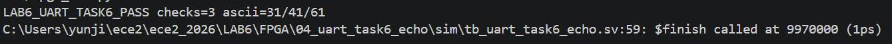

그림 1. `0x31`, `0x41`, `0x61`의 UART 수신·재전송 자동 검사 PASS.

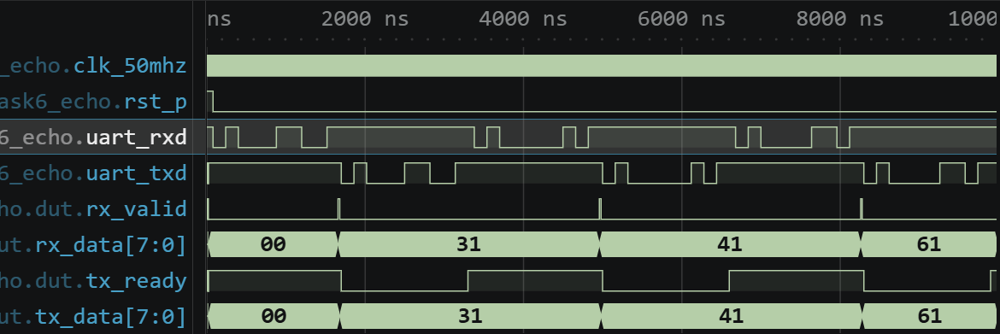

그림 2. 세 문자의 UART RX/TX와 `rx_valid`, `rx_data`, `tx_data` 전체 파형.

전체 파형에서 `uart_rxd`로 세 serial frame이 들어오고 각 frame의 stop bit 확인 뒤 `rx_valid`가 한 번씩 발생하였다. 이에 따라 `rx_data`와 `tx_data`가 `00 → 31 → 41 → 61`로 바뀌고 `uart_txd`에도 대응하는 재전송 frame이 나타났다.

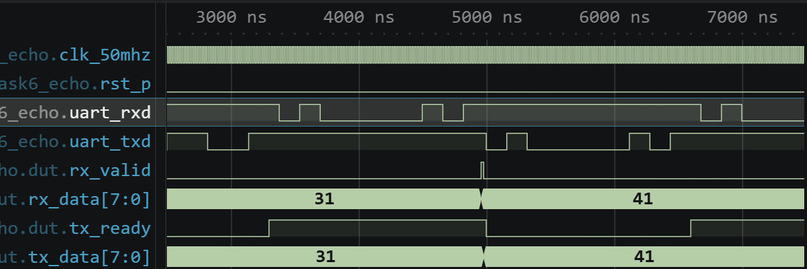

그림 3. 문자 `'1'`과 `'A'`를 수신하고 같은 값으로 재전송하는 대표 구간.

대표 구간에서는 첫 수신 완료 시 `rx_data=8'h31`, `tx_data=8'h31`이 되고, 다음 frame에서는 두 값이 `8'h41`로 바뀌었다. 예상한 ASCII 값과 관찰값이 같으므로 UART 수신 결과가 송신 회로에 전달되는 디지털 동작을 확인하였다.

### 2.3 과제 7: UART 명령으로 FPGA LED 제어

STM32는 과제 6과 같이 PC에서 받은 한 바이트를 UART3로 전달한다. FPGA의 `lab6_uart_led`는 수신 완료 시 ASCII 문자 `0`, `1`, `2`를 구분한다. `0x30`은 LED를 0으로, `0x31`은 1로 만들고, `0x32`는 현재 상태를 반전한다. 이외의 값은 상태를 유지한다. 동시에 받은 명령을 UART TX로 재전송하여 PC에서 명령 수신 여부를 확인할 수 있게 하였다.

```verilog
if (rx_valid) begin
    case (rx_data)
        8'h30: led_state <= 1'b0;
        8'h31: led_state <= 1'b1;
        8'h32: led_state <= ~led_state;
        default: led_state <= led_state;
    endcase
end
```

코드 3. ASCII 명령에 따라 FPGA LED 상태를 변경하는 과제 7의 핵심 RTL.

Testbench의 입력 순서는 `0, 1, 1, 2, 2, X, 0, 2`이고 예상 LED 상태는 `0, 1, 1, 0, 1, 1, 0, 1`이다. 따라서 `1`을 반복해도 ON 상태가 유지되고, `2`를 두 번 입력하면 매번 반전되며, 정의하지 않은 `X(0x58)`에서는 직전 상태가 유지되어야 한다. 또한 각 명령의 echo, framing error 미발생, 마지막 reset 후 LED OFF를 검사하였다.

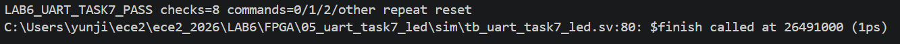

그림 4. 8개 명령, 반복 입력, 기타 문자 및 reset 자동 검사 PASS.

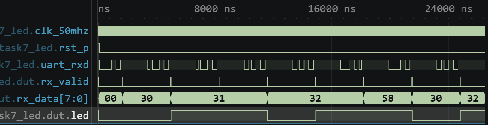

그림 5. 명령 `0, 1, 1, 2, 2, X, 0, 2`에 따른 수신 데이터와 LED 전체 파형.

전체 파형에서 `rx_data`가 `30 → 31 → 31 → 32 → 32 → 58 → 30 → 32`로 바뀌었다. LED는 첫 `31`에서 HIGH가 된 뒤 반복 `31`에서 유지되고, 두 번의 `32`마다 LOW와 HIGH로 반전되었다. `58`에서는 HIGH를 유지하고, 마지막 `30`과 `32`에서 LOW와 HIGH로 순서대로 바뀌어 예상 상태열과 일치하였다.

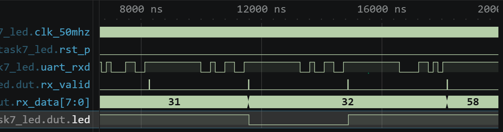

그림 6. 반복 `'1'`, 반전 `'2'`, 기타 문자 `'X'`의 대표 LED 상태 변화.

대표 구간에서는 `rx_data=8'h31` 동안 LED가 HIGH로 유지되다가 `8'h32` 수신 완료 후 LOW로 반전되었고, 이어지는 `8'h58`에서는 LOW 상태가 유지되었다. 명령을 받은 순간이 아니라 `rx_valid`가 발생한 수신 완료 시점에 상태가 바뀌므로 UART frame과 LED 제어가 분리되어 동작함을 알 수 있다.

### 2.4 STM32 build 결과와 보드 검증 계획

| 프로그램 | Compile/Link | RAM | FLASH | 실제 기능 검증 계획 |
|---|---|---:|---:|---|
| 과제 5 PC↔MCU | PASS | 2640 B (2.01%) | 27752 B (5.29%) | UART2 VCP에서 `1`, `A`, `a`를 보내 문자와 ASCII 출력 비교 |
| 과제 6 MCU→FPGA | PASS | 2640 B (2.01%) | 27788 B (5.30%) | MCU PC10(TX)과 FPGA 확장 RX 및 GND를 연결하고 두 COM port에서 입력·수신 비교 |
| 과제 7 UART LED | PASS | 2640 B (2.01%) | 27788 B (5.30%) | `0`, `1`, 반복 `1`, 반복 `2`, 기타 문자를 보내 FPGA LED와 echo 관찰 |

과제 6·7에서는 MCU와 FPGA를 모두 9600 baud, 8N1로 맞추고, 공통 GND를 먼저 연결한다. MCU VCP와 FPGA USB-UART는 서로 다른 COM port로 열어 MCU 송신 결과와 FPGA 수신 결과를 구분한다. 현재 MCU→FPGA 확장 RX의 실제 PACKAGE_PIN은 확정되지 않았으므로 장비 핀맵과 커넥터 위치를 확인하기 전에는 연결하거나 bitstream을 생성하지 않는다.

## 3. FPGA 추가 실습

### 3.1 Servo: PWM 기반 서보모터 제어

Servo 회로는 `servo_position`, `servo_pwm`, `servo_ctrl`의 세 모듈로 구성된다. Testbench에서는 `left_pulse`와 `right_pulse`를 한 clock 동안 인가하므로 입력 1회마다 펄스 폭이 100 µs씩 감소하거나 증가한다. `servo_position`은 reset에서 1500 µs로 시작하고 범위를 1000~2000 µs로 제한하며, 두 입력이 동시에 1이면 위치를 바꾸지 않는다. `servo_pwm`은 50 Hz, 즉 20 ms frame을 만들고 frame 경계에서만 새 `pulse_us`를 `width_cycles`로 저장하여 진행 중인 펄스가 중간에서 잘리지 않게 한다[2].

현재 `servo_board_top`은 물리 입력을 `left_pulse`와 `right_pulse`에 직접 연결하며 동기화, 디바운스 및 1-clock pulse 생성 회로를 포함하지 않는다. 따라서 버튼을 길게 누르면 `servo_position`이 50 MHz clock마다 100 µs씩 변경되어 곧바로 1000 µs 또는 2000 µs의 제한값에 도달할 수 있고, 접점 떨림도 여러 입력으로 인식될 수 있다. 실제 보드 실험 전에는 버튼 입력 처리 회로의 연결 여부를 확인해야 한다.

```verilog
localparam integer FRAME_CYCLES = CLK_HZ / 50;

if (count == FRAME_CYCLES - 1) begin
    count <= 0;
    width_cycles <= pulse_us * (CLK_HZ / 1000) / 1000;
end

assign servo = !rst_p && (count < width_cycles);
```

코드 4. 20 ms frame 경계에서 새로운 서보 펄스 폭을 적용하는 RTL.

실제 50 MHz에서는 한 frame이 `50,000,000 / 50 = 1,000,000` clock이고, 1.0/1.5/2.0 ms의 HIGH 폭은 각각 50,000/75,000/100,000 clock이다. Testbench는 시간을 줄이기 위해 `TEST_CLK_HZ=100,000`을 사용하므로 한 frame은 2000 clock, 세 HIGH 폭은 100/150/200 clock으로 축소된다. Testbench clock 주기가 10 ns이므로 캡처에서는 frame 20,000 ns와 HIGH 구간 1000/1500/2000 ns로 보인다. 축소 parameter는 clock 수 비율을 검사하기 위한 것으로 실제 보드의 20 ms 시간을 대신하지 않는다.

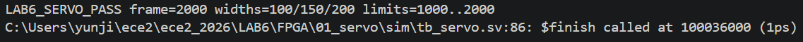

그림 7. 2000-clock frame, 세 펄스 폭, 범위 제한, 동시 입력 및 reset 검사 PASS.

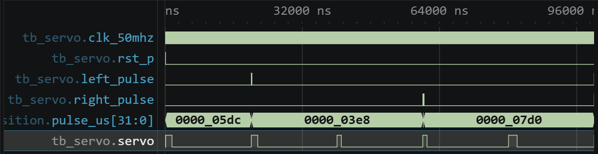

그림 8. `pulse_us`와 Servo PWM이 1500, 1000, 2000으로 변하는 전체 파형.

전체 파형에서 reset 해제 후 `pulse_us=1500`이 적용되고, 왼쪽 입력 반복 뒤 `1000`, 오른쪽 입력 반복 뒤 `2000`으로 바뀌었다. 각 값은 다음 frame부터 PWM HIGH 폭에 반영되었고 범위를 넘지 않았다.

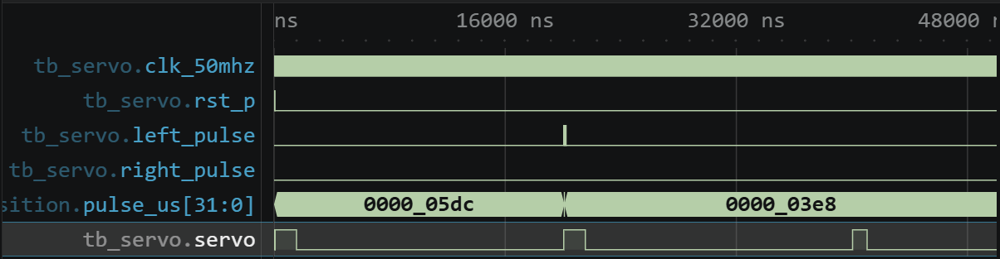

그림 9. `pulse_us`가 1500에서 1000으로 바뀐 뒤 다음 frame의 HIGH 폭이 줄어드는 대표 구간.

대표 파형에서 `left_pulse` 뒤 `pulse_us`가 1500에서 1000으로 감소했지만 진행 중인 PWM pulse는 즉시 잘리지 않았다. 다음 2000-clock frame에서 HIGH count가 150에서 100으로 줄어 예상한 frame 경계 갱신과 일치하였다. 실제 서보에서는 PWM 주기와 HIGH 시간을 계측기로 먼저 확인한 뒤 1.0, 1.5, 2.0 ms에서 모터 각도가 변하는지 관찰할 계획이다.

### 3.2 SRAM: 메모리 읽기·쓰기

SRAM 회로는 4-bit 입력 주소를 18-bit `ram_address`의 하위 비트에 연결하고, 4-bit 입력 데이터를 16-bit `ram_data`의 하위 비트에 출력한다. `ram_cs`, `ram_oe`, `ram_we`는 모두 LOW 활성이다. 쓰기 요청만 있을 때 FPGA가 `ram_data`를 구동하고 제어값은 `{CS, OE, WE}=3'b010`이다. 읽기 요청만 있을 때 FPGA는 버스를 High-Z로 해제하고 외부 SRAM이 데이터를 구동하며 제어값은 `3'b001`이다. 두 요청이 동시에 들어오면 충돌을 피하기 위해 읽기와 쓰기를 모두 무시하고 `3'b111` 및 High-Z 상태가 된다.

```verilog
assign drive_data = ctrl_w && !ctrl_r;
assign read_data  = ctrl_r && !ctrl_w;
assign ram_data = drive_data ? {12'b0, data_in} : 16'bz;
assign led_out = read_data ? {4'b0, ram_data[3:0]} : 8'b0;
```

코드 5. SRAM의 읽기·쓰기 요청을 분리하고 양방향 데이터 버스를 제어하는 RTL.

Testbench는 주소 0~15에 `15-address`를 차례로 쓴 뒤 같은 주소를 읽는다. 따라서 주소 0, 1, 2의 예상 데이터와 LED 하위 nibble은 각각 `F`, `E`, `D`이다. 각 접근 뒤 비활성 구간에서 `ram_data=16'hzzzz`인지 확인하고, 마지막에는 읽기와 쓰기를 동시에 요청하여 버스가 해제되는지 검사한다. 사용한 SRAM model은 디지털 기능만 나타내므로 실제 장치의 ns 단위 접근·setup·hold 시간은 포함하지 않는다[2].

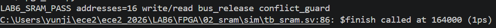

그림 10. 16개 주소의 write/read, 버스 해제 및 동시 요청 보호 검사 PASS.

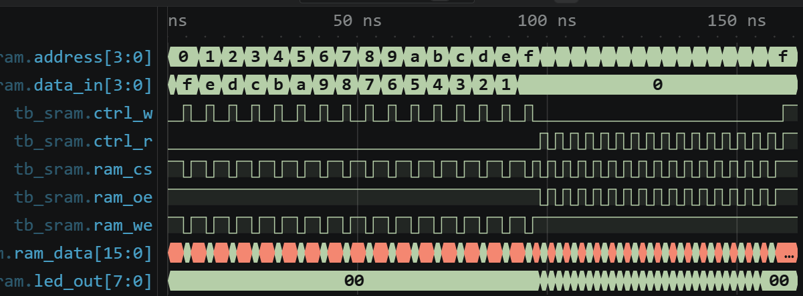

그림 11. 주소 0~15에 대한 write 구간과 read 구간의 전체 파형.

전체 파형에서 write 구간의 `address`가 0에서 F까지 증가하는 동안 `data_in`과 `ram_data`가 F에서 0까지 감소하였다. Read 구간에서는 같은 주소 순서로 저장값이 다시 나타났으며 각 활성 구간 사이에는 버스가 `zzzz`로 해제되었다.

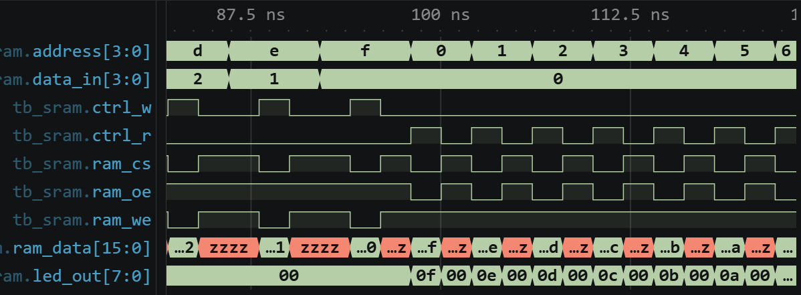

그림 12. 마지막 write와 주소 0, 1, 2의 read 및 High-Z 전환 대표 구간.

대표 파형에서 write의 마지막 주소 D, E, F에 데이터 2, 1, 0이 구동된 뒤 read가 시작되었다. 주소 0, 1, 2에서는 `ram_data`가 각각 `000F`, `000E`, `000D`로 나타났고 `led_out`도 `0F`, `0E`, `0D`로 일치하였다. Read가 비활성인 사이에는 버스와 LED가 각각 High-Z와 0으로 돌아가 예상한 버스 방향 제어와 일치하였다. 실제 보드에서는 먼저 제어 신호의 활성 극성을 확인하고, 여러 주소에 서로 다른 값을 쓴 뒤 읽은 값과 비교하며 접근 시간 조건도 함께 검토할 계획이다.

### 3.3 DAC: 8-bit 병렬 출력 제어

DAC 회로는 `ramp8`이 0부터 255까지 증가하는 8-bit 값을 만들고, `dac_parallel8`이 채널과 데이터를 출력한 뒤 한 clock 길이의 LOW `dac_wen` pulse를 발생시킨다. 기본 `UPDATE_CYCLES=500,000`이므로 50 MHz에서 `500,000 / 50,000,000 = 10 ms`마다 다음 값을 준비한다. `dac_csn`과 `dac_ldacn`은 LOW로 유지되고 `add_sel`은 `dac_a_b`에 저장되어 채널을 선택하며, LED는 DAC 데이터와 같은 값을 표시한다.

최종 회로에서는 데이터와 WE가 같은 edge에서 바뀌지 않도록 `update`에서 데이터와 채널을 먼저 register에 저장하고 `write_pending`을 설정한다. 다음 clock에만 `we_n`을 LOW로 내려 데이터 setup 시간을 한 clock 확보하고, 그 동안 데이터와 채널을 유지한다.

```verilog
we_n <= 1'b1;
if (write_pending) begin
    we_n <= 1'b0;
    write_pending <= 1'b0;
end else if (update) begin
    data <= value;
    a_b <= channel;
    write_pending <= 1'b1;
end
```

코드 6. 데이터와 채널을 먼저 등록하고 다음 clock에 DAC write pulse를 만드는 RTL.

Testbench에서는 `UPDATE_CYCLES=4`로 줄여 260회 쓰기를 실행한다. 쓰기 순번을 0부터 계산할 때, 인덱스 252~259의 예상 데이터는 `FC, FD, FE, FF, 00, 01, 02, 03`이다. 각 write에서 WE LOW 폭 1 clock, 데이터·채널의 setup/hold, LED와 데이터의 일치, 130회 뒤 채널 전환, 255→0 순환을 검사한다.

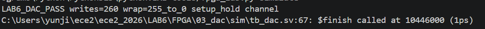

그림 13. 260회 쓰기, 255→0 순환, setup/hold 및 channel 검사 PASS.

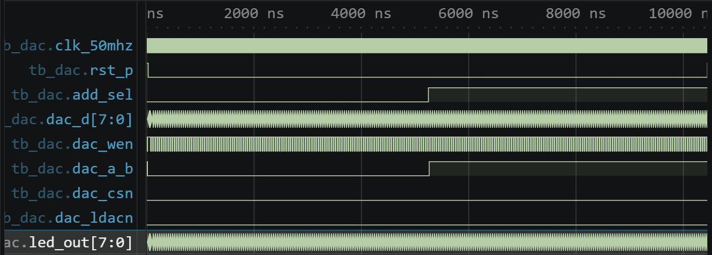

그림 14. 반복되는 DAC write pulse와 중간의 channel 전환 전체 파형.

전체 파형에서 `dac_wen`은 값마다 한 clock 동안 LOW가 되었고 `dac_d`와 `led_out`은 같은 순서로 증가하였다. 약 130회 write 뒤 `add_sel`이 바뀌자 `dac_a_b`도 다음 데이터 준비 시점에 새 채널 값으로 바뀌었다.

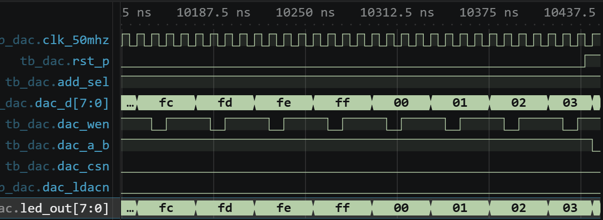

그림 15. `FC → FD → FE → FF → 00 → 01 → 02 → 03`의 순환과 WE pulse 대표 구간.

대표 파형에서 `dac_d`와 LED가 `FC, FD, FE, FF, 00, 01, 02, 03`으로 증가하였다. 각 데이터는 `dac_wen`이 LOW가 되기 한 clock 전에 바뀌고 LOW 구간 동안 유지되어 예상한 setup/hold 구조와 일치하였다. 이 파형은 디지털 입력 순서만 검증한 것이므로 실제 보드에서는 write pulse 폭과 데이터 안정 구간을 측정한 뒤, 계측기로 채널별 아날로그 출력 전압의 변화와 255→0 전환을 확인할 계획이다.

## 4. 실제 보드 실험 계획

| 실험 | 보드에서 수행할 시험 | 예상 결과 | 기록할 자료 |
|---|---|---|---|
| 과제 5 | UART2 VCP 9600 8N1에서 `1`, `A`, `a`를 줄바꿈 없이 전송 | 문자와 `31`, `41`, `61`의 ASCII 값이 함께 출력 | Serial Monitor 화면 |
| 과제 6 | 확장 RX 핀을 장비 자료로 확정한 뒤 MCU PC10(TX), FPGA RX, 공통 GND 연결 | MCU로 보낸 세 문자가 FPGA USB-UART에서 동일하게 수신 | 두 COM port 화면과 연결 사진 |
| 과제 7 | 과제 6 연결에서 `0`, `1`, `2`, 기타 문자를 반복 전송 | OFF, ON, 매회 반전, 상태 유지가 명령표와 일치 | 명령 화면과 LED 영상 |
| Servo | Program Device 후 reset, 좌·우 입력과 동시 입력 시험, PWM 측정 | 20 ms 주기, 1.0~2.0 ms 범위와 중앙 1.5 ms, 입력별 각도 변화 | 계측 파형과 서보 영상 |
| SRAM | 주소별 값을 write한 뒤 read하고 제어선·버스 방향 측정 | 저장값과 read/LED 값 일치, 비활성 시 버스 해제 | logic analyzer 파형과 LED 영상 |
| DAC | 두 channel에서 증가 데이터와 WE를 측정하고 analog 출력 관찰 | 데이터·LED 증가, 255→0 순환, 채널별 출력 변화 | digital 파형과 전압 측정 화면 |

UART 과제 6·7의 MCU→FPGA 확장 RX 핀은 아직 미확정이며, 실제 보드 실험 전에 핀 배치를 확인할 예정이다.

## 5. 참고문헌

[1] 전자전기컴퓨터설계실험Ⅱ, 「STM32_2 · 컴퓨터와 FPGA 통신」, `STM32_2.md`, 2026.

[2] 전자전기컴퓨터설계실험Ⅱ, 「FPGA 추가 실험자료」, `FPGA_additional.md`, 2026.

[3] 전자전기컴퓨터설계실험Ⅱ, 「LAB6 XDC Pin Status」, `LAB6/XDC_PIN_STATUS.md`, 2026.

[4] 전자전기컴퓨터설계실험Ⅱ, 「실험 수행 및 보고서 작성 지침」, `index.md`, 2026.
