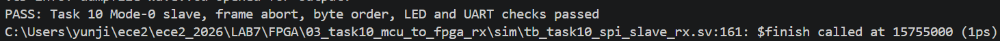
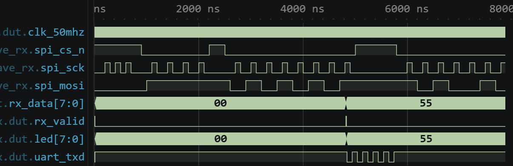
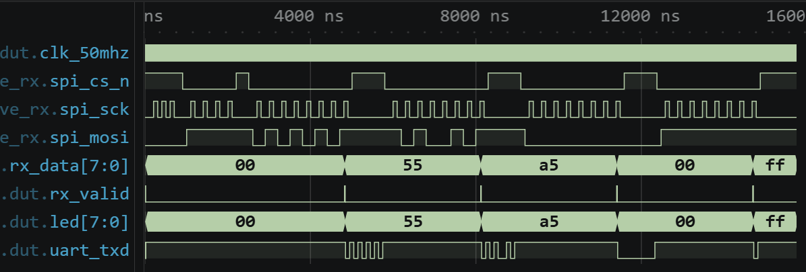
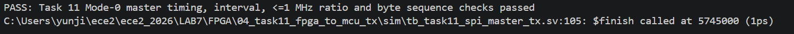
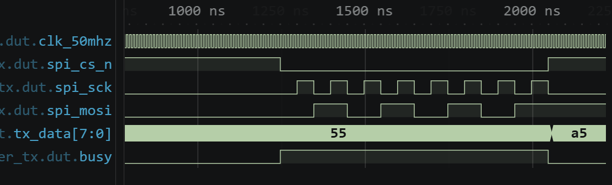
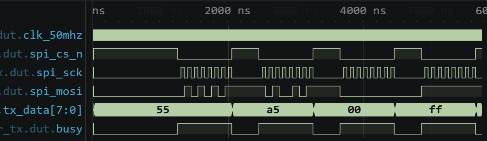
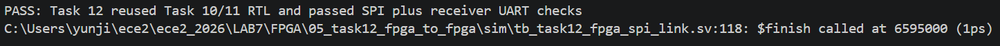
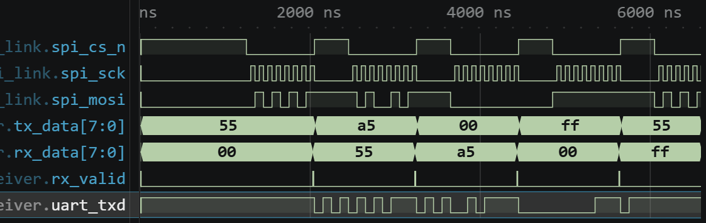

# 전자전기컴퓨터설계실험Ⅱ 실험 전 보고서

# LAB 7 – STM32 SPI 통신 및 FPGA 송수신 설계

| 항목 | 내용 |
|---|---|
| 학과 | 전자전기컴퓨터공학부 |
| 학번/이름 | 2025440032 / 김윤지 |
| 작성일 | 2026.10.31 |
| 대상 | STM32_3 · SPI 과제 8~12 |
| 검증 환경 | STM32Cube VS Code · CMake/Ninja · GNU Arm Toolchain 14.3.1 · Icarus Verilog 12.0(devel) · VaporView · Vivado 2026.1 |
| 프로젝트 | ece2_2026 / LAB7 |
| 소스 기준 커밋 | `1e69c7b429118837470b16dd66aad4200ce98108` |
| GitHub | <https://github.com/yunuos2525-cloud/ece2_2026> |
| 제출 태그 | `LAB7_PRE_FINAL` |

## 1. 실험 목적 및 설계 개요

이번 실험에서는 SPI Mode 0을 이용하여 MCU와 FPGA 사이에서 한 바이트씩 데이터를 전달한다. 과제 8에서는 STM32가 만든 SCK, MOSI, CS 파형을 오실로스코프로 확인하고, 과제 9에서는 두 STM32를 Master와 Slave로 연결하여 수신값을 비교한다. 과제 10에서는 FPGA SPI Slave를 설계하여 MCU가 보낸 데이터를 LED와 FPGA UART로 출력하며, 과제 11에서는 FPGA SPI Master를 설계하여 MCU로 데이터를 보낸다. 과제 12에서는 과제 10과 11의 회로를 두 FPGA에 각각 적용하고 역할을 교대한다[1][2][3].

공통 통신 조건은 Mode 0, 8-bit, MSB-first이다. SCK는 대기 중 LOW이고 수신 측은 상승 에지에서 MOSI를 읽는다. 송신 측은 첫 상승 에지 전에 MSB를 준비하고 이후 하강 에지에서 다음 비트로 갱신한다. CS는 LOW 활성이고 이번 실험에서는 MISO를 사용하지 않는다. MCU의 기본 SCK는 약 781.25 kHz이며 FPGA가 Master일 때는 1 MHz 이하로 설정한다[1].

| 과제 | 데이터 전달 경로 | 사전 확인 범위 |
|---|---|---|
| 8 | STM32 Master → 오실로스코프 | MCU Build 완료, 실제 파형 측정 예정 |
| 9 | STM32 Master → STM32 Slave → VCP UART | Master/Slave Build 완료, 양방향 연결 예정 |
| 10 | STM32 Master → FPGA Slave → LED·FPGA UART | Icarus·XSim·Vivado 구현 완료 |
| 11 | FPGA Master → STM32 Slave → VCP UART | Icarus·XSim·Vivado 구현 완료 |
| 12 | FPGA Master → FPGA Slave → LED·FPGA UART | 통합 Icarus·XSim 완료, 역할 교대 예정 |

시험 데이터는 `0x55`, `0xA5`, `0x00`, `0xFF`를 순서대로 사용하였다. 시뮬레이션 PASS와 bitstream 생성은 디지털 설계 준비 결과이며, 실제 보드 사이의 통신 성공을 의미하지는 않는다.

## 2. STM32 SPI 실험

### 2.1 Task 8 — MCU SPI 송신

STM32의 SPI1은 기본 Master 설정을 유지한다. `polling_routine()`은 1초가 지날 때마다 네 시험값 중 하나를 선택하고 PB6의 CS를 LOW로 만든 뒤 `HAL_SPI_Transmit()`으로 1 byte를 전송한다. 전송 함수가 끝나면 CS를 다시 HIGH로 만들고 다음 시험값으로 이동한다. 반환값 `result=0`은 HAL 송신 함수가 정상 종료되었다는 뜻이며, 상대 장치가 정확히 수신했다는 의미는 아니다[1].

```c
static const uint8_t test_bytes[] = {0x55U, 0xA5U, 0x00U, 0xFFU};
static uint32_t last_ms = 0U;
static uint32_t index = 0U;
uint32_t now_ms = HAL_GetTick();

if (now_ms - last_ms < 1000U)
    return;
last_ms = now_ms;

uint8_t tx = test_bytes[index];
HAL_GPIO_WritePin(SPI_CS_ece2_GPIO_Port,
                  SPI_CS_ece2_Pin, GPIO_PIN_RESET);
HAL_StatusTypeDef result =
    HAL_SPI_Transmit(&hspi1, &tx, 1U, 100U);
HAL_GPIO_WritePin(SPI_CS_ece2_GPIO_Port,
                  SPI_CS_ece2_Pin, GPIO_PIN_SET);

printf("TX=%02X, result=%d\r\n",
       (unsigned int)tx, (int)result);
index = (index + 1U) % (sizeof(test_bytes) / sizeof(test_bytes[0]));
```

코드 1. PB6 CS를 제어하며 네 시험값을 1초 간격으로 보내는 Task 8 Master 코드.

상승 에지에서 예상되는 MOSI 값은 다음과 같다.

| 송신값 | 예상 MOSI 비트 순서(MSB-first) |
|---|---|
| `0x55` | `0 1 0 1 0 1 0 1` |
| `0xA5` | `1 0 1 0 0 1 0 1` |
| `0x00` | `0 0 0 0 0 0 0 0` |
| `0xFF` | `1 1 1 1 1 1 1 1` |

Task 8 Master는 Debug configuration에서 Build에 성공하였고 RAM 2648 B(2.02%), FLASH 28904 B(5.51%)를 사용하였다. 실험 당일 PB3(SCK), PA7(MOSI), PB6(CS)를 측정하여 CS LOW 구간에 상승 에지가 8회 나타나는지, SCK 대기값이 LOW인지, MOSI가 위 비트열과 일치하는지 확인한다. 또한 SCK 주기를 측정하여 교안의 예상값 약 781.25 kHz와 비교한다.

### 2.2 Task 9 — MCU 간 SPI 송수신

Master는 Task 8과 같은 송신 코드를 사용한다. Slave는 `ece2_474_init()`에서 SPI1을 Slave와 hardware NSS input으로 다시 초기화하고 PA4를 SPI1 NSS로 설정한다. 이후 `HAL_SPI_Receive()`가 한 바이트를 정상 수신하면 9600-baud VCP UART로 `RX=%02X`를 출력한다. 2초 동안 데이터가 없을 때의 timeout은 송신 측을 기다리는 상태이므로 배선과 Master 실행 상태를 함께 확인해야 한다[1].

```c
void ece2_474_init(void)
{
    if (HAL_SPI_DeInit(&hspi1) != HAL_OK)
        Error_Handler();

    hspi1.Init.Mode = SPI_MODE_SLAVE;
    hspi1.Init.NSS = SPI_NSS_HARD_INPUT;
    if (HAL_SPI_Init(&hspi1) != HAL_OK)
        Error_Handler();

    GPIO_InitTypeDef gpio = {0};
    gpio.Pin = SPI_NSS_RX_ece2_Pin;
    gpio.Mode = GPIO_MODE_AF_PP;
    gpio.Pull = GPIO_PULLUP;
    gpio.Speed = GPIO_SPEED_FREQ_LOW;
    gpio.Alternate = GPIO_AF5_SPI1;
    HAL_GPIO_Init(SPI_NSS_RX_ece2_GPIO_Port, &gpio);
}

void polling_routine(void)
{
    uint8_t rx = 0U;
    HAL_StatusTypeDef result =
        HAL_SPI_Receive(&hspi1, &rx, 1U, 2000U);

    if (result == HAL_OK)
    {
        printf("RX=%02X\r\n", (unsigned int)rx);
    }
    else if (result == HAL_TIMEOUT)
    {
        printf("RX timeout: check sender, SCK, MOSI, CS and GND\r\n");
    }
    else
    {
        printf("RX error=%d\r\n", (int)result);
    }
}
```

코드 2. SPI1을 Slave로 재설정하고 받은 한 바이트를 VCP UART로 출력하는 Task 9 코드.

| 신호 | Master STM32 | Slave STM32 |
|---|---|---|
| SCK | PB3 | PB3 |
| MOSI | PA7 | PA7 |
| CS/NSS | PB6 | PA4 |
| GND | GND | GND |

Task 9 Master와 Slave는 각각 Build에 성공하였다. Master의 메모리 사용량은 Task 8과 같고, Slave는 RAM 2640 B(2.01%), FLASH 30736 B(5.86%)를 사용하였다. 실험에서는 Slave를 먼저 실행한 뒤 Master를 시작하여 VCP에 `RX=55`, `RX=A5`, `RX=00`, `RX=FF`가 순서대로 나타나는지 확인한다. 역할을 교대할 때는 프로그램뿐 아니라 CS도 새 Master의 PB6에서 새 Slave의 PA4로 다시 연결한다.

## 3. FPGA SPI 송수신 설계

### 3.1 Task 10 — MCU에서 FPGA로 수신

Task 10의 `spi_slave_rx`는 외부 SCK, MOSI, CS를 50 MHz FPGA clock에 2단 동기화한다. 이전 SCK 값과 현재 동기화 값을 비교하여 상승 에지를 검출하고, CS가 LOW일 때만 MOSI를 shift register에 넣는다. 여덟 번째 상승 에지에서는 완성된 바이트를 `rx_data`에 저장하고 `rx_valid`를 한 clock 발생시킨다. CS가 중간에 HIGH가 되면 shift register와 bit counter를 초기화하므로 불완전한 frame은 수신 완료로 처리되지 않는다.

```verilog
always @(posedge clk) begin
    if (rst_p) begin
        sck_sync <= 2'b00;
        mosi_sync <= 2'b00;
        cs_sync <= 2'b11;
        sck_previous <= 1'b0;
        shift <= 8'h00;
        bit_count <= 3'd0;
        rx_data <= 8'h00;
        rx_valid <= 1'b0;
    end else begin
        sck_sync <= {sck_sync[0], spi_sck};
        mosi_sync <= {mosi_sync[0], spi_mosi};
        cs_sync <= {cs_sync[0], spi_cs_n};
        sck_previous <= sck_sync[1];
        rx_valid <= 1'b0;

        if (cs_sync[1]) begin
            shift <= 8'h00;
            bit_count <= 3'd0;
        end else if (sck_rising) begin
            shift <= {shift[6:0], mosi_sync[1]};
            if (bit_count == 3'd7) begin
                rx_data <= {shift[6:0], mosi_sync[1]};
                rx_valid <= 1'b1;
                bit_count <= 3'd0;
            end else begin
                bit_count <= bit_count + 1'b1;
            end
        end
    end
end
```

코드 3. 동기화된 SCK 상승 에지에서 MOSI를 MSB-first로 수신하는 SPI Slave 핵심 RTL.

상위 모듈은 `rx_valid`가 발생할 때 받은 값을 `last_data`에 저장하여 LED에 표시한다. UART 송신기가 준비되어 있으면 같은 바이트를 즉시 전송하고, 사용 중이면 한 바이트를 pending register에 보관하였다가 전송한다. Testbench에서는 CS가 HIGH일 때 들어오는 clock 무시, 4-bit 불완전 frame 폐기, 네 시험값의 수신, `rx_valid`, LED, UART byte를 검사하였다.



그림 1. Task 10의 Mode 0 수신, 불완전 frame 폐기, byte 순서, LED 및 UART 검증 PASS.



그림 2. 불완전 frame을 폐기한 뒤 첫 정상 frame `0x55`를 수신한 확대 파형.

그림 2의 처음에는 CS가 HIGH인 상태의 SCK가 무시되었고, 이어 CS가 LOW인 동안 4개 bit만 보낸 뒤 다시 HIGH가 되었다. 이 구간에서 `rx_data`는 `00`을 유지하고 `rx_valid`가 발생하지 않았다. 다음 정상 frame에서는 CS LOW 동안 상승 에지 8회가 입력되었고 수신 완료 시 `rx_valid`가 한 번 발생하면서 `rx_data`와 LED가 `55`로 바뀌었다. 예상한 불완전 frame 폐기 조건과 첫 정상 수신 결과가 일치하였다.



그림 3. `0x55`, `0xA5`, `0x00`, `0xFF` 네 frame의 수신 데이터, valid, LED 및 UART 전체 파형.

전체 파형에서는 각 frame이 끝날 때 `rx_data`와 LED가 `55 → A5 → 00 → FF`로 변경되고 `rx_valid`가 각 바이트마다 한 번씩 발생하였다. `uart_txd`에는 각 수신 뒤 serial frame이 나타났다. UART의 실제 바이트 값은 파형의 토글 모양만으로 판독하지 않고, Testbench에서 start/data/stop bit를 복원하여 기대값과 비교하였다. 같은 Testbench는 Icarus와 XSim에서 모두 PASS하였다.

### 3.2 Task 11 — FPGA에서 MCU로 송신

Task 11의 SPI Master는 50 MHz clock을 분주하여 SCK를 만든다. 기본 parameter는 `SCK_HZ=1_000_000`이므로 half period는 25 clock이고 SCK는 1 MHz가 된다. 전송을 시작할 때 CS를 LOW로 하고 `tx_data[7]`을 MOSI에 먼저 출력한다. 이후 half-period마다 SCK를 반전하며, 상승 에지에서는 Slave가 현재 bit를 읽고 하강 에지에서는 다음 bit를 MOSI에 준비한다. 여덟 번째 bit의 하강 에지 뒤 CS를 HIGH로 돌리고 `done`을 발생시킨다.

```verilog
if (!busy) begin
    spi_sck <= 1'b0;
    spi_cs_n <= 1'b1;
    half_counter <= {COUNTER_WIDTH{1'b0}};
    if (start) begin
        shift <= tx_data;
        bit_index <= 3'd7;
        spi_mosi <= tx_data[7];
        spi_cs_n <= 1'b0;
        busy <= 1'b1;
    end
end else if (half_counter == HALF_PERIOD_CYCLES - 1) begin
    half_counter <= {COUNTER_WIDTH{1'b0}};
    if (!spi_sck) begin
        /* Rising edge: the receiver samples the already stable bit. */
        spi_sck <= 1'b1;
    end else begin
        /* Falling edge: prepare the next MSB-first bit. */
        spi_sck <= 1'b0;
        if (bit_index == 3'd0) begin
            spi_cs_n <= 1'b1;
            busy <= 1'b0;
            done <= 1'b1;
        end else begin
            bit_index <= bit_index - 1'b1;
            shift <= {shift[6:0], 1'b0};
            spi_mosi <= shift[6];
        end
    end
end else begin
    half_counter <= half_counter + 1'b1;
end
```

코드 4. 첫 MSB를 미리 출력하고 SCK 하강 에지에서 다음 bit를 준비하는 SPI Master 핵심 RTL.

상위 모듈은 50,000,000 clock마다 전송을 시작하고 `0x55`, `0xA5`, `0x00`, `0xFF`를 순환한다. 실제 보드에서는 1초 간격이지만 Testbench는 시간을 줄이기 위해 `CLK_HZ=1000`, `SCK_HZ=100`, `INTERVAL_CYCLES=120`을 사용하였다. 따라서 시뮬레이션의 SCK 주기는 100 ns이고 frame 시작 간격은 1200 ns이다. 이 값은 실제 보드의 1 MHz SCK 및 1초 간격을 나타내는 측정값이 아니다.



그림 4. Mode 0 edge, 전송 간격, 1 MHz 이하의 분주비 및 네 byte 순서 검증 PASS.



그림 5. `0x55` frame에서 CS, SCK, MOSI의 관계를 확대한 파형.

그림 5에서 CS가 LOW가 될 때 SCK는 LOW이고 MOSI에는 `0x55`의 MSB인 0이 첫 상승 에지 전에 준비되어 있다. CS LOW 구간에는 상승 에지가 8회 발생하고 MOSI는 상승 에지 기준으로 `0 1 0 1 0 1 0 1`이 된다. 마지막 bit 이후 SCK와 CS가 대기 상태로 돌아가고 `busy`가 LOW가 되면서 다음 데이터 `0xA5`가 준비되었다.



그림 6. `0x55`, `0xA5`, `0x00`, `0xFF`의 네 SPI frame 전체 파형.

전체 파형에서는 `tx_data`가 `55 → A5 → 00 → FF`로 바뀌며 각 값마다 CS LOW 구간과 8개의 SCK pulse가 나타났다. Testbench는 연속 상승 에지 사이의 가속된 주기가 100 ns인지, frame 시작 간격이 1200 ns인지, CS가 끝나기 전에 상승 에지가 8회 발생하는지 검사하였다. 실제 실험에서는 먼저 오실로스코프로 1 MHz 이하인지 확인한 뒤 STM32 Slave의 VCP 출력과 송신값을 비교할 예정이다.

### 3.3 Task 12 — FPGA 간 SPI 통신

Task 12는 별도의 Master나 Slave RTL을 복사하지 않고 Task 11의 송신 상위 모듈과 Task 10의 수신 상위 모듈을 같은 Testbench에 연결하였다. Master의 `spi_sck`, `spi_mosi`, `spi_cs_n`을 Slave의 같은 이름의 입력에 연결하고, Slave가 수신한 값과 UART 출력이 네 시험값과 일치하는지 검사하였다.

```verilog
task11_fpga_mcu_tx_top #(
    .CLK_HZ(1_000),
    .SCK_HZ(100),
    .INTERVAL_CYCLES(120)
) transmitter (
    .clk_50mhz(clk),
    .rst_p(rst_p),
    .spi_sck(spi_sck),
    .spi_mosi(spi_mosi),
    .spi_cs_n(spi_cs_n),
    .led(tx_led)
);

task10_mcu_fpga_rx_top #(
    .CLK_HZ(1_000),
    .UART_BAUD(100)
) receiver (
    .clk_50mhz(clk),
    .rst_p(rst_p),
    .spi_sck(spi_sck),
    .spi_mosi(spi_mosi),
    .spi_cs_n(spi_cs_n),
    .uart_txd(uart_txd),
    .led(rx_led)
);
```

코드 5. Task 11 Master 출력과 Task 10 Slave 입력을 직접 연결한 Task 12 통합 Testbench.



그림 7. Task 10·11 RTL을 그대로 재사용한 SPI 연결과 수신 FPGA UART 검증 PASS.



그림 8. Master 송신 데이터와 Slave 수신 데이터, `rx_valid`, 수신 UART의 통합 파형.

통합 파형에서 각 수신 완료 시 `rx_valid`가 발생하고 `rx_data`가 `55 → A5 → 00 → FF`로 바뀌었다. Master의 `tx_data`는 frame 완료 직후 다음 값으로 갱신되므로 같은 시각의 표시값만 보면 `tx_data=A5`, `rx_data=55`처럼 한 byte 차이가 난다. Testbench는 `rx_valid`가 발생한 시점의 완료된 frame을 기준으로 기대값과 비교하였고 네 바이트가 모두 일치하였다. 수신 FPGA의 UART도 Testbench가 serial bit를 복원하여 네 바이트를 검사하였다. Icarus와 XSim 모두 동일한 통합 Testbench에서 PASS하였다.

실제 Task 12에서는 송신 FPGA에 Task 11 Master bitstream을, 수신 FPGA에 Task 10 Slave bitstream을 적용한다. A→B 확인 후 두 bitstream을 서로 바꾸어 B→A도 시험한다. 두 보드는 SCK, MOSI, CS와 GND를 같은 이름끼리 연결한다.

## 4. Vivado 구현 및 보드 검증 계획

Task 10과 Task 11의 FPGA 회로를 Vivado 2026.1에서 합성·구현하고 bitstream을 생성하였다. 두 설계 모두 timing 조건을 만족하였으며 DRC Error는 발생하지 않았다.

| 항목 | Task 10 Slave | Task 11 Master |
|---|---|---|
| WNS | +15.236 ns | +15.479 ns |
| WHS | +0.120 ns | +0.163 ns |
| DRC Error | 0 | 0 |
| Warning | CFGBVS-1 1건 | CFGBVS-1 1건 |
| Bitstream | 생성 완료 | 생성 완료 |

CFGBVS-1은 configuration bank 전압 설정과 관련된 경고로 남아 있다.

SPI 신호는 공개 COMBO II-DLD 핀맵과 기존 LAB의 XDC를 참고하여 다음과 같이 배정하였다[4].

| SPI 신호 | FPGA 확장 핀 | PACKAGE_PIN |
|---|---|---|
| SCK | BDIO00 | F8 |
| MOSI | BDIO01 | E8 |
| CS | BDIO02 | A7 |

실험 당일에는 Task 8의 SPI 파형, Task 9의 MCU 간 송수신, Task 10·11의 MCU–FPGA 통신, Task 12의 FPGA 간 송수신과 역할 교대를 확인할 예정이다. 실제 연결 전에는 확장 커넥터 위치와 3.3 V 호환성을 확인한다.

## 5. 결론

SPI Mode 0 조건에 맞추어 STM32 Master/Slave 프로그램과 FPGA Master/Slave 회로를 준비하였다. STM32의 다섯 역할은 모두 Debug Build를 완료하였고, FPGA Task 10~12는 불완전 frame 처리, 송수신 timing, 네 byte 전달 및 UART 출력을 Testbench로 확인하였다.

Task 10·11은 Vivado 합성, 배치·배선, timing 및 bitstream 생성까지 완료하였으며 UCIO-1과 NSTD-1은 없었다. CFGBVS-1 warning과 실제 connector·전압 조건은 보드에서 확인해야 한다. 실험 당일에는 Task 8~12의 실제 파형과 보드 간 통신, 역할 교대 결과를 순서대로 확인할 예정이다.

## 참고문헌

[1] 전자전기컴퓨터설계실험Ⅱ, 「STM32_3 · SPI로 MCU와 FPGA 연결」, `STM32_3.md`, 2026.

[2] 전자전기컴퓨터설계실험Ⅱ, 「STM32 실습 매뉴얼」, `index.md`, 2026.

[3] 전자전기컴퓨터설계실험Ⅱ, 「4주 실습 계획 — 11/2 STM32_3 SPI 통신 및 보고서 작성 요령」, `STM32_4week_plan.pdf`, 2026.

[4] rycando, 「COMBO II-DLD pinMap.txt」, GitHub, <https://github.com/rycando/LCD_LAB_term/blob/master/pinMap.txt>, accessed 2026.10.31.
